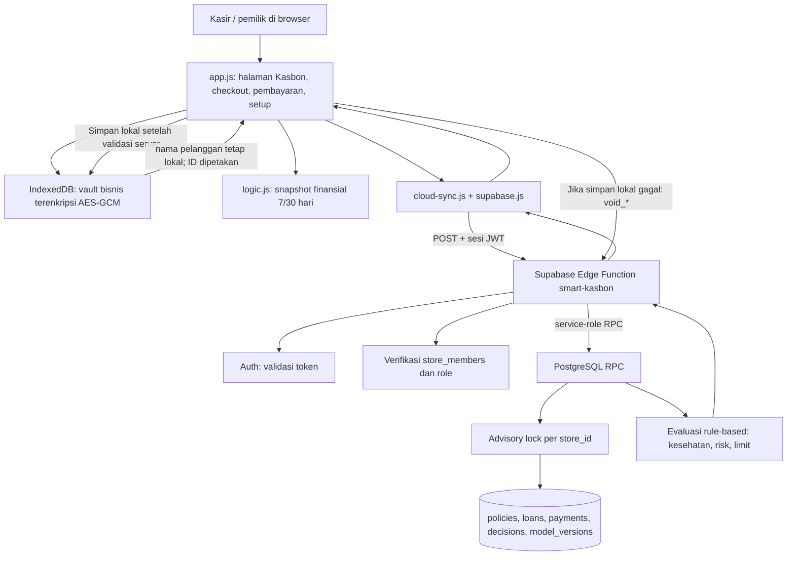

# Laporan Teknis dan Audit Implementasi Smart Kasbon

**Aplikasi:** WarungPintar
**Tanggal laporan:** 13 November 2026
**Commit dasar yang diperiksa:** `9a1e9ea` (`Add purchase-based product creation and currency formatting`)
**Ruang lingkup:** perubahan Smart Kasbon yang ada di working tree saat pemeriksaan.
**Batas pemeriksaan:** pembacaan kode/config dan hasil tes yang tersedia; migrasi belum dijalankan pada PostgreSQL/Supabase dan fitur belum diuji pada toko produksi.

> **Pembaruan 13 November 2026:** mismatch ID yang ditemukan dalam audit awal telah diperbaiki di working tree dan tes regresi ID pseudonim lulus. Pemeriksaan lanjutan juga menemukan serta memperbaiki bug perhitungan limit total piutang. Perbaikan belum dideploy dan belum diverifikasi pada Deno/PostgreSQL/Supabase; fitur tetap **belum siap untuk toko nyata**. Bagian awal merekam temuan historis audit pertama; addendum di akhir laporan adalah status terbaru dan mengesampingkan status lama jika berbeda.

## 1. Ringkasan Implementasi

Smart Kasbon dibuat untuk menerapkan batas kasbon berdasarkan kebijakan toko, kondisi keuangan ringkas, serta riwayat pembayaran pelanggan. Keputusan penerbitan dan pencatatan pembayaran dirancang agar divalidasi di server, bukan hanya di browser. Data bisnis utama tetap berada di vault terenkripsi lokal/cloud; sebagian metadata kasbon sengaja disimpan di Supabase agar server dapat menegakkan limit dan mengunci transaksi lintas perangkat.

**Yang ada di source tree:**

- UI di halaman Kasbon untuk memuat dashboard, memperlihatkan kondisi toko, piutang dan tunggakan, ringkasan risiko, keputusan terbaru, serta mengatur kebijakan sebagai pemilik.
- `smartKasbonFinancialSnapshot` menghitung ringkasan transaksi 7/30 hari yang dikirim ke backend.
- Client mengirim aksi ke Supabase Edge Function `smart-kasbon`.
- Edge Function memverifikasi JWT, keanggotaan toko, role pemilik untuk aksi tertentu, bentuk data, dan memanggil fungsi database.
- Migration membuat tabel kebijakan, kasbon, pembayaran, keputusan, versi model, RLS/grant, fungsi evaluasi dan fungsi transaksi.
- Ada bootstrap riwayat kasbon lama, pseudonimisasi ID pelanggan untuk operasi tertentu, penguncian transaksi per toko di SQL, retry satu kali untuk error jaringan terpilih, dan kompensasi jika operasi backend berhasil tetapi penyimpanan lokal gagal.
- Dokumentasi menyatakan bahwa aturan saat ini rule-based dan ML belum diterapkan.

**Yang belum selesai atau belum dibuktikan:**

- Temuan awal mismatch ID kasbon/pembayaran sudah diperbaiki di working tree, tetapi alur lengkap belum dibuktikan pada database runtime.
- Limit total piutang pada migration awal mengurangi saldo piutang berjalan dua kali; formula source sudah diperbaiki, tetapi belum diuji pada PostgreSQL.
- Tidak ada tes otomatis untuk Edge Function, migration SQL, transaksi ledger, idempotensi database, concurrency, retry, kompensasi, dan otorisasi multi-tenant.
- Migration SQL belum divalidasi dengan PostgreSQL lokal maupun diterapkan ke Supabase. Edge Function belum dideploy dan konfigurasi runtime/secret di Supabase belum diverifikasi.
- Belum ada hasil uji alur kasbon dari browser dengan akun dan backend nyata.
- Machine Learning belum diterapkan, dilatih, dievaluasi, ataupun digunakan untuk keputusan.
- Perubahan Smart Kasbon belum di-commit atau di-push pada saat pemeriksaan ini. File laporan ini adalah deliverable baru.

## 2. Arsitektur Sistem

1. Aplikasi browser membaca bisnis dari vault di IndexedDB. Perubahan vault dikerjakan pada salinan data terisolasi, kemudian disimpan kembali dalam bentuk terenkripsi.
2. `app.js` membentuk ringkasan finansial dan menyiapkan bootstrap riwayat ketika pemilik membuka Kasbon. Nama pelanggan tidak dikirim pada payload dashboard; UI mencoba mencocokkan ID pelanggan backend dengan data pelanggan lokal.
3. `cloud-sync.js` meneruskan aksi Smart Kasbon ke `supabase.js`, yang mengirim POST ke `/functions/v1/smart-kasbon` menggunakan sesi Supabase.
4. Gateway memverifikasi JWT sesuai `supabase/config.toml`. Edge Function memverifikasi token lagi melalui Auth, mengambil keanggotaan pada `store_members`, lalu menerapkan batas role pemilik untuk aksi yang ditentukan.
5. Edge Function menggunakan service-role key dari environment server untuk membaca data dashboard dan memanggil RPC. Fungsi SQL melakukan evaluasi/transaksi terhadap tabel ledger. Setiap transaksi mengunci ID toko dengan `pg_advisory_xact_lock`.
6. Backend mengembalikan keputusan/hasil. Kasbon atau pembayaran juga disimpan secara lokal; jika langkah lokal gagal, frontend mencoba membatalkan catatan server.



**Catatan arsitektur yang penting:** diagram menggambarkan komponen yang dibuat, bukan bukti bahwa database/Edge Function sudah terpasang atau beroperasi. Audit awal menemukan perbedaan ID pada jalur issue/payment; mismatch tersebut telah diperbaiki pada working tree dan belum diverifikasi pada database runtime. Lihat addendum.

## 3. Daftar File yang Diubah

Daftar berdasarkan `git status --short` sebelum file laporan dibuat.

| Path | Fungsi file | Perubahan dan alasan |
|---|---|---|
| `js/app.js` | Alur UI dan aksi aplikasi | Menambahkan pseudonimisasi dan bootstrap, sinkronisasi snapshot, pemuatan dashboard, keputusan kasbon/pembayaran, setup kebijakan, retry/kompensasi, serta penanda pembersihan/reset offline. Tujuan: menghubungkan UI ke ledger server. Termasuk temuan ID tidak konsisten yang dijelaskan dalam laporan. |
| `js/logic.js` | Logika bisnis murni | Menambahkan `smartKasbonFinancialSnapshot` untuk omzet, HPP, laba, arus kas, dan cold start. Tujuan: membentuk input finansial backend tanpa memasukkan piutang kasbon sebagai kas yang diterima. |
| `js/cloud-sync.js` | Konteks akun dan sinkronisasi | Menambahkan `smartKasbon(action, payload)`, yang mensyaratkan sesi dan koneksi lalu meneruskan `store_id` aktif. |
| `js/supabase.js` | Klien HTTP/Auth Supabase | Menambahkan pemanggilan POST Edge Function `smart-kasbon` melalui wrapper request yang sudah ada. |
| `supabase/config.toml` | Konfigurasi Edge Function | Menetapkan `verify_jwt = true` untuk `smart-kasbon`. |
| `supabase/functions/smart-kasbon/index.ts` | API Edge Function | Menambahkan validasi input, pemeriksaan JWT/keanggotaan/role, query dashboard, pemanggilan RPC, dan respons error. Menggunakan service-role key dari environment server. |
| `supabase/migrations/202610240001_smart_kasbon.sql` | Skema dan transaksi backend | Menambahkan lima tabel, RLS/grant, evaluasi rule-based, fungsi transaksi, bootstrap, kompensasi, reset dan penguncian per toko. Belum dijalankan atau divalidasi di PostgreSQL. |
| `tests/smart-kasbon.test.js` | Tes logika Smart Kasbon | Empat tes menguji pseudonimisasi ID, validasi timestamp, pemisahan omzet/laba/arus kas, dan cold start. Tidak menguji SQL atau Edge Function. |
| `README.md` | Dokumentasi proyek | Menambahkan langkah migrasi/deploy, aturan limit/risk, keterbatasan ML, dan peringatan bahwa metadata Smart Kasbon tidak dienkripsi end-to-end. |
| `sw.js` | Service worker/cache | Menaikkan versi cache ke `warungpintar-v46` supaya aset baru tidak terus memakai cache lama. |

File terkait yang diperiksa namun **tidak** termasuk perubahan Smart Kasbon dalam status tersebut: `js/db.js`, `js/crypto.js`, `css/style.css`, dan migration dasar `supabase/migrations/202610210001_warungpintar.sql`.

## 4. Formula dan Logika Smart Kasbon

Formula berikut dibaca dari `smart_kasbon_evaluate` di migration, bukan asumsi desain.

### 4.1 Snapshot finansial yang menjadi input

`smartKasbonFinancialSnapshot` memakai periode berjalan 30 hari, periode pembanding 30 hari sebelumnya, dan periode 7 hari:

- **Omzet** = jumlah `hargaJual × qty` dari penjualan yang dihitung sebagai pendapatan.
- `saleCountsAsRevenue` menerima transaksi tanpa `statusPembayaran`, atau status `berhasil` / `kasbon`; status `menunggu_konfirmasi` dan `dibatalkan` tidak dihitung.
- **HPP** = jumlah `hargaBeliSaatItu × qty`.
- **Laba kotor** = omzet − HPP.
- **Laba bersih** = omzet − HPP − pengeluaran usaha. Penarikan pribadi tidak mengurangi laba bersih.
- **Kas masuk** = penjualan non-kasbon yang dihitung sebagai pendapatan + penerimaan pembayaran kasbon.
- **Kas keluar** = total pembelian barang + pengeluaran + penarikan pribadi.
- **Arus kas** = kas masuk − kas keluar.
- Penjualan metode kasbon tetap dihitung sebagai omzet/laba, tetapi tidak dihitung sebagai kas masuk saat diterbitkan. Pembayaran kasbon dihitung sebagai kas masuk pada waktu pembayaran.

Implementasi ini tidak menghitung saldo kas/modal kerja aktual otomatis. `cash_available`, `working_capital`, `liabilities`, dan `reserve_cash` diisi/dikonfirmasi pemilik. `financeSnapshot` menerima angka dari browser setelah validasi bentuk/nilai; backend tidak menghitung ulang snapshot dari vault terenkripsi.

### 4.2 Kondisi kesehatan toko

Notasi:

- `R`, `Rprev`: omzet 30 hari terakhir dan 30 hari sebelumnya.
- `P`, `Pprev`: laba bersih dua periode tersebut.
- `margin = P / R` jika `R > 0`, selain itu nol.
- `salesTrend = (R − Rprev) / Rprev` jika `Rprev > 0`; jika tidak, `1` bila `R > 0`, selain itu `0`.
- `profitTrend = (P − Pprev) / abs(Pprev)` jika `abs(Pprev) > 0`; jika tidak, `1` bila `P > 0`, selain itu `0`.
- `overdueRatio = piutang jatuh tempo / seluruh piutang aktif`, nol bila piutang nol.
- `cashFlow` = snapshot arus kas 30 hari.

Kategori diuji secara berurutan; kondisi pertama yang cocok dipakai:

| Kategori | Kondisi aktual | Faktor `H` |
|---|---|---:|
| `cold_start` | `has_sales_30` false | 0,10 |
| `kritis` | kas atau modal kerja null; atau kas ≤ cadangan; atau laba < 0 **dan** arus kas < 0; atau `overdueRatio ≥ 0,35` | 0 |
| `menurun` | `salesTrend ≤ −0,20` atau `profitTrend ≤ −0,20` | 0,20 |
| `stagnan` | `margin < 0,05` atau laba ≤ 0 | 0,35 |
| `sangat_sehat` | `margin ≥ 0,15`, kedua tren ≥ 0,20, arus kas ≥ 0, `overdueRatio < 0,05` | 1 |
| `sehat` | `margin ≥ 0,10`, arus kas ≥ 0, `overdueRatio < 0,15` | 0,80 |
| `stabil` | selain kondisi di atas | 0,60 |

Kondisi `cold_start` diperiksa sebelum kondisi kritis. Implementasi menandai toko cold start hanya berdasarkan ada/tidaknya setidaknya satu transaksi penjualan pada 30 hari; tidak ada syarat jumlah sampel minimum selain itu.

### 4.3 Kapasitas dan limit

Misalkan:

- `C` = kas tersedia dari kebijakan.
- `Reserve` = cadangan kas.
- `W` = modal kerja sebelum kewajiban dan piutang.
- `L` = kewajiban.
- `AR` = seluruh saldo piutang aktif, yaitu `Σ(amount − paid_amount)`.
- `Mtotal` = `max_total_receivable`.
- `Mcustomer` = `max_per_customer`.

Formula yang dijalankan SQL:

```text
capacity = min(max(C − Reserve, 0), max(W − L − AR, 0))
totalLimit = min(Mtotal, floor(capacity × H))
rawCustomerLimit = min(Mcustomer, totalLimit)
customerLimit = floor(rawCustomerLimit × customerRiskFactor)
```

`customerRiskFactor` = 0 untuk risiko tinggi, 0,5 untuk sedang, dan 1 untuk rendah. Nilai limit yang dipakai dalam pemeriksaan adalah nilai yang telah dikalikan faktor risiko.

### 4.4 Risk score pelanggan

Untuk pelanggan:

- `n` = jumlah kasbon berstatus `active` yang memiliki `settled_at`.
- `late` = jumlah dari kasbon tersebut yang tanggal pelunasannya melewati `due_date`.
- `lateRate = late / n`, bila `n > 0`.
- `customerOverdue` = saldo berjalan yang sudah melewati jatuh tempo.
- `customerBalance` = seluruh saldo berjalan pelanggan.
- `overdueShare = customerOverdue / customerBalance`, bila `customerBalance > 0`.
- `avgLateDays` = rata-rata `max(tanggal pelunasan − due_date, 0)` untuk kasbon yang sudah dilunasi.

Jika `n > 0`:

```text
riskScore = clamp(
  round(100 − 50 × lateRate − 30 × min(overdueShare, 1)
            − 20 × min(avgLateDays / 30, 1)),
  0, 100
)
```

Jika belum ada riwayat pelunasan, skor awal **60**, kategori **sedang**, faktor **0,5**. Setelah itu:

- **Tinggi** bila ada saldo pelanggan yang sudah jatuh tempo, atau skor < 50; faktor 0.
- **Sedang** bila skor < 75 atau jumlah pelunasan historis < 3; faktor 0,5.
- **Rendah** selain itu; faktor 1.

Risiko tinggi menolak kasbon baru. Pembayaran tetap memakai jalur pembayaran; kode tidak melakukan evaluasi risiko untuk menolak pembayaran.

### 4.5 Jumlah pelanggan aktif dan keputusan

Pelanggan aktif dihitung sebagai pelanggan unik dengan sekurangnya satu kasbon berstatus `active` dan jumlah sisa saldo > 0.

```text
activeLimit =
  0, jika H <= 0
  max(1, floor(max_active_customers × H)), selain itu
```

Untuk kasbon pelanggan baru, backend menolak bila `active_customers + 1 > activeLimit`. Pelanggan yang telah mempunyai saldo berjalan tidak dihitung sebagai pelanggan baru.

Kasbon baru ditolak bila salah satu kondisi ini benar:

1. Kebijakan belum dikonfigurasi.
2. Snapshot finansial tidak segar: `financial_snapshot_at` lebih lama dari 7 hari atau lebih dari 5 menit di masa depan.
3. Kesehatan `kritis` atau `totalLimit ≤ 0`.
4. Risk pelanggan tinggi.
5. `customerBalance + amount > customerLimit`.
6. `AR + amount > totalLimit`.
7. Kasbon untuk pelanggan baru melampaui `activeLimit`.
8. Nominal atau tanggal tidak valid; tanggal jatuh tempo baru yang lebih awal dari tanggal Jakarta hari ini ditolak.

Pengaruh laba, omzet, margin, arus kas, tren, kas, cadangan, modal kerja, kewajiban, piutang dan keterlambatan dibatasi pada formula di atas. Ini bukan model prediktif atau rekomendasi keuangan.

## 5. Implementasi Machine Learning

Pipeline ML advisory kini diimplementasikan pada source dan Edge Function staging, tetapi **belum ada model yang dapat dilatih atau dipakai**. Query agregat staging pada 14 November 2026 menunjukkan 0 kasbon, 0 pembayaran, dan 0 model. Karena itu tidak ada artifact atau metrik bisnis; status tetap cold start.

- **Algoritma:** logistic regression dengan preprocessing/standardisasi numerik yang disimpan bersama artifact.
- **Label:** pelunasan penuh dari pembayaran yang tercatat sampai akhir tanggal jatuh tempo WIB. Pembayaran setelah cutoff dan pinjaman yang belum matang tidak dipakai sebagai label.
- **Fitur:** nominal log, tenor, skor/kelas kesehatan, dan snapshot metrics pada saat server menerbitkan kasbon. ID pelanggan hanya digunakan untuk split group; tidak masuk ke fitur atau artifact.
- **Evaluasi:** holdout kronologis 80/20 dan mengecualikan pelanggan holdout yang muncul di training. Minimum: 100 baris training, 40 evaluasi, 25 contoh tiap kelas training, 10 tiap kelas evaluasi, serta 10 pelanggan evaluasi independen.
- **Aktivasi:** kandidat disimpan sebagai `shadow`; aktivasi manual oleh owner hanya diizinkan bila PR-AUC mengungguli baseline, Brier score lebih rendah, dan expected calibration error ≤ 0,1. Ini guard teknis, bukan jaminan performa/statistical assurance.
- **Batas tenancy dan beban:** query selalu disaring oleh `store_id`, satu proses dibatasi 10.000 kasbon/50.000 pembayaran, dan pelatihan dibatasi satu kali per toko per 24 jam.
- **Keputusan:** model tidak mengubah approval, limit, atau guard SQL. Prediksi hanya advisory; jika tidak aktif/data tidak cukup, aturan yang ada tetap menentukan transaksi.
- **Bukti performa:** test fixture sintetis hanya menguji mekanisme dan determinisme; tidak dipakai melatih staging, membuat artifact, atau mengklaim akurasi bisnis.

## 6. Database dan Ledger

Migration terkait: `supabase/migrations/202610240001_smart_kasbon.sql`.

| Tabel | Kolom penting dan relasi |
|---|---|
| `smart_kasbon_policies` | `store_id` PK/FK ke `stores`; konfigurasi kas, modal kerja, kewajiban, cadangan, batas per pelanggan, pelanggan aktif, total piutang, snapshot JSON, timestamp freshness, flag bootstrap dan versi kebijakan. |
| `smart_kasbon_loans` | `id` PK UUID; `store_id` FK ke `stores`; `customer_id` UUID tanpa FK ke tabel pelanggan (karena pseudonim); `amount`, `paid_amount`, `due_date`, `created_by`, `status`, `settled_at`, `decision_features`; unique `(store_id,id)`. |
| `smart_kasbon_payments` | `id` PK; `store_id` FK ke `stores`; `loan_id`, nominal, waktu dan pembuat; composite FK `(store_id,loan_id)` ke `(store_id,id)` pada loans. |
| `smart_kasbon_decisions` | ID identity PK, `store_id` FK, loan/customer ID opsional, action, approved, JSON keputusan, actor dan waktu. Tidak ada FK loan/customer. Dipakai sebagai riwayat keputusan/audit. |
| `smart_kasbon_model_versions` | ID identity PK, `store_id` FK, versi unik per toko, state, versi fitur, JSON model/metrics dan hitungan training/evaluation. Belum digunakan untuk training atau keputusan. |

### Relasi dan pseudonimisasi

- Relasi store pada kebijakan/kasbon/pembayaran/keputusan/model memakai `store_id`.
- Pembayaran mempunyai composite FK yang mencegah pembayaran tertaut ke loan dari toko berbeda.
- `pseudonymousUuid(kind,id,storeId)` di `js/logic.js` membuat UUID deterministik dari SHA-256 atas string `warungpintar:smart-kasbon:<storeId>:<kind>:<id>`, lalu menyesuaikan bit versi/varian UUID.
- Bootstrap data lama mengubah ID kasbon, pembayaran, dan pelanggan menjadi UUID turunan. Nama pelanggan tetap dicocokkan lokal melalui peta nama pada browser.
- Pseudonimisasi ini bukan anonimisasi: transformasi deterministik tanpa secret salt; orang yang mengetahui nilai ID asal dapat menguji kandidat. Ketidakkonsistenan ID pada jalur mutasi ditemukan dalam audit awal dan sudah diperbaiki di working tree; validasi runtime belum dilakukan.
- Backend tetap menyimpan nominal kasbon/pembayaran, tanggal, status, snapshot keuangan dan JSON keputusan. Metadata tersebut tidak dilindungi AES-GCM vault.

### Ledger, saldo, idempotensi, dan atomicity

- `paid_amount` disimpan pada row loan. Saldo adalah `amount − paid_amount`; check constraint membatasi `0 ≤ paid_amount ≤ amount`.
- Pembuatan pembayaran memeriksa `paid_amount + amount ≤ loan.amount`, menambah `paid_amount`, dan menetapkan `settled_at` ketika lunas. Pembayaran parsial diperbolehkan.
- Idempotensi pembayaran memeriksa `payment_id` yang sudah ada dan membandingkan `loan_id`/nominal; penerbitan loan mencari ID yang sudah ada dan membandingkan customer/nominal/status.
- RPC memperoleh advisory lock per `store_id` dan mengunci policy row. Pembayaran juga memakai `FOR UPDATE` pada loan.
- Penerbitan, evaluasi, insert loan, update pembayaran/saldo, dan audit dilakukan dalam satu pemanggilan PostgreSQL function sehingga berada pada transaksi database yang sama. Mekanisme ini masuk akal secara kode tetapi belum diuji pada PostgreSQL atau concurrency nyata.
- Kompensasi `void_loan` mengubah status loan menjadi `void` jika dibuat actor saat ini dan belum memiliki pembayaran. `void_payment` menghapus row pembayaran, mengurangi `paid_amount`, dan memasukkan catatan keputusan kompensasi.
- Ini bukan ledger append-only penuh: kompensasi pembayaran menghapus row pembayaran; audit tindakan kompensasi tersimpan terpisah. `clear_history` juga menghapus semua row pembayaran dan menandai loan aktif sebagai void.
- IndexedDB lokal menyimpan satu vault terenkripsi; `db.atomic` mengubah salinan terisolasi lalu menyimpan vault terenkripsi dalam satu unit lokal. Atomicity lokal tidak membuat transaksi lokal dan PostgreSQL menjadi satu transaksi terdistribusi; aplikasi menggunakan kompensasi untuk mengurangi ketidakkonsistenan.

## 7. Keamanan dan Multi-Tenant

### Bukti kontrol yang ada di kode

- `supabase/config.toml`: `verify_jwt = true` pada fungsi `smart-kasbon`.
- Edge Function memvalidasi access token melalui `auth.auth.getUser(token)`, mencari pasangan `(store_id,user_id)` di `store_members`, dan menolak anggota yang tidak ada.
- `bootstrap`, `set_policy`, `sync_finance`, `evaluate_model`, dan `clear_history` dibatasi pada role `owner` di Edge Function.
- Actor (`p_actor`) dikirim ke RPC dari `userData.user.id`, bukan dari payload request.
- Edge Function menggunakan service-role key dari `Deno.env`; browser memanggil Edge Function lewat publishable key/sesi dan tidak menerima service-role key pada jalur yang diperiksa.
- UUID, nominal integer aman, rentang nominal, tanggal, snapshot dan batch bootstrap divalidasi di Edge Function.
- Semua tabel Smart Kasbon mengaktifkan RLS. Migration mencabut semua privilege dari `public`, `anon`, `authenticated`, memberikan grant ke `service_role`, dan tidak mendefinisikan policy langsung untuk tabel tersebut. Akses dimaksudkan hanya melalui Edge Function/service role.
- Query dashboard dan RPC dibatasi oleh `store_id`. SQL menggunakan store_id pada query loan/payment; payment juga memiliki composite FK.
- Fungsi SQL `SECURITY DEFINER` mengatur `search_path = ''`, mencabut execute dari `public`, `anon`, `authenticated`, dan memberi execute kepada `service_role`.
- CORS mengizinkan origin `APP_URL` serta localhost/127.0.0.1. README meminta `APP_URL` diset sebagai secret/environment Supabase.
- Vault bisnis utama dienkripsi AES-GCM; key wrapping menggunakan PBKDF2 pada `js/crypto.js`. Pengecualian metadata Smart Kasbon dijelaskan dalam README.

### Batas dan risiko yang belum diverifikasi

- RLS/grant baru efektif setelah migration diterapkan. Tidak ada hasil uji RLS langsung, cross-tenant, atau privilege database.
- Karena Edge Function memakai service role yang melewati RLS, validasi membership dan filter store di Edge/RPC merupakan batas keamanan kritis. Belum ada integration test yang mencoba store ID milik toko lain.
- Snapshot finansial dan angka kas/modal kerja berasal dari client/pemilik. Edge memvalidasi format dan batas integer, bukan membuktikan bahwa input cocok dengan vault. Pemilik yang tidak jujur atau browser yang dimanipulasi dapat mengirim angka berbeda.
- Timestamp pembayaran baru diambil dari waktu database dan tidak dapat dipilih client; validasi timestamp untuk data historis bootstrap menolak tanggal lebih dari 5 menit di masa depan. Timestamp histori tetap berasal dari vault lokal dan tidak membuktikan pembayaran benar-benar terjadi.
- ID pelanggan deterministik berbasis SHA-256 tanpa secret salt; pseudonimisasi mengurangi paparan nama langsung tetapi tidak memberi jaminan anonimitas.
- Keputusan JSON dan snapshot agregat dapat mengungkap saldo/arus keuangan kepada operator project Supabase. Ini dinyatakan di README.
- Tidak ada bukti pengujian CORS pada domain produksi, rotasi secret, logging/retensi, atau respons terhadap ukuran request ekstrem.

## 8. Laporan Keuangan

### Omzet, HPP, laba

Di `logic.js`, omzet terdiri dari penjualan yang lolos `saleCountsAsRevenue`; HPP memakai harga beli pada waktu penjualan; laba kotor = omzet − HPP; laba bersih = laba kotor − pengeluaran usaha. Penarikan pribadi tidak mengurangi laba bersih.

Untuk Smart Kasbon, penjualan kasbon termasuk omzet dan laba pada tanggal transaksi, tetapi tidak dimasukkan ke `cashSales`. Dengan demikian piutang kasbon tidak langsung dihitung sebagai kas masuk. Pembayaran kasbon dicatat sebagai collections/kas masuk pada tanggal pembayaran.

### Snapshot kas

```text
cash_in_30 = total penjualan terhitung selain metode kasbon + pembayaran kasbon
cash_out_30 = total purchases + operating expenses + withdrawals
cash_flow_30 = cash_in_30 − cash_out_30
```

Penarikan pribadi memang tidak mengurangi laba bersih, tetapi ikut mengurangi arus kas. Piutang aktif dihitung pada server sebagai jumlah saldo kasbon belum lunas. Piutang tidak dikurangkan dari laba bersih; ia berpengaruh pada kapasitas modal kerja (`working_capital − liabilities − receivable`) dan rasio tunggakan.

Pembayaran parsial menurunkan saldo melalui `paid_amount`; pelunasan penuh mengisi `settled_at`. Kasbon lewat jatuh tempo dihitung bila `due_date` lebih awal daripada tanggal hari ini di zona `Asia/Jakarta`. Nilai overdue dan total receivable disajikan di dashboard.

### Batas akurasi

- Snapshot memakai tanggal `sale.waktu` untuk periode penjualan, bukan waktu konfirmasi kas/bayar. Untuk transaksi yang baru dikonfirmasi kemudian, waktu pelaporan kas dapat berbeda dari waktu penerimaan aktual.
- `cash_out_30` menghitung seluruh `purchase.total` sebagai pengeluaran kas pada tanggal pembelian; kode snapshot tidak mengklasifikasikan pembelian secara tunai/kredit.
- Semua pembayaran kasbon menggunakan waktu lokal yang dikirim browser; tidak ada rekonsiliasi ke mutasi bank/kas.
- Tes snapshot membuktikan satu contoh hitung sederhana, bukan kelengkapan data akuntansi atau kecocokan dengan transaksi toko nyata.
- Angka kas tersedia/modal kerja tetap input manual dan tidak dapat diverifikasi dari data aplikasi.

## 9. Dashboard dan UI/UX

- **Frontend:** `js/app.js`, terutama `vKasbon`, `smartKasbonPanel`, `fetchSmartKasbon`, `payDebt`, `manualDebt`, dan `setupSmartKasbon`.
- **Data sumber:** ringkasan/policy/keputusan/risiko berasal dari Edge Function dan PostgreSQL; nama pelanggan dipetakan dari `S.customers` lokal; daftar kasbon dan pembayaran utama tetap berasal dari vault lokal.
- **Data yang ditampilkan:** label kesehatan toko, piutang aktif/terlambat, pelanggan aktif dibanding kebijakan, jumlah kasbon aktif, batas piutang efektif, status freshness snapshot, ringkasan kategori risiko, sebagian skor per pelanggan, keputusan terbaru, dan status ML/model.
- **Kebijakan:** tombol atur/ubah hanya dirender bagi owner; form meminta kas, modal kerja, kewajiban, cadangan, limit per pelanggan, maksimum pelanggan aktif, dan maksimum total piutang. UI mengingatkan bahwa kas/modal kerja tidak dilacak otomatis.
- **Loading/error/empty:** menampilkan teks memuat, pesan error dan tombol coba lagi, state dashboard belum dimuat, state kebijakan belum diset, dan state tanpa riwayat risiko/keputusan.
- **Nama:** bila mapping pelanggan lokal tidak tersedia, UI menampilkan “Pelanggan pseudonim”.
- **Responsivitas:** CSS umum mendefinisikan `.row.wrap`, dua kolom `.grid2`, lalu mengubah grid menjadi satu kolom pada lebar ≤520px; ada aturan tambahan ≤360px. Ini membuktikan aturan responsive CSS ada, bukan hasil uji visual dashboard di ukuran layar berbeda.
- **Pengujian UI:** ringkasan sesi sebelumnya hanya membuktikan halaman login dapat dibuka di browser lokal. Dashboard/kasbon tidak dibuktikan lewat browser dengan backend atau akun toko.

## 10. Retry dan Compensation

- `smartKasbonMutationWithRetry` menjalankan request pertama. Retry dijalankan **maksimal satu kali** bila pesan error cocok dengan pola koneksi tertentu (`tidak dapat terhubung ke server`, `network`, `failed to fetch`). Error validasi/penolakan bisnis tidak otomatis diulang.
- Retry menggunakan payload/ID yang sama. SQL mendesain idempotensi berdasarkan ID loan/payment; hasil komit yang responsnya hilang diharapkan dikenali ulang.
- Jika retry tetap gagal, kode mencoba aksi undo (`void_loan` atau `void_payment`). Jika undo gagal juga, error eksplisit meminta pengguna memeriksa dashboard sebelum mengulang.
- Untuk penerbitan kasbon, server dipanggil lebih dulu lalu `db.atomic` menyimpan transaksi lokal. Jika simpan lokal gagal, aplikasi langsung mencoba `void_loan`.
- Untuk pembayaran, backend dipanggil dulu, kemudian validasi/simpan pembayaran dan saldo secara lokal dalam `db.atomic`. Bila penyimpanan lokal gagal, aplikasi mencoba `void_payment`.
- `void_loan` mensyaratkan actor yang sama dan tidak ada pembayaran; `void_payment` mensyaratkan actor pencipta pembayaran yang sama. Semua aksi memakai lock database per toko.
- Saat offline, aksi kasbon/pembayaran diblokir. Penanda clear/reset disimpan lokal dan dicoba saat pemilik membuka Kasbon kembali.

**Risiko tersisa:** ini bukan transaksi terdistribusi atomik. Bila server dan client kehilangan respons bersamaan, status dapat tidak diketahui; bila kompensasi gagal, backend dapat menyimpan transaksi yang tidak ada di vault lokal. Pesan error meminta pengecekan manual, tetapi tidak ada reconciliation otomatis yang membandingkan ledger dengan vault. Mismatch ID yang disebut di audit awal sudah diperbaiki pada working tree, tetapi belum diuji end-to-end.

## 11. Hasil Pengujian

### Perintah dan hasil aktual yang tersedia

- `npm test` (`node --test`): **37 lulus, 0 gagal** pada validasi 13 November 2026 yang dicatat di addendum pertama; saat itu 35 baseline test ditambah dua tes regresi.
- `npm run build`: **berhasil**, menghasilkan bundle `js/barcode-scanner.js` sekitar 473,9 kB. Script build hanya menjalankan build scanner; bukan build/integrasi backend.
- `node --check` untuk semua berkas `js/**/*.js`: **berhasil**, tanpa keluaran error.
- Esbuild membundle `supabase/functions/smart-kasbon/index.ts` bersama import lokal, dengan import eksternal Supabase dikecualikan: **berhasil**. Ini bukan Deno type-check, deploy, atau runtime test.
- `git diff --check`: **exit code 0**, tidak menemukan whitespace error. Git menampilkan peringatan bahwa LF akan menjadi CRLF pada `js/app.js`, `js/logic.js`, dan `sw.js`.
- Migration SQL: **tidak diuji** terhadap PostgreSQL/Supabase. Tidak ada bukti `supabase db test`, `supabase start`, atau deploy.

Rincian 35 test baseline ditambah dua test regresi yang tampil pada output aktual saat validasi tersebut. Kolom “expected” merangkum maksud/assertion kasus; “actual” adalah hasil runner, semuanya PASS. Kasus ini bukan bukti bahwa setiap fitur backend Smart Kasbon telah diuji. Jumlah tersebut adalah riwayat pada saat itu, bukan total suite terbaru; lihat addendum lanjutan.

| # | Nama test aktual | Expected result yang diuji | Actual |
|---:|---|---|---|
| 1 | data vault hanya dapat dibuka dengan password akun atau recovery key | Data terenkripsi dapat dibuka menggunakan kredensial yang didukung | PASS |
| 2 | cadangan terenkripsi tidak memuat data terbuka dan menolak password salah | Backup tetap terenkripsi dan password salah ditolak | PASS |
| 3 | format harga memberi pemisah ribuan dan mengabaikan karakter selain angka | Input harga diformat ribuan dan karakter nonangka tidak dipakai | PASS |
| 4 | parse harga menerima nilai berformat dan membiarkan input kosong | Nilai berformat diparse dan input kosong tetap kosong/null sesuai fungsi | PASS |
| 5 | IndexedDB menyimpan vault terenkripsi dan transaksi stok tetap atomik | Data vault tersimpan terenkripsi dan mutasi stok satu unit | PASS |
| 6 | laba kotor memakai harga beli saat transaksi (historis) | HPP/laba memakai harga beli yang tersimpan pada baris penjualan | PASS |
| 7 | prive tidak mengurangi laba bersih, pengeluaran mengurangi | Penarikan pribadi dikecualikan dari laba; expense mengurangi laba | PASS |
| 8 | kasbon: sisa utang dan jatuh tempo | Sisa kasbon dihitung dan status jatuh tempo dikenali | PASS |
| 9 | pembayaran kasbon menolak jumlah tidak valid dan lebih dari saldo | Nominal tidak valid/lebih besar dari saldo ditolak | PASS |
| 10 | peringatan stok: habis, di bawah minimum, dan prediksi habis | Kondisi stok menipis menghasilkan peringatan yang sesuai | PASS |
| 11 | produk lambat laku | Produk lama dengan stok yang tidak terjual teridentifikasi | PASS |
| 12 | laporan barang terjual memuat semua produk dan menggabungkan jumlah dalam periode | Produk dan kuantitas transaksi digabungkan sesuai periode | PASS |
| 13 | zakat perdagangan: contoh 85 gram emas, haul, dan kadar 2,5% | Contoh nisab/haul menghasilkan nilai sesuai aturan test | PASS |
| 14 | zakat perdagangan membedakan nilai di bawah, tepat, dan di atas nisab | Batas nisab dibandingkan dengan benar | PASS |
| 15 | zakat perdagangan mensyaratkan haul dan tidak menetapkan kewajiban saat belum terpenuhi | Haul yang belum selesai tidak menghasilkan kewajiban | PASS |
| 16 | zakat perdagangan membatasi dasar negatif menjadi nol dan piutang macet tidak ditambahkan | Nilai bersih negatif dibatasi nol dan piutang macet dikecualikan | PASS |
| 17 | nilai persediaan menggunakan nilai pasar yang diberikan, bukan biaya produk | Nilai persediaan mengikuti harga pasar yang diinput | PASS |
| 18 | komponen keuntungan hanya dihitung saat belum tercakup komponen lain | Komponen yang sudah masuk tidak dihitung ganda | PASS |
| 19 | harga emas kosong atau gagal diverifikasi tidak menghasilkan kewajiban | Data emas tak tersedia tidak memicu kewajiban | PASS |
| 20 | perubahan harga emas dan data harta dihitung ulang secara konsisten | Perubahan input menghasilkan kalkulasi konsisten | PASS |
| 21 | zakat perdagangan menolak input negatif, pecahan, dan nilai melebihi batas aman | Input tidak valid/di luar safe integer ditolak | PASS |
| 22 | haul diperkirakan dari kalender Hijriah dan tanggal yang tidak valid memerlukan konfirmasi manual | Kalender Hijriah digunakan dan tanggal invalid ditangani | PASS |
| 23 | nomor WhatsApp dinormalisasi ke format 62 | Nomor lokal dinormalisasi ke prefix Indonesia | PASS |
| 24 | skor kesehatan usaha 0-100 dan butuh data | Skor dibatasi rentang dan menandai data yang belum cukup | PASS |
| 25 | struk memuat total dan kembalian | Teks struk mencantumkan jumlah dan kembalian | PASS |
| 26 | struk mencantumkan status bayar yang tidak mengklaim QRIS lunas | Status QRIS pending tidak ditampilkan lunas | PASS |
| 27 | QRIS menunggu konfirmasi dan transaksi yang dibatalkan tidak dihitung dalam ringkasan | Pending/cancel tidak dihitung seperti transaksi sukses | PASS |
| 28 | transaksi QRIS yang dikonfirmasi berpindah ke urutan transaksi terbaru | Waktu/status konfirmasi memengaruhi urutan transaksi | PASS |
| 29 | CSV meloloskan tanda kutip dan menetralkan sel formula | CSV quoting dan mitigasi formula diuji | PASS |
| 30 | belanja barang membuat produk baru dengan stok awal dan restock memperbarui stok atomik | Produk baru/restock mengubah stok dalam satu mutasi | PASS |
| 31 | belanja dengan total tidak valid tidak mengubah data | Validasi total gagal tanpa mutasi | PASS |
| 32 | snapshot keuangan memisahkan omzet, laba, dan arus kas 30 hari | Contoh mengharapkan omzet 25.000; HPP 15.000; laba kotor 10.000; laba bersih 9.000; kas masuk 21.500; kas keluar 3.500; arus kas 18.000; transaksi QRIS pending dikecualikan | PASS |
| 33 | snapshot menandai toko tanpa transaksi sebagai cold start | Tidak ada sales menghasilkan `has_sales_30=false`, omzet/laba bersih nol | PASS |
| 34 | membuat berkas xlsx valid berisi lembar kerja dan nilai sel | Workbook terbentuk dan sel dapat dibaca | PASS |
| 35 | menolak data lembar kerja yang tidak berbentuk daftar baris | Input workbook dengan shape salah ditolak | PASS |
| 36 | ID backend kasbon deterministik dan terpisah antarjenis serta toko | ID yang dihasilkan berupa UUID valid dan berbeda untuk namespace/toko berbeda | PASS |
| 37 | timestamp Smart Kasbon dinormalisasi dan menolak nilai invalid atau masa depan | Timestamp valid dinormalisasi; tanggal invalid dan lebih dari 5 menit di masa depan ditolak | PASS |

**Cakupan Smart Kasbon langsung dari 37 tes:** empat tes di `smart-kasbon.test.js` menguji pseudonimisasi ID, validasi timestamp, snapshot finansial, dan cold start. Test no. 8–9 menguji helper hutang/pembayaran lokal umum, bukan Edge Function, SQL, RLS, atau transaksi backend. Tes UUID menguji helper, bukan keseluruhan alur issue → payment pada database.

## 12. Pengujian Skenario Bisnis

| Skenario | Status bukti | Catatan |
|---|---|---|
| Toko baru tanpa histori | **Unit test parsial** | Snapshot cold start diuji. Faktor cold-start di SQL dan keputusan issue tidak diuji di database. |
| Keuntungan meningkat | **Belum diuji** | Tidak ada integration test tren/health factor SQL. |
| Keuntungan stagnan | **Belum diuji** | Threshold margin/laba pada SQL belum dites. |
| Keuntungan menurun | **Belum diuji** | Perubahan tren omzet/laba belum dites. |
| Kas toko kritis | **Belum diuji** | Kondisi kas, cadangan, dan kapasitas belum dites terhadap SQL. |
| Pelanggan tepat waktu | **Belum diuji backend** | Tidak ada tes risk score SQL untuk riwayat tepat waktu. |
| Pelanggan terlambat | **Belum diuji backend** | Tidak ada tes risk score SQL untuk keterlambatan. |
| Pelanggan menunggak | **Belum diuji backend** | Tidak ada tes penolakan karena overdue balance. |
| Pembayaran parsial | **Helper lokal diuji; backend belum** | Tes helper pembayaran menolak nominal invalid/di atas saldo; pembaruan ledger partial tidak diuji. |
| Pelunasan | **Helper lokal parsial; backend belum** | Tidak ada tes `settled_at` SQL atau alur server-to-local. |
| Limit pelanggan aktif tercapai | **Belum diuji** | Tidak ada test batas jumlah pelanggan. |
| Limit total piutang tercapai | **Belum diuji** | Tidak ada test formula/penolakan limit SQL. |
| Transaksi bersamaan | **Belum diuji** | Advisory lock ada di source, tapi concurrency tidak dijalankan. |
| Kegagalan jaringan | **Belum diuji** | Tidak ada simulasi fetch/Edge error pada test suite. |
| Retry dan kompensasi | **Belum diuji** | Tidak ada test request retry, idempotensi server, undo, atau kegagalan undo. |

## 13. Temuan Risiko dan Kekurangan

Tingkat severity menilai dampak potensial dan kekuatan bukti. Temuan “terkonfirmasi dari kode” tidak berarti sudah direproduksi di Supabase, karena belum ada DB runtime.

| ID / severity | Temuan dan bukti | Dampak |
|---|---|---|
| **F-01 — CRITICAL, RESOLVED IN WORKING TREE; runtime belum diverifikasi** | Audit awal menemukan `issue` memakai ID mentah sedangkan `payment` memakai UUID pseudonim. Working tree kini membuat `issue`, `payment`, `void_loan`, dan bootstrap memakai UUID pseudonim yang sama per loan; helper UUID diperbaiki agar membentuk seluruh 32 digit hex dan versi/variant UUID valid. Tes ID regresi lulus. | Mismatch kode diperbaiki, tetapi alur issue → partial payment → settlement belum dijalankan pada database. Perbaikan belum dideploy. |
| **F-02 — HIGH, belum diuji** | Migration SQL belum dijalankan pada PostgreSQL/Supabase; Edge Function belum dideploy. Hasil tes hanya sintaks Edge, bukan DB. | Kesalahan SQL/RPC, grant, schema, runtime environment, CORS dan asumsi PostgREST mungkin baru muncul saat deploy. Jangan gunakan produksi sebelum uji staging. |
| **F-03 — HIGH, risiko integritas input** | Snapshot angka dan nilai kas/modal kerja berasal dari client. Edge Function memvalidasi bentuk/angka (`index.ts` sekitar L57–90), namun tidak dapat membandingkan snapshot dengan vault yang terenkripsi; pemilik memasukkan kas/modal kerja manual (`app.js` sekitar L1350–1386). | Client yang dimodifikasi atau input pemilik yang tidak akurat dapat menaikkan/menurunkan limit. Backend tidak memiliki data terbuka untuk audit ulang angka sumber. |
| **F-04 — MEDIUM, PARTIALLY RESOLVED** | Timestamp pembayaran baru diambil dari `now()` database; Edge tidak meneruskan `paid_at` dari client untuk aksi payment. Timestamp umum yang masih diterima (mis. bootstrap historis) ditolak jika lebih dari 5 menit di masa depan. | Tanggal pembayaran baru tidak dapat dimundurkan oleh client. Timestamp histori saat bootstrap masih bersumber dari vault dan tidak diverifikasi independen; keputusan histori dapat dipengaruhi data pemilik. |
| **F-05 — MEDIUM, pseudonimisasi** | Hash SHA-256 deterministik memakai `storeId`, jenis dan ID, tanpa secret salt (`logic.js`, `pseudonymousUuid`). Jalur loan/payment/void/bootstrap yang sudah diperiksa menggunakan UUID pseudonim yang sama per entitas; `actor_id` tetap ID Auth. | Pseudonimisasi tidak anonim; ID asal yang diketahui dapat diuji. Server tetap menyimpan nominal, tanggal dan metrik keuangan. |
| **F-06 — MEDIUM, akurasi kas** | Snapshot menganggap seluruh `purchase.total` sebagai cash out pada tanggal pembelian dan memakai `sale.waktu` sebagai rentang penjualan (`logic.js` sekitar L45–87). | Untuk pembelian kredit atau konfirmasi pembayaran yang terjadi pada tanggal berbeda, snapshot arus kas/periode dapat berbeda dari kas aktual. Status pembayaran pembelian tidak diperiksa oleh fungsi snapshot. |
| **F-07 — MEDIUM, ledger non-append-only** | Kompensasi `void_payment` menghapus row pembayaran dan mengubah `paid_amount`; `clear_history` juga menghapus semua payments (`migration` sekitar L373–398, L591–608). | Audit menyimpan aksi kompensasi, tetapi tidak mempertahankan row pembayaran sebagai entri immutable. Rekonstruksi penuh ledger setelah penghapusan terbatas. |
| **F-08 — MEDIUM, concurrency belum terbukti** | Advisory lock per toko dan row lock ada pada SQL (`migration` sekitar L365 dan L558–570), tetapi tidak ada tes DB concurrency. | Mekanisme terlihat menserialisasi mutasi yang melewati RPC; efektivitas operasional dan retry lintas request belum dibuktikan. |
| **F-09 — LOW, ML belum ada** | Model table adalah placeholder; `evaluate_model` mengembalikan `unavailable`; keputusan memakai rumus SQL. | Tidak ada prediksi ML atau hasil evaluasi yang dapat diklaim. Ini keterbatasan eksplisit, bukan kegagalan model. |
| **F-10 — MEDIUM, operasi/rekonsiliasi** | Bila respons server atau kompensasi tidak pasti, aplikasi meminta pemeriksaan manual; tidak ada job rekonsiliasi ledger-vault yang terlihat. | Bisa terjadi catatan backend tanpa catatan lokal setelah kegagalan berantai. Error dijelaskan ke pengguna, tetapi penyelesaian masih manual. |
| **F-11 — MEDIUM, test coverage (historis)** | Catatan audit awal memiliki cakupan test logika keuangan yang terbatas; pada addendum 13 November tercatat empat tes logika Smart Kasbon. Tidak ada tes migration runtime, Edge authorization, retry/kompensasi. | Sebagian besar klaim keamanan/transaksi adalah inspeksi kode, bukan perilaku runtime yang telah diuji. |

**Koreksi historis F-11:** empat tes logika Smart Kasbon tersedia pada addendum pertama dan total suite saat itu 37 tes lulus. Addendum lanjutan mencatat tiga tes pemulihan tambahan (40 total) serta suite SQL pgTAP yang disiapkan. Hasil setelah pengujian staging tercatat pada addendum terbaru di bawah.

**Race condition:** source menggunakan lock database per toko, sehingga mekanisme utama dirancang mencegah dua mutasi backend melewati limit secara bersamaan. Tidak ada race test yang membuktikan perilaku tersebut. Frontend juga memiliki flag in-memory; flag itu tidak mengunci tab/perangkat lain dan bukan pengganti lock database.

## 14. Status Kesiapan

| Area | Penilaian | Dasar |
|---|---|---|
| Implementasi source | **Sebagian terimplementasi; belum siap produksi** | Mismatch ID dan double-subtraction limit diperbaiki di source; validasi database dan Edge runtime belum dilakukan. |
| Testing | **Rendah untuk Smart Kasbon backend** | 37 tes lulus, termasuk empat tes Smart Kasbon murni; tidak ada integrasi SQL/Edge. |
| Keamanan | **Kontrol desain tersedia; belum terverifikasi** | JWT, membership, owner checks, RLS/grant dan service role tampak di source, tetapi database belum diaplikasikan dan belum diuji cross-tenant. |
| Integrasi | **Belum selesai** | Migration dan Edge Function belum diterapkan/deploy; secret/domain runtime belum diverifikasi. |
| Penggunaan toko nyata | **Tidak siap** | Perbaikan belum dideploy, belum ada staging/integration test, dan input finansial bersifat self-reported. |
| Machine Learning | **Belum siap / belum diimplementasikan** | Tidak ada model, training/evaluation data, metrik, atau penggunaan model dalam keputusan. |

**Kesimpulan historis:** jangan menyatakan fitur production-ready. Source memiliki rancangan backend rule-based; pada audit pertama teridentifikasi bug jalur pembayaran, yang status terkininya dicatat pada addendum.

## 15. Rekomendasi Lanjutan

### P0 — Sebelum uji bisnis

1. Verifikasi perbaikan ID dan formula limit di PostgreSQL/Supabase staging; tambahkan integration test issue → partial payment → settlement.
2. Jalankan migration dan Edge Function di proyek staging terpisah. Validasi semua fungsi SQL, grants, foreign keys, dan fungsi rollback sebelum production.
3. Uji kasus issue → payment → settlement serta kegagalan lokal/kompensasi dengan database aktual. Jangan melakukan migrasi produksi sebelum hasilnya lulus.

### P1 — Keamanan, integritas, dan transaksi

1. Tambahkan test multi-tenant: user toko A mencoba semua aksi memakai store ID toko B; uji owner vs assistant dan akses langsung ke tabel.
2. Tambahkan tes batas untuk setiap kelas health, rumus risk, overdue, jumlah pelanggan aktif, total receivable, freshness snapshot, dan nominal minimum/maksimum.
3. Uji konkurensi dua issue/pembayaran pada toko yang sama dan pada toko berbeda.
4. Tetapkan kebijakan validasi timestamp pembayaran, terutama masa depan dan perubahan tanggal, serta dokumentasikan siapa yang boleh mencatat/mengubah tanggal historis.
5. Tambahkan prosedur rekonsiliasi setelah kegagalan kompensasi, termasuk pencocokan ID server dengan vault lokal.
6. Uji RLS dan grant setelah migration terpasang; service role harus tetap hanya berada di secret Edge Function.

### P2 — Akurasi dan privasi

1. Tentukan apakah arus kas harus memakai waktu pembayaran/konfirmasi dan status pembayaran pembelian; tambahkan field sumber aktual bila dibutuhkan.
2. Tinjau snapshot yang berasal dari client/pemilik dan tampilkan waktu serta sumber input yang jelas; jika diperlukan validasi independen, definisikan data minimum yang dapat dibuka ke server.
3. Tinjau pseudonimisasi (termasuk ID transaksi baru), minimisasi metadata dan retensi keputusan; dokumentasikan bahwa hash saat ini deterministik, bukan anonimisasi.
4. Tambahkan tes visual/aksesibilitas UI pada ukuran ponsel, kondisi loading/error dan akun assistant.

### P3 — Machine Learning

1. Jangan mengaktifkan ML hanya karena ada tabel model atau skor risiko rule-based.
2. Kumpulkan dataset historis yang sah dan terdefinisi, tentukan label/target serta pencegahan kebocoran waktu, dan evaluasi holdout.
3. Tetapkan metrik, ambang penerimaan, pemantauan drift, penjelasan keputusan, fallback rule-based, dan prosedur rollback sebelum model dapat ikut memutus limit.

## 16. Referensi Bukti

Nomor baris di bawah merujuk ke working tree yang diperiksa. File dan rentang fungsi ditulis supaya auditor dapat menavigasi sumber dengan cepat.

| Bukti | Lokasi |
|---|---|
| Pseudonimisasi dan bootstrap legacy | Audit awal: `js/app.js` L84–168. Current helper: `js/logic.js` L45–56; bootstrap payload: `js/app.js` L84–111. |
| Snapshot, fetch dashboard, konteks akun | `js/app.js` L171–223: `fetchSmartKasbon`; `cloud-sync.js` L276–280: `smartKasbon` |
| Temuan ID issue/payment | Audit awal: `js/app.js` L226–242 dan L1277–1301. Current paths: `js/app.js` L213–228 (issue), L1266–1315 (payment/compensation); SQL L503–541 (issue), L542–575 (payment). |
| Retry dan kompensasi | `js/app.js` L250–295: `smartKasbonMutationWithRetry`, `saveLocalWithLoanCompensation`; pembayaran L1303–1325 |
| Financial snapshot dan formula laba/kas | `js/logic.js` L34–87: `summarize`, `smartKasbonFinancialSnapshot`, `saleCountsAsRevenue` |
| Limit, health dan risk score | `supabase/migrations/202610240001_smart_kasbon.sql` L96–333: `smart_kasbon_evaluate`; khusus risk L185–199; health L220–240; capacity/limits L243–254; approval L280–303 |
| Tabel, PK/FK, RLS/grants | Migration L1–94; fungsi transaction lock L335–369 |
| Bootstrap, issue/payment, idempotensi dan kompensasi | Migration L400–471 (bootstrap), L495–541 (issue), L542–575 (payment), L576–608 (void) |
| Edge validation/auth/role/dashboard | `supabase/functions/smart-kasbon/index.ts` L29–124 (validasi), L126–159 (JWT/membership/role), L162–217 (dashboard), L219–269 (aksi/RPC) |
| JWT gateway | `supabase/config.toml` L7–8 |
| Client request Edge | `js/supabase.js` L168–173 |
| Dashboard dan policy UI | `js/app.js` L1195–1259: `vKasbon`, `smartKasbonPanel`; L1277–1389: pembayaran dan setup |
| Reset/clear dan retry offline | `js/app.js` L1870–1932; bootstrap pending L128–168 |
| Penyimpanan lokal atomik/terenkripsi | `js/db.js` L53–88 (vault), L178–219 (`atomic`), L336–342 (wipe/clear); `js/crypto.js` L21–47, L91–105 |
| RLS membership dasar | `supabase/migrations/202610210001_warungpintar.sql` L10, L85–108, L123–125 |
| Responsive CSS | `css/style.css` L50–53, L323–359 |
| Tes baru | Audit awal: dua snapshot test. Current: `tests/smart-kasbon.test.js` L5–59; 4 tes untuk ID, timestamp, snapshot, dan cold start. |
| Dokumentasi deployment/formula/ML/privacy | `README.md` L99–133, L199–207, L240–248 |
| Versi cache | `sw.js` L3 |
| Hasil runner aktual | Baseline: 35 PASS/0 FAIL. Current: `npm test` 37 PASS/0 FAIL; `npm run build` berhasil; `node --check` semua `js/**/*.js` berhasil; esbuild bundle Edge + local import berhasil; `git diff --check` exit 0. |

### Ringkasan untuk auditor berikutnya

Prioritas pemeriksaan independen adalah menguji ID, formula limit, otorisasi, RLS, dan concurrency pada database staging. Jangan menganggap Edge Function/migration aktif di produksi berdasarkan keberadaan file. **Machine Learning tidak benar-benar diterapkan; implementasi keputusan saat ini adalah Rule-Based System.**

## Addendum — Audit Lanjutan dan Perubahan Working Tree (13 November 2026)

Addendum ini memperbarui temuan dan hasil pada bagian sebelumnya tanpa menghapus rekaman audit awal. Semua perubahan di bawah hanya berada pada working tree lokal. Tidak ada commit, push, deploy, ataupun perubahan database produksi.

### Perubahan yang diperiksa

| File | Perubahan/status terbaru |
|---|---|
| `js/logic.js` | `pseudonymousUuid` membentuk UUID dari seluruh 32 digit hex digest dan menetapkan bit versi/variant UUID. Ditambahkan `validatedSmartKasbonTimestamp`, yang menormalkan timestamp valid dan menolak nilai lebih dari 5 menit di masa depan. |
| `js/app.js` | Penerbitan, pembayaran, pembatalan, bootstrap dan kompensasi memakai ID loan/payment pseudonim yang konsisten per toko. Pembayaran baru menggunakan waktu yang dikembalikan server untuk catatan lokal; waktu pembayaran tidak lagi dipilih/dikirim oleh client. |
| `supabase/functions/smart-kasbon/index.ts` | Aksi payment tidak meneruskan `paid_at` dari client. Validasi timestamp yang masih digunakan memakai helper bersama dan menolak input invalid/terlalu jauh di masa depan. |
| `supabase/migrations/202610240001_smart_kasbon.sql` | Payment memakai `now()` database dan mengembalikan `paid_at` server pada respons normal/idempoten. Perhitungan kapasitas total diperbaiki agar piutang berjalan tidak dikurangi dua kali. |
| `tests/smart-kasbon.test.js` | Ditambahkan regresi UUID pseudonim dan timestamp; seluruh suite kini berisi 37 test. |
| `README.md` | Formula batas total, sumber waktu pembayaran, batas kepercayaan snapshot, serta arti pseudonimisasi diperjelas. |
| `LAPORAN_AUDIT_SMART_KASBON.md` | Addendum ini merekam perubahan, hasil validasi baru, dan blocker yang masih terbuka. |

### Formula limit terbaru di SQL

Formula berikut adalah bentuk aktual pada migration setelah perubahan working tree:

```text
capacity = min(
  max(cash_available - reserve_cash, 0),
  max(working_capital - liabilities, 0)
)
total_limit = min(policy.max_total_receivable, floor(capacity * health_factor))
remaining_receivable = max(total_limit - current_receivable, 0)
```

Kasbon ditolak jika `current_receivable + amount > total_limit`. Limit pelanggan adalah `floor(min(policy.max_per_customer, total_limit) * risk_factor)` dan penerbitan ditolak jika `customer_balance + amount` melebihinya. Sebelumnya `current_receivable` juga dikurangi saat membentuk `capacity`, lalu dibandingkan lagi sebagai saldo berjalan terhadap `total_limit`; akibatnya piutang yang ada memengaruhi kapasitas dua kali. Formula sekarang memperlakukan `total_limit` sebagai batas absolut, sedangkan saldo berjalan hanya dikurangkan sekali pada pemeriksaan saldo dan sisa limit. Perubahan ini dinilai dari nama kebijakan, pemeriksaan saldo, dan definisi “batas total piutang”; **belum diuji pada PostgreSQL**, sehingga tetap perlu validasi bisnis/runtime.

### Identitas dan waktu transaksi

- Jalur issue/payment sebelumnya tidak menggunakan ID loan yang sama. Setelah diselaraskan, keduanya memakai `pseudonymousUuid('loan', localLoanId, storeId)`; pembatalan loan juga memakai ID tersebut. ID payment yang sama dipakai untuk pencatatan dan kompensasi.
- Tes regresi ID awalnya menemukan helper UUID lama menghasilkan bentuk malformed, contoh `1df76171-b191-50a8-8-`, yang tidak sesuai validator UUID Edge Function. Helper diperbaiki; tes helper baru dan suite akhir lulus. Ini belum membuktikan alur RPC end-to-end.
- Pembayaran baru memperoleh timestamp database; waktu lokal disalin dari respons server. Timestamp histori bootstrap masih berasal dari data vault pemilik dan tidak dapat diverifikasi secara independen.
- SHA-256 tetap deterministik dan tanpa secret salt; ini pseudonimisasi, bukan anonimisasi. `actor_id` masih merupakan ID pengguna Auth.

### Hasil validasi pada addendum pertama (snapshot 13 November 2026)

| Pemeriksaan | Hasil aktual | Batas interpretasi |
|---|---|---|
| `npm test` (`node --test`) | **37 PASS, 0 FAIL** | 35 test baseline ditambah regresi UUID dan timestamp; tidak menjalankan SQL/Edge pada Supabase. |
| `npm run build` | **PASS**; scanner bundle 473.9 kB | Script hanya membangun `js/barcode-scanner.js`, bukan seluruh aplikasi/backend. |
| `node --check` seluruh `js/**/*.js` | **PASS** | Pemeriksaan sintaks JavaScript saja. |
| Esbuild bundle Edge Function + import lokal | **PASS**; Supabase SDK URL dikecualikan | Bukan Deno type-check, deployment, ataupun function runtime test. |
| `git diff --check` | **PASS**, exit code 0 | Ada peringatan Git tentang konversi LF ke CRLF pada beberapa file. |
| Migration, RLS/grant, RPC, concurrent transaction | **BELUM DIUJI** | Tidak ada PostgreSQL/Supabase staging yang digunakan; jangan gunakan project production untuk uji ini. |
| Browser end-to-end, dua akun/dua toko | **BELUM DIUJI** | Tidak ada hasil E2E atau cross-tenant runtime. |

Riwayat tes: baseline 35/35 lulus; test UUID baru sempat gagal dan menunjukkan helper malformed; setelah perbaikan, tes terarah lulus dan suite akhir 37/37 lulus. Tidak ada klaim bahwa pembayaran, kompensasi, idempotensi database, ataupun concurrent issuance telah berhasil diuji.

### Temuan keamanan pada snapshot addendum pertama (sebelum mitigasi lanjutan)

1. **HIGH — registrasi publik dapat membuat email belum diverifikasi seolah sudah terkonfirmasi.** `supabase/functions/register-owner/index.ts` memanggil `admin.auth.admin.createUser` dengan `email_confirm: true`. Endpoint menerima permintaan tanpa sesi dan tidak terlihat memiliki CAPTCHA atau rate limit aplikasi; pemeriksaan Origin juga tidak menolak request tanpa header Origin. Orang lain dapat membuat akun terkonfirmasi memakai alamat email yang belum terdaftar, membuat pemilik alamat tersebut kehilangan kemampuan mendaftar dengan emailnya dan memungkinkan penyamaran identitas. Ini memerlukan alur verifikasi email (atau kontrol anti-abuse yang setara) dan pengujian Auth; perubahan tidak dilakukan karena membutuhkan perubahan UX/config email/Auth dan deployment yang tidak diotorisasi.
2. **MEDIUM — endpoint pemulihan dapat mengungkap keberadaan akun dan tidak menunjukkan pembatasan percobaan di kode.** `reset-password` memberikan respons berbeda untuk akun tidak ditemukan, toko tidak ada, data pemulihan tidak ada, dan kode pemulihan tidak cocok; fungsi menelusuri daftar pengguna per 1000. Kunci pemulihan merupakan prasyarat kuat, tetapi rate limit/CAPTCHA dan mitigasi enumeration tidak tampak di fungsi. Pengaturan rate limit Supabase di luar repository belum diverifikasi.
3. **HIGH — snapshot finansial merupakan input client tepercaya.** Bentuk/rentang angka divalidasi, namun backend tidak menghitung ulang angka dari vault terenkripsi. Pemilik/client termodifikasi dapat mengubah snapshot atau angka kas/modal kerja; score/limit bukan audit keuangan independen.
4. **HIGH — integrasi backend belum terbukti.** SQL, RLS, grants, verifikasi JWT, penguncian, idempotensi dan isolasi tenant belum dijalankan pada staging. Ini blocker terlepas dari hasil tes JavaScript.

### Status kesiapan pada addendum pertama (digantikan oleh addendum lanjutan)

- **Implementasi source:** perbaikan mismatch ID dan pengurangan ganda limit ada di working tree; belum dideploy atau dibuktikan runtime.
- **Testing:** 37 tes lokal lulus, tetapi tidak menguji backend; kesiapan integrasi rendah.
- **Keamanan:** belum siap disahkan karena risiko registrasi publik, input finansial client, dan RLS/multi-tenant belum diuji.
- **Penggunaan toko nyata:** **BELUM SIAP**. Jangan masukkan transaksi/keputusan kasbon produksi sampai verifikasi email/anti-abuse, staging, migrasi, integrasi, otorisasi, dan alur kompensasi selesai.
- **Machine Learning:** **BELUM DIIMPLEMENTASIKAN**. Tidak ditemukan model, dataset training, target, metode training/evaluasi, hasil evaluasi, maupun pemanggilan model dalam keputusan. Keputusan tetap rule-based; tabel/istilah model tidak mengubah status ini.

### Prioritas rekomendasi pada addendum pertama

- **P0:** sediakan proyek staging terpisah; jalankan migration dan uji end-to-end issue → pembayaran parsial → pelunasan, formula limit, idempotensi, kompensasi, concurrency, RLS, dan isolasi dua toko.
- **P1:** ubah pendaftaran agar memverifikasi kepemilikan email dan menambahkan proteksi abuse; mitigasi enumeration/rate-limit reset; tinjau ulang sumber snapshot/kas sehingga keputusan limit tidak bergantung sepenuhnya pada nilai client.
- **P2:** tambah tes backend untuk seluruh threshold kesehatan/risk/limit, kebijakan retensi ledger, serta rekonsiliasi jika kompensasi gagal; validasi histori bootstrap.
- **P3:** baru pertimbangkan ML setelah dataset/label sah, evaluasi temporal, metrik, pemantauan, fallback, dan rollback tersedia. Jangan sebut implementasi sekarang sebagai ML.

**Kesimpulan addendum pertama:** tidak ada bukti yang cukup untuk menyatakan Smart Kasbon siap produksi atau siap digunakan di toko nyata. Machine Learning tidak diterapkan; sistem saat ini Rule-Based. Status setelah mitigasi lanjutan ada pada addendum terakhir.

### Referensi bukti addendum pertama

| Temuan/kontrol | Lokasi dan simbol |
|---|---|
| UUID pseudonim dan timestamp | `js/logic.js` L45–62: `pseudonymousUuid`, `validatedSmartKasbonTimestamp`; regresi di `tests/smart-kasbon.test.js` L5–24. |
| ID loan issue/payment/kompensasi konsisten | `js/app.js` L213–228: `authorizeSmartKasbonLoan`; L1266–1315: `payDebt`; bootstrap di L84–111. |
| Timestamp pembayaran baru | `supabase/functions/smart-kasbon/index.ts` L52–57, L240–259; `supabase/migrations/202610240001_smart_kasbon.sql` L542–575, khususnya L563–572. |
| Koreksi kapasitas piutang | `supabase/migrations/202610240001_smart_kasbon.sql` L243–249 (capacity/total limit), L293–298 (saldo + amount dibandingkan terhadap batas absolut), L320–323 (remaining limit). Belum dijalankan di PostgreSQL. |
| Registrasi publik dan email confirmation | `supabase/config.toml` L1–2 (`verify_jwt = false`); `supabase/functions/register-owner/index.ts` L5–34 (Origin/permintaan), L60–75 (validasi dan `email_confirm: true`). |
| Pemulihan dan enumeration | `supabase/config.toml` L4–5 (`verify_jwt = false`); `supabase/functions/reset-password/index.ts` L60–91 (pencarian akun dan respons yang berbeda). |
| Edge authorization Smart Kasbon | `supabase/functions/smart-kasbon/index.ts` L151–160 (validasi user/membership); L240–269 (aksi/RPC). Belum diverifikasi melalui request runtime. |
| Ringkasan finansial client | `js/logic.js` L65–107: `smartKasbonFinancialSnapshot`; data dikirim di `js/app.js` L154 dan L1371. |
| Hasil runner pada addendum pertama | Output aktual `npm test` 37/37; `npm run build` selesai; pemeriksaan sintaks JavaScript, esbuild bundle Edge, dan `git diff --check` selesai. |

## Addendum Lanjutan — Mitigasi Akun, Pengujian, dan Blocker (13 November 2026)

Addendum ini memperbarui status mitigasi pendaftaran/pemulihan dan bukti lokal setelah addendum sebelumnya. Seluruh migrasi, tes database, dan pengujian autentikasi Supabase di bawah masih belum dijalankan pada staging. Tidak ada perubahan pada database produksi, deployment, commit, atau push. Bagian terdahulu dipertahankan sebagai catatan kondisi saat audit sebelumnya.

### 1. Registrasi owner tanpa verifikasi email

Registrasi publik yang dapat mengesahkan email tanpa membuktikan kepemilikan mailbox telah diganti pada source dengan undangan administrator satu kali. `register-owner` memvalidasi undangan lalu membuat akun melalui Supabase Auth `signUp`; fungsi tidak lagi memanggil `admin.createUser(email_confirm: true)`. Migration menyimpan SHA-256 token, bukan token mentah, mengikat token ke alamat email yang dinormalisasi, memberi masa berlaku default 7 hari, mengunci reservasi selama 5 menit, dan menandai undangan terpakai setelah sesi Auth berhasil. RPC yang mengelola undangan dibatasi untuk `service_role`; kode dibuat dengan 32 byte acak.

Pilihan ini mempertahankan persyaratan aplikasi tanpa verifikasi email dan tidak memerlukan provider SMS. Tradeoff UX-nya ialah calon pemilik tidak dapat mendaftar mandiri dan harus meminta kode kepada administrator. Ini adalah persetujuan melalui bearer secret, **bukan bukti kepemilikan alamat email**: siapa pun yang memperoleh kode dapat mencoba membuat akun untuk alamat yang diundang. Pengiriman kode harus melalui kanal privat, dan penerbitannya perlu dibatasi serta diaudit. Verifikasi nomor telepon dapat membuktikan kontrol nomor tetapi memerlukan provider, biaya, perubahan alur, dan pengelolaan nomor; tidak dipilih pada perubahan ini.

Alur Auth mensyaratkan pengaturan Supabase **Confirm email OFF** agar `signUp` menghasilkan sesi. Jika sesi tidak terbentuk, fungsi mengembalikan error konfigurasi dan berusaha menghapus akun sementara serta melepas reservasi. Perilaku ini, termasuk hasil cleanup dan tidak adanya email konfirmasi, belum diuji pada Auth staging. Pengaturan tersebut merupakan blocker konfigurasi dan bukan sesuatu yang dapat dibuktikan hanya dari repository.

### 2. Pemulihan akun dan pembatasan percobaan

Untuk permintaan dengan format email/kata sandi yang valid, `reset-password` memberikan status HTTP 202 dan payload `{ "request_received": true }` yang sama baik email tidak ditemukan, recovery key salah, recovery key benar, atau bucket rate limit telah habis. Untuk email yang tidak ditemukan, fungsi tetap melakukan verifikasi terhadap dummy recovery envelope. Input recovery key dengan format salah diganti dengan nilai dummy agar alur verifikasi tetap memakai PBKDF2. Hasil ini mengurangi account enumeration melalui respons aplikasi; tidak membuktikan kesetaraan waktu eksekusi atau meniadakan side channel pada jaringan/log.

Kunci pemulihan saat ini berisi 20 byte acak (160 bit), ditampilkan sebagai lima kelompok delapan digit hex. Envelope dibungkus dengan AES-GCM; validasi server memakai PBKDF2-HMAC-SHA-256 120.000 iterasi, salt 16 byte, IV 12 byte, dan AES-256-GCM. Kunci mentah tidak disimpan di server; server hanya menerima envelope untuk memverifikasi recovery key. Biaya verifikasi yang sama untuk alamat tak dikenal membantu menyamarkan keberadaan akun, tetapi juga memberi biaya komputasi kepada endpoint publik.

Pembatasan dicatat persisten pada tabel `password_reset_attempts` dengan fingerprint HMAC-SHA-256 email (secret `RESET_RATE_LIMIT_SECRET`, minimal 32 karakter): paling banyak 10 percobaan per fingerprint dalam jendela satu jam; percobaan ke-11 dan seterusnya ditolak dengan respons generik. Upsert database membuat penghitungan per alamat atomik terhadap request yang bersamaan. Record lebih tua dari 24 jam dibersihkan bertahap, maksimum 50 record pada pemanggilan yang melakukan pembersihan. Secret tidak boleh dirotasi tanpa memahami bahwa fingerprint lama tidak akan cocok dengan bucket baru.

**Risiko tersisa:** limiter hanya berdasarkan email, bukan IP/perangkat; penyerang dapat menghabiskan jatah suatu alamat dan menghalangi pemilik sementara (denial of service). Belum ada pengujian runtime konkurensi limiter. Perlindungan persisten tersedia di source, tetapi efektivitasnya belum terbukti di PostgreSQL.

### 3. Sumber keuangan dan batas jaminan

Backend menerima snapshot yang dihitung oleh browser dari vault lokal terenkripsi dan angka kas/modal kerja/kewajiban yang diisi pengguna. Server memvalidasi struktur, rentang, timestamp, dan transaksi ledger, tetapi tidak memiliki plaintext sumber untuk menghitung ulang penjualan, HPP, biaya, kas, atau histori pelanggan secara independen. Pemilik/client termodifikasi tetap dapat mengirim angka yang menyesatkan. Perbaikan source mengurangi manipulasi waktu pembayaran dan membatasi transaksi ledger, bukan memverifikasi kesehatan usaha.

Karena itu, skor, risk score, dan limit adalah **aturan internal berbasis input yang belum diverifikasi**, bukan audit usaha, penilaian kredit yang tervalidasi, atau jaminan kemampuan bayar. Keterbatasan ini belum diselesaikan; verifikasi independen memerlukan perubahan arsitektur/data (misalnya ledger server-side untuk operasi sumber dan mekanisme rekonsiliasi) yang mempertimbangkan dampak pada model vault terenkripsi. Tidak ada klaim bahwa perubahan tersebut telah dilakukan.

### 4. Pengujian database dan keamanan yang disiapkan

`supabase/tests/security_integrity.test.sql` memuat `plan(55)` dan 55 assertion pgTAP. Suite ini **disiapkan, tidak dijalankan**. Suite harus dijalankan hanya pada database lokal/staging yang terisolasi, sesudah migration dasar dan migration yang diuji diterapkan. Test memerlukan role/schema Supabase seperti `anon`, `authenticated`, `service_role`, `auth.users`, serta extension pgTAP; test bukan migration runner dan tidak membuktikan migrasi dapat diterapkan dari database kosong.

| Area | Yang dicakup oleh file tes | Bukti aktual |
|---|---|---|
| Tabel, RLS, dan grants | Keberadaan tabel undangan/rate-limit, RLS aktif, akses tabel ditolak ke anon/authenticated, hak fungsi terbatas | Assertion tertulis, belum dieksekusi |
| Pendaftaran dan recovery | Undangan terikat email, reservasi/release/redeem sekali pakai; limiter menerima 10, menolak percobaan berikutnya, lalu mengizinkan setelah jendela lewat; RPC lookup target | Assertion tertulis, belum dieksekusi |
| Owner, assistant, anon, dua toko | Fixture dua owner dan satu assistant; pemeriksaan visibilitas store, membership, role, dan privilege anon | Beberapa pemeriksaan RLS/SQL tertulis; **bukan** pengujian request HTTP Edge Function atau seluruh operasi tabel |
| Smart Kasbon RPC | Bootstrap, set policy, issue, issue idempotent, pembayaran parsial, payment idempotent, batas piutang, pelunasan | Assertion tertulis, belum dieksekusi |
| Kompensasi dan isolasi | Void loan/payment untuk kompensasi serta penolakan pembayaran lintas toko | Assertion tertulis, belum dieksekusi |
| Concurrency | Tidak ada tes dua sesi/request bersamaan | **Belum disiapkan atau diuji**; file pgTAP satu sesi tidak membuktikan lock/advisory-lock mengatasi race |
| Edge authorization | Tidak ada pengujian runtime JWT owner/assistant/anon kepada setiap Edge Function | **Belum diuji**; memerlukan endpoint staging dan token fixture yang aman |

Dengan demikian suite memberi rancangan cakupan database yang berguna, tetapi belum memenuhi pembuktian migrasi, concurrency, atau keseluruhan batas otorisasi HTTP. Pengujian akun owner, assistant, tanpa login, dan dua toko belum boleh diberi status PASS.

### 5. Hasil validasi aktual pada working tree

| Pemeriksaan | Hasil | Batas interpretasi |
|---|---|---|
| `npm test` (`node --test`) | **40 PASS, 0 FAIL** | 37 tes dari hasil addendum pertama ditambah tiga tes `recovery-security.test.js`; tes lokal JavaScript saja |
| Tes recovery key | `recovery key validation matches the 160-bit generated format` — PASS | Validasi format dan nilai acak yang dihasilkan |
| Tes recovery envelope | `server recovery verification accepts only the matching recovery key` — PASS | Verifikasi kriptografi lokal terhadap envelope; bukan fungsi Supabase runtime |
| Tes fingerprint limiter | `password reset rate-limit fingerprint is keyed and email-normalized` — PASS | HMAC dan normalisasi lokal; bukan atomicity RPC PostgreSQL |
| `npm run build` | **PASS**, scanner bundle 473.9 kB | Hanya build pemindai barcode |
| `node --check` semua `js/**/*.js` | **PASS** | Sintaks JavaScript saja |
| Esbuild bundle `register-owner`, `reset-password`, `smart-kasbon` dengan SDK URL eksternal | **PASS** | Parsing/bundling saja; bukan Deno type-check, deployment, atau runtime test |
| `git diff --check` | **PASS**, exit code 0 | Git mengeluarkan peringatan konversi LF→CRLF pada beberapa file |
| `security_integrity.test.sql` | **BELUM DIJALANKAN** | Tidak ada hasil migration/RLS/grants/RPC |
| Auth, Edge HTTP, concurrency, dua toko pada staging | **BELUM DIUJI** | Tidak ada staging terverifikasi yang digunakan |

Pemeriksaan lingkungan menemukan executable Docker tetapi daemon tidak dapat dihubungi (`dockerDesktopLinuxEngine` pipe tidak tersedia). `supabase`, `psql`, dan `deno` tidak ditemukan pada PATH. Tidak ada koneksi database staging yang telah diverifikasi dalam sesi ini. Oleh sebab itu migration tidak dijalankan; khususnya tidak ada koneksi atau perubahan terhadap database produksi.

Browser smoke lokal juga tidak menghasilkan bukti registrasi: halaman yang dibuka memuat `js/app.js?v=45`, sedangkan source saat itu telah meminta invite code; snapshot browser menampilkan formulir lama tanpa field undangan dan service worker melaporkan gagal memperbarui cache. `index.html` dan `manifest.webmanifest` pada working tree kini menggunakan cache query v46 yang sejalan dengan `sw.js` v46, tetapi percobaan ulang browser tetap menyajikan `js/app.js?v=45`. Ini menunjukkan browser/server tersebut belum mengambil working tree yang diperbarui atau masih memakai cache lama. Karena itu perubahan cache belum terverifikasi di browser; pengujian formulir dan pendaftaran tetap **BELUM LULUS/BELUM TERBUKTI**, bukan PASS.

### 6. Status risiko terkini

| Risiko | Status |
|---|---|
| Registrasi publik tanpa persetujuan | **Dimitigasi pada source** dengan undangan administrator satu kali; Auth staging dan kebocoran/penyalahgunaan kode belum diuji. |
| Account enumeration reset | **Dimitigasi pada respons source** untuk input valid; respons/waktu runtime belum diuji. |
| Tebakan recovery key berulang | **Dimitigasi pada source** dengan limiter DB persisten 10/jam/email; belum dieksekusi pada DB. DoS per-email tetap mungkin. |
| Manipulasi sumber angka finansial | **BELUM DIHILANGKAN**; snapshot dan input kas tetap client/pemilik. Limit bukan jaminan kesehatan usaha. |
| Migration, RLS/grants/RPC, dan isolasi tenant | **BELUM DIBUKTIKAN**; tes SQL tersedia tetapi belum dijalankan. |
| Issue/payment/idempotensi/kompensasi | **BELUM DIBUKTIKAN pada DB**; hanya assertion pgTAP yang belum dijalankan dan tes helper lokal. |
| Race condition/concurrency | **BELUM DIUJI**; membutuhkan tes dua sesi/request pada staging. |
| Machine Learning | **BELUM DIIMPLEMENTASIKAN**; Smart Kasbon tetap Rule-Based System. |

### 7. Penilaian kesiapan setelah mitigasi

- **Implementasi source:** alur undangan dan respons pemulihan seragam tersedia pada working tree; perlu validasi konfigurasi Auth dan runtime.
- **Testing lokal:** 40 tes JavaScript lulus, build dan bundling syntax lulus; cakupan backend tetap tidak terbukti.
- **Keamanan:** membaik pada pendaftaran dan percobaan reset, tetapi belum layak disahkan tanpa uji staging, Edge authorization, concurrency, dan mitigasi risiko sumber keuangan.
- **Integrasi:** **BELUM TERVERIFIKASI**. Migration belum diterapkan di database lokal/staging; deployment Edge Function tidak dilakukan.
- **Penggunaan toko nyata:** **BELUM SIAP**. Jangan beri status “SIAP DIGUNAKAN PENGGUNA NYATA” sampai seluruh migration, Auth config, isolasi, transaksi, concurrency, dan prosedur kegagalan berhasil diuji di staging.
- **Machine Learning:** **BELUM SIAP karena belum ada implementasi ML**; keputusan tetap Rule-Based.

### 8. Prioritas lanjutan

- **P0:** sediakan PostgreSQL/Supabase lokal atau staging yang terisolasi dan kredensial pengujian; verifikasi target bukan produksi sebelum menjalankan migration/test. Jalankan migration berurutan dan 55 tes pgTAP; perbaiki semua kegagalan sebelum lanjut.
- **P0:** uji pendaftaran dengan Confirm email OFF, kode valid/salah/kedaluwarsa/terpakai, kegagalan `signUp`/cleanup, serta pastikan tidak ada email konfirmasi. Uji reset untuk akun tidak ada, key salah/benar, limiter habis, error RPC, dan respons yang sama.
- **P0:** buktikan issue, partial payment, settlement, idempotensi, kompensasi, limit total, dan isolasi owner/assistant/anon/dua toko pada database/Edge staging.
- **P1:** siapkan tes dua sesi/request bersamaan untuk penerbitan dan pembayaran pada toko sama dan berbeda; jangan menyimpulkan advisory lock efektif hanya dari inspeksi SQL.
- **P1:** tentukan mitigasi abuse pemulihan (rate limit per IP/edge atau challenge) tanpa membocorkan keberadaan akun; uji dampak limiter email terhadap denial-of-service.
- **P1:** tetapkan desain sumber keuangan yang dapat diverifikasi secara independen atau pertahankan batas produk dengan penjelasan jelas bahwa limit bukan jaminan kemampuan bayar.
- **P2:** uji pemulihan setelah kompensasi gagal, rotasi secret rate-limit, penghapusan record kedaluwarsa, dan observabilitas tanpa menyimpan email/kunci mentah.
- **P3:** evaluasi ML hanya setelah ada data, label, izin pemrosesan, baseline, evaluasi temporal, dan kontrol model yang dapat diaudit; ML bukan syarat yang saat ini terpenuhi.

### 9. Referensi bukti addendum ini

| Bukti | Lokasi |
|---|---|
| UI kode undangan | `js/app.js`, `renderAuth`; pengiriman payload di `js/supabase.js` |
| Reserve → Auth signUp → complete/cleanup undangan | `supabase/functions/register-owner/index.ts` |
| Tabel token dan RPC undangan, tabel rate limit, lookup reset, grants | `supabase/migrations/202611130001_registration_and_recovery_security.sql` |
| Batas akses fungsi reset | `supabase/functions/reset-password/index.ts` |
| Format key, HMAC, dummy envelope, verifikasi PBKDF2/AES-GCM | `supabase/functions/_shared/reset-security.js`; generator key di `js/crypto.js` |
| Tiga tes lokal recovery | `tests/recovery-security.test.js` |
| 55 assertion backend yang disiapkan | `supabase/tests/security_integrity.test.sql` (`plan(55)`) |
| Instruksi Confirm email, invite, secret dan migrasi | `README.md` |
| Cache aplikasi setelah perubahan UI | `index.html`, `manifest.webmanifest`, `sw.js` (v46) |

**Kesimpulan terkini:** beberapa risiko registrasi dan enumeration telah dimitigasi pada source, tetapi seluruh temuan P0/P1 belum dapat dinyatakan hilang atau terbukti. Staging dan tooling database tidak tersedia pada pemeriksaan ini; status penggunaan nyata tetap **BELUM SIAP**. Machine Learning tidak diterapkan—Smart Kasbon tetap menggunakan **Rule-Based System**.

## Catatan Verifikasi Tambahan — Percobaan Supabase Lokal (13 November 2026)

Setelah pemeriksaan sebelumnya, Docker daemon dapat dihubungi (Docker Server 29.5.3) dan Supabase CLI 3.1.0 dapat dijalankan secara sementara melalui `npx` tanpa menambahkan dependency proyek. `npx supabase start` dicoba untuk membuat lingkungan lokal terisolasi, bukan menyentuh proyek produksi.

Stack lokal **tidak berhasil dimulai**. Pengambilan image container mengalami `toomanyrequests: Rate exceeded`; beberapa unduhan kemudian gagal dengan `read-only file system` pada penyimpanan Docker/containerd. Proses dihentikan setelah retry berulang. Tidak ada container Supabase lokal yang siap dan tidak ada migration atau tes SQL yang dijalankan.

Pada pemeriksaan environment setelah pengguna menyatakan staging tersedia, proses tool tetap tidak menerima `SUPABASE_STAGING_PROJECT_REF`, `SUPABASE_STAGING_URL`, `SUPABASE_STAGING_DB_URL`, maupun `SUPABASE_STAGING_ANON_KEY`. Nilai secret tidak dibaca atau ditampilkan. Target staging tidak dapat diverifikasi, sehingga tidak ada koneksi ke Supabase remote dan tidak ada perubahan database.

**Status:** migration, RLS/grants, transaksi, isolasi tenant, Auth, dan concurrency tetap **BELUM DIUJI**. Agar dapat melanjutkan, lingkungan harus menyediakan staging terisolasi dengan variabel yang dapat diakses proses pengujian, serta memperbaiki storage Docker atau menyiapkan PostgreSQL/Supabase lokal yang berfungsi. Project production `skvskjrhhekwvkwuxjec` tidak digunakan.

## Addendum Terbaru — Verifikasi Database Staging (13 November 2026)

Addendum ini memperbarui status Addendum Lanjutan dan Catatan Verifikasi Supabase Lokal di atas. Bagian terdahulu dipertahankan sebagai rekaman kondisi saat itu; jika berbeda, hasil di sini yang berlaku. Tidak ada database produksi yang diubah, tidak ada Edge Function yang dideploy, dan tidak ada commit atau push.

### 1. Target dan migration

Supabase CLI menampilkan project `warungpintar-staging` dengan ref `unkmykhwddwhbtuioqrg` sebagai `ACTIVE_HEALTHY`. Project produksi `CodeMu` (`skvskjrhhekwvkwuxjec`) tetap menjadi project linked lokal dan **tidak** menjadi target operasi write. Seluruh perintah perubahan database menyebut ref staging secara eksplisit. CLI tetap menandai metadata target sebagai `environment: unverified`; identitas staging diverifikasi dari nama/ref pada daftar project, bukan dari label environment CLI.

Dry-run staging menunjukkan lima migration pending. Kelimanya kemudian berhasil diterapkan dan diverifikasi dengan `supabase migration list`:

- `202610210001_warungpintar.sql`
- `202610220001_store_data_updated_at_wib.sql`
- `202610230001_store_qris_storage.sql`
- `202610240001_smart_kasbon.sql`
- `202611130001_registration_and_recovery_security.sql`

Ini membuktikan kelima migration dapat diterapkan pada database staging yang saat itu belum memiliki riwayat migration tersebut. Tidak ada migration dijalankan pada project produksi. Supabase lokal tetap tidak tersedia karena kegagalan Docker yang dicatat sebelumnya.

### 2. Hasil pgTAP staging

`supabase/tests/security_integrity.test.sql` sekarang telah dijalankan pada staging. pgTAP tersedia di server tetapi belum terpasang, sehingga extension diaktifkan sementara hanya untuk pelaksanaan tes, lalu dihapus kembali. Tes pertama mengungkap dua masalah pada test fixture, bukan pada migration: grant ke alias schema `pg_temp` gagal, dan expected `paid_amount` salah (`10000`, padahal pembayaran yang diuji berjumlah `400000`). File test diperbaiki menjadi grant dinamis ke schema temporary aktif dan expected `400000`.

**Hasil akhir: 55/55 assertion PASS, 0 FAIL.** Rincian assertion aktual meliputi:

- Tabel undangan dan reset limiter tersedia; RLS aktif; anon/authenticated tidak memperoleh akses tabel terlarang; grants fungsi reset sesuai.
- Undangan 256-bit terikat email, reservasi/release/redeem sekali pakai; limiter mengizinkan 10 percobaan, memblokir berikutnya, dan pulih setelah window.
- Lookup recovery owner/assistant; fixture owner A, owner B, dan assistant; visibilitas RLS hanya pada toko anggota; assistant tidak menjadi owner; anon tidak dapat membaca tabel stores; RPC transaksi tidak dapat dipanggil role authenticated.
- Bootstrap, penerbitan kasbon, idempotensi issue/payment, pembayaran parsial, pelunasan, batas piutang, rekonsiliasi saldo, dan penolakan pembayaran lintas toko.
- Kompensasi `void_loan`/`void_payment` dan pemulihan saldo.

Suite ini menguji SQL/RLS dan privilege pada role database yang disiapkan oleh test. Suite **tidak** menguji setiap tabel/operasi, HTTP/JWT Edge Function, Auth UI, konfigurasi Confirm email, atau perilaku browser. Ia juga bukan bukti bahwa nilai finansial yang dimasukkan pemilik benar di dunia nyata.

### 3. Concurrency staging

Dua request `smart_kasbon_transaction('issue', ...)` dikirim secara bersamaan ke database staging untuk satu toko uji. Setiap pelanggan memiliki riwayat tiga pelunasan tepat waktu agar kedua request secara individual memenuhi limit pelanggan; batas total piutang toko ditetapkan `1200`, dan tiap request meminta `800`.

- Request A: **approved = true**.
- Request B: **approved = false**, dengan alasan “Batas total piutang toko akan terlampaui.”
- Query verifikasi sesudah kedua request: **1 kasbon aktif, piutang outstanding `800`**.

Ini membuktikan satu skenario concurrency penerbitan kasbon pada RPC dan batas total piutang yang diuji. Ini **bukan** tes concurrency pembayaran, ID request duplikat bersamaan, kegagalan jaringan/retry, atau beban berulang. Semua akun, toko, pinjaman, keputusan, dan pembayaran khusus tes dibersihkan; query verifikasi mengembalikan nol akun/toko/pinjaman uji. Extension pgTAP juga sudah dihapus setelah tes.

### 4. Validasi lokal terbaru

| Pemeriksaan | Hasil aktual | Batas |
|---|---|---|
| `npm test` (`node --test`) | **43 PASS, 0 FAIL** | Tes JavaScript/unit; bukan pengujian Edge runtime |
| `npm run build` | **PASS**, scanner bundle 473.9 kB | Build aplikasi yang dikonfigurasi proyek |
| `git diff --check` | **Exit 0** | Git hanya memperingatkan konversi line ending LF/CRLF |
| Deno CLI | **Tidak tersedia** | Edge Function belum di-type-check dengan Deno |
| Migration staging | **5/5 diterapkan dan tercatat** | Hanya staging |
| pgTAP staging | **55/55 PASS** | Ruang lingkup sesuai assertion yang tercantum di atas |
| Concurrency issue | **1 disetujui, 1 ditolak; saldo 800** | Satu skenario dua request |

### 5. Hal yang masih belum dibuktikan atau diselesaikan

1. `supabase functions list --remote=unkmykhwddwhbtuioqrg` mengembalikan daftar kosong dan daftar custom secret staging juga kosong. `register-owner`, `reset-password`, `smart-kasbon`, `assistant-access`, dan `invite-assistant` **belum dideploy** ke staging. Karena itu alur pendaftaran, recovery, JWT, owner/assistant/anon melalui HTTP, respons enumeration, secret runtime, CORS, dan interaksi UI belum diuji. Pengguna memberikan kandidat origin `https://warungpintar-ijd1.onrender.com`, tetapi pemeriksaan GET ke `/` dan `/js/config.js` sama-sama mendapat HTTP 404. Origin tersebut tidak dipakai dan deployment dihentikan. Source `js/config.js` saat ini hanya memuat `config.local.js` pada localhost; host non-local memakai konfigurasi production. Maka belum ada bukti bahwa origin itu menggunakan project staging.
2. Pengguna mengonfirmasi bahwa Supabase Auth staging disetel **Confirm email OFF**. Nilai ini belum dibaca secara independen atau diverifikasi melalui alur runtime; pendaftaran tanpa verifikasi email tetap bergantung pada konfigurasi tersebut.
3. Angka kas, modal kerja, snapshot omzet/laba, dan histori awal berasal dari client/pemilik. Tabel vault tetap menyimpan ciphertext; backend belum memiliki ledger server-side dari transaksi penjualan/pembelian/pengeluaran untuk menghitung ulang angka finansial. **Pemilihan ledger server sebagai sumber otoritatif belum diimplementasikan.** Smart Kasbon tidak boleh dipasarkan sebagai jaminan kesehatan usaha atau kemampuan bayar.
4. RLS/isolasi yang PASS terbatas pada assertion SQL. Tes HTTP owner/assistant/anon lintas dua toko belum dilakukan; seluruh tabel dan jalur operasional belum tercakup.
5. Race test hanya mencakup dua penerbitan dengan ID berbeda dan limit total. Payment concurrency, duplicate request serentak, serta outage/retry belum dibuktikan.
6. Kompensasi masih dapat menghapus row pembayaran/menandai loan void; ini bukan ledger immutable yang sepenuhnya append-only.
7. Mesin lokal gagal menjalankan Supabase akibat masalah Docker; Deno tidak tersedia. Edge build sebelumnya adalah bundle/syntax check saja.

### 6. Status kesiapan yang diperbarui

- **Migrations, grants/RLS yang diassert, RPC issue/payment/idempotency/kompensasi:** terverifikasi pada staging untuk 55 assertion.
- **Concurrency penerbitan kasbon:** satu skenario lulus.
- **Auth dan Edge runtime:** belum terverifikasi; function inventory staging kosong.
- **Integritas angka keuangan independen:** belum diselesaikan; sumber browser/pemilik tetap dapat dimanipulasi atau keliru.
- **Kesiapan penggunaan toko nyata/produksi:** **BELUM SIAP**. PASS database tidak menghapus blocker Auth/Edge, ledger, pengujian HTTP menyeluruh, atau risiko sumber data.
- **Machine Learning:** **belum diimplementasikan**; keputusan tetap Rule-Based System.

### 7. Pekerjaan lanjutan berdasarkan prioritas

- **P0:** setelah izin deployment staging diberikan, deploy fungsi ke staging, konfigurasikan secret yang dibutuhkan tanpa mengungkap nilainya, pastikan Confirm email OFF, lalu uji registrasi, recovery, serta HTTP owner/assistant/anon dan isolasi dua toko.
- **P0:** rancang dan implementasikan ledger server-side untuk transaksi aplikasi sebelum menyebut sumber angka kasbon tepercaya. Pertahankan keterbatasan bahwa server hanya dapat mengesahkan transaksi yang dicatat di aplikasi; kebenaran tunai dunia nyata membutuhkan rekonsiliasi/sumber eksternal.
- **P1:** tambahkan tes dua sesi untuk pembayaran, duplicate ID bersamaan, limiter reset, serta retry/kompensasi saat jaringan gagal.
- **P1:** dokumentasikan limit sebagai rule-based advisory, bukan kelayakan kredit atau jaminan pembayaran.
- **P2:** pertimbangkan ledger append-only dan rekonsiliasi terjadwal; uji penghapusan akun dan operasi pemulihan.

**Kesimpulan:** database staging dan skenario penerbitan concurrency yang diuji lulus setelah test fixture diperbaiki. Namun ini belum memenuhi target “layak produksi tanpa kekurangan”: Auth/Edge belum dideploy/diuji dan sumber keuangan belum dapat diverifikasi secara independen. Jangan beri status **SIAP DIGUNAKAN PENGGUNA NYATA**.

## Addendum — Persiapan Frontend Staging Render

Addendum ini mencatat perubahan setelah verifikasi database staging di atas. Bagian sebelumnya dipertahankan sebagai riwayat; status deployment frontend dan kesiapan aplikasi keseluruhan dinilai ulang di sini. Tidak ada service Render yang dibuat atau dideploy, tidak ada Edge Function/migration yang dijalankan, tidak ada perubahan database production, serta tidak ada commit atau push.

### Perubahan yang dibuat

| Path | Perubahan dan bukti |
|---|---|
| `js/config.js` | Menambahkan resolver konfigurasi runtime staging yang mewajibkan project ref staging, Supabase HTTPS yang tepat, Publishable Key, dan origin HTTPS yang cocok. Jika marker staging aktif tetapi file runtime hilang/invalid, aplikasi menampilkan error dan tidak fallback ke Supabase production. Export `APP_URL` dan `EXPECTED_PROJECT_REF` tetap konsisten dengan pemilihan konfigurasi aktif. |
| `scripts/build-render-staging.mjs` | `validateStagingBuildEnvironment` memvalidasi environment, URL/ref project staging, format publishable key, secret backend terlarang, serta pasangan `RENDER_SERVICE_NAME`/`RENDER_EXTERNAL_URL` jika ada. `copyFrontend` hanya menyalin asset frontend, membundle scanner tanpa menimpa source, dan menghilangkan URL/key production dari salinan `config.js`. `verifyOutput` menolak path backend/test dan referensi project production. Build menggunakan output terpisah `dist-staging`, runtime config, marker staging, versi cache service worker staging, dan hash untuk cache-busting. |
| `tests/config.test.js`, `tests/staging-build.test.js` | Menambahkan test runtime fail-closed, project/origin mismatch, staging environment, key/secret validation, Render identity/origin, dan local build tanpa mengarang URL Render. |
| `package.json`, `.gitignore` | Menambahkan `npm run build:staging` dan mengabaikan `dist-staging/` serta direktori temporary build. |
| `README.md` | Menambahkan instruksi manual untuk membuat Static Site terpisah di Render, konfigurasi environment variable, build command, dan publish directory. |

### Hasil verifikasi aktual

| Pemeriksaan | Hasil | Batas |
|---|---|---|
| `npm test` (`node --test`) | **49 PASS, 0 FAIL** | Unit/local tests; bukan tes HTTP Render, Auth, atau Edge runtime. |
| `npm run build:staging` | **PASS**; scanner bundle 473.9 kB dan output `dist-staging` dibuat | Memakai nilai Publishable Key placeholder lokal untuk uji build, bukan key staging aktual. Variabel `RENDER_*` tidak tersedia pada build ini. |
| Pemeriksaan isi artefak | **10 PASS**: scanner/runtime bundle tersedia; config lokal, Supabase backend, tests, dan `node_modules` tidak ada; referensi project production, URL, dan Publishable Key tidak ada; marker dan cache staging terpasang; ref runtime sesuai | Inspeksi file statis lokal, bukan respons HTTP atau inspeksi deployment Render. |
| Build staging tanpa environment wajib | **Ditolak** dengan `WP_ENVIRONMENT wajib bernilai staging.` | Menguji fail-closed sebelum proses menulis artefak. |
| `git diff --check` | **Exit 0** | Terdapat peringatan Git tentang konversi LF/CRLF pada file yang berubah di working tree. |
| Render Static Site / origin HTTPS / browser | **BELUM DIUJI** | Service ID/origin staging dan akses pengelolaan Render tidak tersedia pada tugas ini. Tidak ada deployment yang dapat diklaim berhasil. |

### Status terbaru dan batasan

- Frontend kini **siap dibuild secara lokal untuk staging** dan memiliki langkah deployment manual pada `README.md`; ini bukan bukti service Render telah dibuat, deployment aktif, atau aplikasi berhasil berjalan melalui HTTP.
- Tidak ada variabel environment staging Render aktual atau key staging aktual yang dipakai dalam build lokal. Build script mengizinkan build lokal tanpa `RENDER_*`; saat variabel Render tersedia keduanya harus hadir bersama-sama dan identitas service harus sesuai.
- Artefak lokal dibangun menggunakan Publishable Key placeholder untuk tes, diperiksa, lalu dihapus agar tidak tertinggal sebagai bundle yang dapat keliru dipakai. Render akan membuat output `dist-staging` dari konfigurasi environment service-nya.
- Production tidak disentuh. Output staging terpisah dari output/build source production. Aplikasi browser tetap membutuhkan RLS/backend untuk keamanan data; Supabase Publishable Key bukan secret.
- Hasil pemeriksaan frontend ini **tidak** mengatasi blocker sebelumnya: Edge Functions/Auth staging belum diverifikasi melalui HTTP; ledger finansial server-side belum diimplementasikan; transaksi tunai dan histori tetap dapat berasal dari input pemilik. Smart Kasbon tetap Rule-Based, bukan Machine Learning, dan bukan jaminan kemampuan bayar.
- Status keseluruhan: **BELUM SIAP DIGUNAKAN PENGGUNA NYATA / BELUM TERVERIFIKASI SIAP PRODUKSI**. Validasi hosting masih memerlukan pembuatan service staging terpisah, pemasangan environment variables pada Render, deployment manual, dan pengujian HTTPS/browser serta alur Auth/Edge.

## Addendum — Investigasi Frontend Staging dan Pengujian Runtime (13 November 2026)

Addendum ini melengkapi riwayat audit sebelumnya tanpa menghapus hasil historis. Pemeriksaan dilakukan pada branch `staging`, commit dasar `0d718692c51c830d8a4c5b3a7f0933c5fce6683d`. Tidak ada commit, push, deployment, atau operasi tulis ke Supabase dalam pemeriksaan ini. Semua request ke Supabase hanya membaca health/settings atau memeriksa ketersediaan route Edge Function.

### 1. Environment dan batas pemeriksaan

- Frontend staging yang diperiksa: `https://warungpintar-frontend-staging.onrender.com`.
- Project staging yang diperiksa: `unkmykhwddwhbtuioqrg`. Nilai project ref dan format publishable key pada runtime live diverifikasi tanpa menampilkan nilai key.
- Environment lokal: Windows, Node.js/npm. Build lokal menggunakan publishable-key placeholder, bukan key Render.
- Tidak ada variabel environment dengan nama `SUPABASE`, `RENDER`, `DATABASE`, atau `POSTGRES` tersedia pada proses pemeriksaan. `supabase`, `psql`, dan `deno` tidak tersedia pada PATH. Docker CLI tersedia, tetapi Docker Engine gagal dihubungi melalui `dockerDesktopLinuxEngine` (HTTP 500 dari Docker API).
- Build dan tes lokal tidak menggunakan `js/config.local.js`; file konfigurasi lokal tidak disalin ke artefak.

### 2. Investigasi 404 dan akar penyebab

`index.html` memuat `js/app.js` sebagai ES module. `app.js` memiliki import lokal ke `db.js`, `logic.js`, `xlsx.js`, `crypto.js`, `supabase.js`, `cloud-sync.js`, `currency.js`, `receipt.js`, dan `config.js`. Modul-modul itu kemudian mengimpor `db.js`, `logic.js`, `crypto.js`, `supabase.js`, dan runtime config. `config.js` juga memiliki import runtime `config.runtime.js`; `config.local.js` hanya fallback lokal yang dijalankan pada localhost dan sengaja tidak disertakan pada staging.

Pada source sebelum perubahan, `copyFrontend` hanya menyalin file `.js` yang berada langsung di direktori `js/`, sementara `verifyOutput` hanya mewajibkan beberapa file inti. Karena `logic.js`, `supabase.js`, dan `config.js` berada langsung di direktori itu dan tidak masuk daftar pengecualian, kode build yang diperiksa **seharusnya menyalin ketiga file tersebut**. Karena itu bukti yang tersedia tidak cukup untuk menyatakan bahwa implementasi lama secara pasti menghilangkan tiga file tersebut.

404 yang dilaporkan tidak dapat direproduksi saat pemeriksaan:

- Halaman Render saat ini menampilkan halaman masuk dan badge `STAGING`.
- Semua 28 path asset dari artefak lokal saat ini merespons HTTP 200 pada Render, termasuk seluruh 13 asset JavaScript; pemeriksaan terpisah untuk 12 modul/entry JavaScript juga semuanya HTTP 200.
- Audit teks pada 17 asset live menemukan URL, key, dan project ref production tidak ada. Runtime live menunjuk ke project staging yang disetujui.
- Browser setelah reload tidak mencatat console error, page error, request gagal, atau response HTTP 4xx/5xx.

Dengan demikian akar penyebab historis 404 tetap **tidak dapat dipastikan** dari bukti yang tersedia; deployment lama, publish directory, branch service, atau cache lama tidak dapat dibedakan tanpa log/artifact deployment yang gagal. README sebelumnya menyarankan branch `main`, tidak konsisten dengan branch staging yang diminta; petunjuk itu telah dikoreksi menjadi `staging`. Perubahan dokumentasi ini tidak membuktikan branch yang sedang dipakai Render.

Risiko build yang dapat dibuktikan adalah tidak adanya penyalinan subdirektori JS secara rekursif dan tidak adanya pemeriksaan graph import lokal. Build dapat lolos meskipun modul baru ditempatkan pada subfolder atau asset yang dirujuk tidak tersedia. Perbaikan berikut mencegah kondisi tersebut lolos secara diam-diam.

### 3. Perbaikan dan file yang diubah

| Path | Perubahan |
|---|---|
| `scripts/build-render-staging.mjs` | Menyalin pohon modul JavaScript secara rekursif sambil tetap mengecualikan konfigurasi lokal, file source scanner, dan runtime config hasil generate. Pemeriksa output kini memeriksa entrypoint module HTML, import/re-export statis, dynamic import literal, URL module relatif ke `import.meta.url`, serta asset lokal dari HTML, manifest, CSS (`url()`/`@import`), dan daftar precache service worker. Import dinamis `config.local.js` di `js/config.js` hanya dikecualikan sebagai fallback localhost; runtime staging wajib memiliki environment, URL, ref, format publishable key, dan origin yang valid. Pemindaian artefak menolak URL/key/ref production dan pola backend credential. |
| `tests/staging-build.test.js` | Menambah tes penyalinan JS nested, sanitasi konfigurasi production, pemeriksaan graph import rekursif, runtime staging yang tidak cocok, dan broken asset HTML/CSS. Fixture mencakup fallback `config.local.js` yang opsional pada localhost. |
| `README.md` | Memperbaiki petunjuk branch service Render dari `main` menjadi `staging` dan mendokumentasikan penyalinan/verifikasi dependency rekursif serta pengecualian fallback localhost. |
| `LAPORAN_AUDIT_SMART_KASBON.md` | Addendum ini merekam bukti aktual dan blocker yang masih terbuka. |

`package.json` dan `package-lock.json` tidak berubah dalam pekerjaan ini. Dependency esbuild yang diperlukan sudah tercatat sebelumnya.

### 4. Hasil pengujian frontend

| Test/pemeriksaan | Expected result | Actual result | Status |
|---|---|---|---|
| `npm ci` | Instalasi bersih sesuai lockfile | Exit 0; 7 package ditambahkan, audit melaporkan 0 vulnerability. npm memberi warning bahwa postinstall esbuild belum disetujui oleh kebijakan `allow-scripts`; JavaScript API tetap berhasil menggunakan binary platform yang terpasang. | **PASS** |
| `npm test` | Seluruh suite lulus | 53 tes, 53 PASS, 0 FAIL, 0 skipped. Termasuk validasi environment, penyalinan rekursif, pemblokiran import/asset yang hilang, sanitasi config, dan tes bisnis lokal. | **PASS** |
| `npm run build` | Bundle scanner dapat dibuat | Exit 0; bundle scanner 473.9 kB. Hash file tracked `js/barcode-scanner.js` sama sebelum dan setelah build. | **PASS** |
| `npm run build:staging` | Artefak `dist-staging` valid untuk project staging | Exit 0; build ID `e970008c0216`; memakai placeholder key lokal. `verifyStagingOutput` memeriksa graph JS, asset statis, runtime config, dan pola credential. | **PASS** |
| Syntax JavaScript output | Semua file JS dapat diparse | `node --check` berhasil untuk 13 file JavaScript di `dist-staging`. | **PASS** |
| Audit artefak output | Modul, CSS, gambar, dan runtime tersedia; tidak ada config production/local | 28 file: 13 JS, 1 CSS, 11 image, serta file pendukung. Seluruh modul yang diimpor tersedia. URL/key/ref production dan pola backend credential tidak ditemukan. `config.runtime.js` berisi target staging dan placeholder yang cocok dengan input build; nilai key tidak dicatat. | **PASS** |
| HTTP server lokal dari `dist-staging` | Semua path artefak menjawab 200 | Server lokal sementara melayani 28/28 asset dengan HTTP 200. Server dihentikan setelah pemeriksaan. | **PASS** |
| Browser lokal staging | Halaman aktif, tanpa error, responsive | Login ter-render; splash tersembunyi setelah `app-ready`. Tidak ada console/page/network error. Pada viewport 390, 768, dan 1280 px tidak ada horizontal overflow. | **PASS** |
| Browser Render live | Entry dan asset yang diperiksa tersedia | Halaman masuk dan badge `STAGING` terlihat; 28/28 path asset dari artefak saat ini merespons 200. Tidak ada console/page/request/HTTP error saat reload. Viewport 390, 768, dan 1280 px tidak menunjukkan horizontal overflow. | **PASS** |

Audit lokal menggunakan placeholder; audit live memeriksa key hanya secara format dan tidak menampilkan atau menyimpan nilainya. Pemeriksaan ini bukan deployment baru.

### 5. Registrasi dan autentikasi

| Skenario | Expected result | Actual result | Status |
|---|---|---|---|
| Submit form registrasi kosong | Browser menolak field wajib sebelum request | Form `checkValidity()` mengembalikan false; field email, toko, undangan, password, dan konfirmasi ditandai wajib. | **PASS — validasi UI saja** |
| Format email/invitation/password salah | Browser menolak format dan panjang yang tidak valid | Email tidak valid, invite code bukan 64 hex, dan password pendek ditandai invalid. | **PASS — validasi UI saja** |
| Password dan konfirmasi berbeda | Tidak mengirim request register | UI menampilkan pesan bahwa password belum sama; listener mencatat 0 request ke Supabase. | **PASS — validasi UI saja** |
| Submit recovery kosong | Menolak sebelum reset diproses | Dialog menampilkan `Email akun wajib diisi.` | **PASS — validasi UI saja** |
| Verifikasi email | Tidak mensyaratkan tautan konfirmasi | Endpoint Auth staging `/auth/v1/settings` merespons 200 dengan `mailer_autoconfirm=true` dan email provider aktif. | **PASS — setting Auth teramati** |
| Registrasi owner valid/duplikat | Akun staging dibuat atau duplikat ditolak sesuai aturan | `register-owner` merespons HTTP 404; tidak ada test invite code atau akun testing yang diberikan. Tidak dilakukan bypass registrasi aplikasi. | **BLOCKED** |
| Login valid/salah/tidak dikenal, logout, session persistence | Perilaku Auth nyata dapat diverifikasi | Memerlukan akun testing khusus; Edge Function pendukung tidak tersedia dan tidak ada akun testing yang dapat dipakai. | **BLOCKED** |
| Recovery valid, enumeration, persistent rate limit | Respons seragam dan rate limit terbukti | `reset-password` merespons HTTP 404; tidak ada akun atau recovery key testing. | **BLOCKED** |

GET tanpa mutasi ke lima endpoint staging—`register-owner`, `reset-password`, `smart-kasbon`, `invite-assistant`, dan `assistant-access`—semuanya merespons HTTP 404. Auth health merespons HTTP 200. Ini membuktikan Auth service merespons, tetapi fungsi aplikasi belum tersedia pada runtime staging yang diperiksa.

### 6. Smart Kasbon dan keamanan

Seluruh skenario Smart Kasbon end-to-end berikut **BLOCKED**, bukan PASS: pengajuan, nominal invalid, limit/financial snapshot, duplikasi, persetujuan owner, otorisasi assistant/anon, pencairan, pembayaran parsial/pelunasan, idempotensi/replay, timeout/retry, compensation/void, concurrency, saldo/audit log, dan isolasi tenant. Fungsi `smart-kasbon` live merespons HTTP 404 dan tidak tersedia akun owner/assistant atau koneksi database testing.

RLS/grants, JWT authorization, IDOR/cross-tenant, audit ledger, transaksi PostgreSQL, serta race/concurrency tidak diuji ulang pada run ini. Addendum sebelumnya mencatat 5 migration staging dan 55 assertion pgTAP PASS pada saat pengujian sebelumnya; hasil itu **historis**, bukan pengujian ulang pada tanggal addendum ini. Pada pemeriksaan sekarang tidak ada Supabase CLI, `psql`, Deno, variabel koneksi staging, atau Docker Engine yang berfungsi untuk mengulangnya. Tidak ada permintaan tulis ke Supabase.

Tidak ada skrip `lint` pada `package.json`; karena itu lint tidak dapat dijalankan. Syntax check dan browser automation di atas bukan pengganti lint atau E2E authenticated.

### 7. Risiko tersisa dan status

- **CRITICAL — runtime fitur backend tidak tersedia:** lima Edge Function staging yang diperiksa mengembalikan 404. Pendaftaran owner, recovery, dan Smart Kasbon tidak dapat diuji end-to-end dan beberapa fitur tidak dapat berjalan melalui runtime saat ini.
- **HIGH — autentikasi dan pengujian hak akses belum terbukti:** tidak ada akun owner/assistant/dua toko dan tidak ada HTTP test menggunakan JWT.
- **HIGH — integritas database belum diretest pada run ini:** tidak ada koneksi PostgreSQL staging/tooling lokal yang berfungsi.
- **MEDIUM — insiden 404 awal tidak dapat direkonstruksi:** current live merespons 200 untuk semua asset yang diperiksa; log/artifact deployment yang gagal tidak tersedia.

**Status akhir: BELUM SIAP — ditemukan blocker kritis.** Frontend staging yang saat ini diperiksa berhasil memuat halaman login dan asset statis, tetapi hasil itu tidak membuktikan registrasi, Auth, Smart Kasbon, transaksi, RLS, atau isolasi tenant siap. Tidak ada dasar untuk menyatakan aplikasi siap digunakan pengguna nyata.

Untuk melanjutkan pengujian authenticated diperlukan deployment Edge Functions pada **staging** dengan izin eksplisit, akun owner/assistant dan undangan khusus testing, serta koneksi database staging/tooling yang dapat diakses melalui environment aman. Jangan mengirim service-role key, password, invite code, atau recovery key ke laporan atau chat. Akses Render diperlukan hanya bila harus membuktikan konfigurasi branch/publish directory service yang menghasilkan deployment lama.

## Addendum — Diagnosis Edge Functions Staging dan Regression (13 November 2026)

Pemeriksaan lanjutan dilakukan tanpa mengubah source aplikasi, database, atau konfigurasi Supabase. Seluruh pemeriksaan HTTP menggunakan host project staging yang eksplisit, `https://unkmykhwddwhbtuioqrg.supabase.co`; konfigurasi frontend live hanya dibaca untuk memastikan project ref. Publishable key digunakan di memori sebagai header publik dan tidak dicetak, ditulis ke file, atau disimpan ke laporan.

### 1. CLI, project target, dan konfigurasi

- Branch tetap `staging`, HEAD `0d718692c51c830d8a4c5b3a7f0933c5fce6683d`.
- `where.exe supabase` tidak menemukan Supabase CLI pada PATH. Karena CLI tidak tersedia, status autentikasi CLI **tidak dapat diperiksa**; ini bukan bukti bahwa sesi CLI login atau logout.
- Tidak ada perintah deploy, login, secrets list, migration, atau operasi database yang dijalankan. Daftar remote secrets juga tidak dapat diperiksa tanpa akses Management API/CLI terautentikasi.
- Runtime frontend live memuat project ref staging yang diminta. `GET /auth/v1/health` pada host tersebut menghasilkan HTTP 200.
- `supabase/config.toml` menetapkan `verify_jwt = false` untuk `register-owner` dan `reset-password`, serta `verify_jwt = true` untuk `smart-kasbon`. Tidak ada override untuk `invite-assistant` dan `assistant-access`; keduanya menggunakan default Supabase yaitu verifikasi JWT aktif.

### 2. Function source dan runtime variables yang dibutuhkan

Ada lima function dengan source `index.ts`. `supabase/functions/_shared/reset-security.js` adalah helper, bukan function. Direktori `mailtrap-signup` tidak memiliki entrypoint/source function, sehingga tidak ada function tersebut yang dapat dideploy dari working tree ini.

| Function | Runtime variables yang dibaca source | Dependency lain yang tampak pada source |
|---|---|---|
| `register-owner` | `SUPABASE_URL`, `SUPABASE_ANON_KEY`, `SUPABASE_SERVICE_ROLE_KEY`, `APP_URL` | RPC reservasi/penyelesaian/pelepasan undangan pendaftaran; Supabase Auth signup dan session tanpa konfirmasi email. |
| `reset-password` | `SUPABASE_URL`, `SUPABASE_SERVICE_ROLE_KEY`, `APP_URL`, `RESET_RATE_LIMIT_SECRET` (minimal 32 karakter); tidak membaca anon key | RPC rate limit dan pencarian target recovery; Admin Auth update password. |
| `smart-kasbon` | `SUPABASE_URL`, `SUPABASE_ANON_KEY`, `SUPABASE_SERVICE_ROLE_KEY`, `APP_URL` untuk origin CORS | `smart_kasbon_transaction`, `smart_kasbon_evaluate`, tabel dan policy Smart Kasbon. |
| `invite-assistant` | `SUPABASE_URL`, `SUPABASE_ANON_KEY`, `SUPABASE_SERVICE_ROLE_KEY`, `APP_URL` | Membership dan undangan toko, Admin Auth invite; pengiriman email bergantung pada konfigurasi provider Auth Supabase, bukan variabel SMTP yang dibaca langsung oleh function. |
| `assistant-access` | `SUPABASE_URL`, `SUPABASE_ANON_KEY`, `SUPABASE_SERVICE_ROLE_KEY`, `APP_URL` untuk origin CORS | Membership, key envelope, dan Admin Auth lookup user. |

Nama-nama di atas berasal dari pembacaan source; ketersediaan nilainya pada runtime staging **tidak terverifikasi**. Tidak ada nilai secret yang dibaca atau ditampilkan. Function pendaftaran, recovery, dan kasbon juga membutuhkan migration/RPC terkait yang sudah diterapkan pada staging; status migration remote tidak diperiksa pada run ini.

### 3. Probe HTTP staging

Setiap function diuji dengan preflight `OPTIONS`, `GET` tanpa JWT, dan `POST` dengan JWT dummy tidak valid. Body POST untuk endpoint publik berisi data kosong/tidak valid sehingga, seandainya route hidup, tidak dapat menyelesaikan pendaftaran atau mengonsumsi recovery rate-limit; untuk endpoint yang memerlukan JWT, token dummy tidak dapat mengotorisasi tindakan. Header CORS menunjukkan tidak ada `Access-Control-Allow-Origin` staging karena router tidak menemukan route.

| Function | OPTIONS | Tanpa JWT (GET) | JWT tidak valid (POST) | Hasil |
|---|---:|---:|---:|---|
| `register-owner` | 404 JSON `NOT_FOUND` | 404 JSON `NOT_FOUND` | 404 JSON `NOT_FOUND` | Route tidak ditemukan |
| `reset-password` | 404 JSON `NOT_FOUND` | 404 JSON `NOT_FOUND` | 404 JSON `NOT_FOUND` | Route tidak ditemukan |
| `smart-kasbon` | 404 JSON `NOT_FOUND` | 404 JSON `NOT_FOUND` | 404 JSON `NOT_FOUND` | Route tidak ditemukan |
| `invite-assistant` | 404 JSON `NOT_FOUND` | 404 JSON `NOT_FOUND` | 404 JSON `NOT_FOUND` | Route tidak ditemukan |
| `assistant-access` | 404 JSON `NOT_FOUND` | 404 JSON `NOT_FOUND` | 404 JSON `NOT_FOUND` | Route tidak ditemukan |

Body error router untuk kelima function: `Requested function was not found`. Auth health staging merespons 200. Ini bukti yang lebih spesifik daripada sekadar 404 generik: project host/ref yang dituju aktif, tetapi slug function tidak ditemukan oleh router Edge Functions project tersebut. Bukti ini konsisten dengan function belum dideploy ke project staging atau dideploy dengan nama/project lain. Tanpa daftar deployment Management API/CLI, kedua kemungkinan itu belum dapat dibedakan. Request tidak mencapai handler, sehingga probe ini **tidak** membuktikan aturan JWT, role, atau CORS di dalam source function aman.

| Pemeriksaan | Expected | Actual | Status |
|---|---|---|---|
| Project target | Project ref staging yang disetujui | Ref runtime dan host request cocok; Auth health 200 | **PASS** |
| CLI dan autentikasi | CLI tersedia dan status login dapat diverifikasi | CLI tidak ditemukan pada PATH; auth tidak dapat diperiksa | **BLOCKED** |
| Status route lima function | Router mengenali slug function | Semua membalas `NOT_FOUND: Requested function was not found` | **FAIL — runtime route tidak tersedia** |
| CORS preflight | Route memberi respons CORS function yang tepat | Semua `OPTIONS` 404 tanpa allow-origin staging | **BLOCKED oleh route 404** |
| Anonymous/invalid JWT dan role | Handler memberi status auth/role sesuai desain | Seluruh request berhenti di router 404; tidak ada JWT dummy valid atau akun staging | **NOT TESTED pada handler** |
| Database staging/data dummy | Tanpa mutasi atau transaksi nyata | Tidak ada migration/RPC/write database yang dijalankan; tidak ada data dummy dibuat | **PASS — tidak ada perubahan oleh audit** |
| Deployment function | Kelima function tersedia di staging | Tidak ada deploy; remote router melaporkan kelima slug tidak ditemukan | **NOT DEPLOYED/NOT VERIFIED** |

### 4. Regression test sesi ini

| Pemeriksaan | Hasil | Status |
|---|---|---|
| `npm test` | 53 PASS, 0 FAIL, 0 skipped | **PASS** |
| `npm run build:staging` | Berhasil; output `dist-staging`, build ID `f812f2f64794`; konfigurasi memakai placeholder non-rahasia dan identitas Render staging | **PASS** |
| JavaScript syntax check | 13/13 file JS output lulus `node --check` | **PASS** |
| Audit artifact | 28 file (13 JS, 1 CSS, 11 image, file pendukung); runtime ref/key-format valid; tidak ada ref/URL/key production, backend credential marker, konfigurasi lokal, folder Supabase/tests, atau node_modules | **PASS** |
| `git diff --check` | Tidak ada whitespace error | **PASS** |

Artefak lokal hasil placeholder dibersihkan setelah audit. Tes regresi ini tidak menguji handler Edge Function karena route remote tetap 404.

### 5. Perubahan, efek samping, dan status akhir

Pada tahap lanjutan ini tidak ada perubahan source, konfigurasi, deployment, atau database. Hanya laporan ini yang diperbarui. Tidak ada akun, undangan, transaksi, pembayaran, atau data dummy yang dibuat; tidak ada transaksi yang perlu dikompensasi. Perubahan lokal dari pekerjaan sebelumnya tetap belum di-commit/push. File `supabase/.temp/cli-latest` dan satu file untracked lain tetap dipertahankan tanpa perubahan.

Untuk membedakan function belum dideploy dari deployment ke project lain dan melanjutkan deploy aman, diperlukan Supabase CLI yang tersedia serta terautentikasi, atau akses Management API yang sudah disediakan melalui environment aman. Sebelum deploy harus diverifikasi secret staging yang dibutuhkan—khususnya `APP_URL` dan `RESET_RATE_LIMIT_SECRET`—tanpa menampilkan nilainya; secret bawaan Supabase juga perlu dipastikan tersedia. Tidak perlu mengirim token atau secret melalui chat. Setelah itu diperlukan akun owner/assistant dan data uji khusus staging untuk pengujian JWT, role, tenant, dan E2E.

**Status akhir: BELUM SIAP DIGUNAKAN PENGGUNA NYATA.** Frontend staging dan regresi lokal lulus, tetapi kelima Edge Function tidak ditemukan oleh router staging, dan Auth, otorisasi, database, transaksi, CORS function, serta E2E belum terbukti. Tidak ada deployment Supabase yang dilakukan.

## Addendum — CLI Staging dan Ketersediaan Custom Secrets (13 November 2026)

### Pemeriksaan CLI dan target

- CLI tidak tersedia sebagai perintah global pada PATH, tetapi `npx --yes supabase --version` berhasil menjalankan Supabase CLI versi `3.1.0` dari cache npx. `package.json` dan `package-lock.json` tidak berubah.
- Perintah remote yang dijalankan berikut semuanya menyertakan project ref staging secara eksplisit:
  - `npx --yes supabase functions list --project-ref unkmykhwddwhbtuioqrg`
  - `npx --yes supabase secrets list --project-ref unkmykhwddwhbtuioqrg`
- Kedua query berakhir dengan exit code 0; ini memverifikasi CLI dapat mengakses query read-only yang dibatasi ke project staging. Tidak ada token yang dibaca atau dicetak. Tidak perlu meminta login interaktif.
- Output `functions list` tidak memuat satu pun dari lima slug yang diminta. Pemeriksaan HTTP sebelumnya untuk host staging yang sama memberi `NOT_FOUND: Requested function was not found` untuk kelima slug. Dengan bukti gabungan ini, function belum terdaftar pada project staging yang dituju.
- Percobaan tambahan `functions list --output json` tidak menghasilkan JSON yang dapat diparse; hasil itu tidak dipakai untuk menyimpulkan daftar function. Listing standar dan probe HTTP tetap konsisten.
- Tidak ada perintah yang menargetkan project production, dan tidak ada link, deploy, migration, atau operasi database.

### Ketersediaan secrets

`supabase secrets list` dijalankan dengan output hanya diproses di memori; nilai/digest tidak ditampilkan atau ditulis. Daftar custom secrets tidak memuat:

- `APP_URL`
- `RESET_RATE_LIMIT_SECRET`

Kedua nama tersebut karena itu **belum tersedia sebagai custom secrets staging**. `APP_URL` digunakan oleh kelima source function untuk origin CORS/redirect; untuk `reset-password`, `RESET_RATE_LIMIT_SECRET` juga wajib dan source mensyaratkan panjang minimum 32 karakter. `SUPABASE_URL`, `SUPABASE_ANON_KEY`, dan `SUPABASE_SERVICE_ROLE_KEY` adalah variabel bawaan yang biasanya disediakan runtime Supabase; values maupun keberadaannya di runtime belum diverifikasi melalui function karena route belum dideploy. Jangan mengisi nilai production untuk staging.

Karena `APP_URL` belum terdaftar dan diperlukan untuk origin/redirect staging, **tidak ada dari lima function yang dideploy**. `reset-password` juga tetap terblokir oleh `RESET_RATE_LIMIT_SECRET` yang belum terdaftar. Tidak ada secret yang dibuat atau diubah oleh pemeriksaan ini.

### Tindakan yang diperlukan sebelum deploy

Pemilik project perlu menambahkan custom secrets khusus staging melalui Supabase Dashboard pada project dengan ref `unkmykhwddwhbtuioqrg` → **Edge Functions → Secrets**:

1. `APP_URL` dengan origin frontend staging `https://warungpintar-frontend-staging.onrender.com`.
2. `RESET_RATE_LIMIT_SECRET` dengan nilai acak khusus staging sekurang-kurangnya 32 karakter; buat melalui password manager atau generator lokal tepercaya dan jangan kirim nilainya melalui chat atau laporan.

Sesudah secrets disimpan, verifikasi kembali **nama secret saja** dengan `npx supabase secrets list --project-ref unkmykhwddwhbtuioqrg`. Nilai secrets tidak perlu dibagikan. Baru setelah itu deploy lima slug source menggunakan `--project-ref unkmykhwddwhbtuioqrg`, satu per satu, lalu jalankan ulang HTTP checks. Langkah deploy dihentikan di sini sesuai instruksi agar function yang membutuhkan secret yang belum ada tidak dideploy.

**Status addendum: deploy BLOCKED menunggu tindakan pemilik project untuk menambahkan dua custom secrets staging.** Status kesiapan tetap **BELUM SIAP DIGUNAKAN PENGGUNA NYATA**. Data database staging tidak berubah dan tidak ada data dummy yang tersisa.

## Addendum — Secrets Tersedia, Link Staging, dan Deploy Terblokir Consent (13 November 2026)

### Pemeriksaan secrets dan link lokal

- Dengan `npx --yes supabase secrets list --project-ref unkmykhwddwhbtuioqrg`, kedua nama custom secret yang sebelumnya belum ada kini terdaftar: `APP_URL` dan `RESET_RATE_LIMIT_SECRET`. Output hanya diproses di memori; nilai/digest tidak dibaca, ditampilkan, atau dicatat.
- CLI tetap dapat menjalankan query project-scoped staging. Versi CLI npx adalah 3.1.0; dependency manifest aplikasi tidak berubah.
- Pengguna menyetujui link lokal dan deploy staging. `npx --yes supabase link --project-ref unkmykhwddwhbtuioqrg` berhasil. Target yang ditulis oleh CLI adalah project staging; pemeriksaan lokal setelahnya memastikan `.temp/project-ref` sama dengan ref staging.
- Sebelum link, metadata lokal `.temp/project-ref` menunjuk project production. Tidak ada command yang memakai ref production atau operasi remote ke production. Setelah link staging, file metadata `.temp` yang berubah dipindai tanpa menampilkan isinya: metadata terkait berisi ref staging, tidak berisi ref production atau pola kredensial yang diperiksa.
- Link lokal menambah perubahan working tree pada `supabase/.temp/linked-project.json`, `pooler-url`, `postgres-version`, `project-ref`, `storage-migration`, dan `storage-version`. Perubahan ini adalah metadata lokal hasil link staging, bukan migration database. `supabase/.temp/cli-latest` dan satu file untracked lain yang sudah ada tetap dipertahankan.

### Hasil percobaan deploy

Perintah yang dicoba untuk setiap nama function adalah:

`npx --yes supabase functions deploy <nama-function> --project-ref unkmykhwddwhbtuioqrg --use-api`

Deploy dicoba untuk `register-owner`, `reset-password`, `smart-kasbon`, `invite-assistant`, dan `assistant-access`. Percobaan awal tertahan karena project bukan link lokal; setelah link staging dan persetujuan pengguna, retry untuk kelima function masih berhenti dengan **`HostedMutationConsentRequiredError` / consent deploy tidak tersedia pada command runner**. Exit status setiap command nonzero; CLI memblokir tindakan sebelum deploy. Tidak digunakan `--yes`, API alternatif, atau metode lain untuk melewati consent. Karena itu deploy **tidak berhasil** untuk kelima function.

| Function | Hasil deploy | Bukti |
|---|---|---|
| `register-owner` | **BLOCKED** | CLI consent gate menghentikan command sebelum deploy |
| `reset-password` | **BLOCKED** | CLI consent gate menghentikan command sebelum deploy |
| `smart-kasbon` | **BLOCKED** | CLI consent gate menghentikan command sebelum deploy |
| `invite-assistant` | **BLOCKED** | CLI consent gate menghentikan command sebelum deploy |
| `assistant-access` | **BLOCKED** | CLI consent gate menghentikan command sebelum deploy |

### Verifikasi runtime setelah percobaan

Pengujian dilakukan kembali ke host project staging yang eksplisit setelah seluruh command deploy tertahan:

| Endpoint/function | OPTIONS | GET tanpa JWT | POST JWT invalid | CORS origin staging |
|---|---:|---:|---:|---|
| Auth health | — | **200** | — | — |
| `register-owner` | 404 JSON | 404 JSON | 404 JSON | Tidak tersedia |
| `reset-password` | 404 JSON | 404 JSON | 404 JSON | Tidak tersedia |
| `smart-kasbon` | 404 JSON | 404 JSON | 404 JSON | Tidak tersedia |
| `invite-assistant` | 404 JSON | 404 JSON | 404 JSON | Tidak tersedia |
| `assistant-access` | 404 JSON | 404 JSON | 404 JSON | Tidak tersedia |

`functions list --project-ref unkmykhwddwhbtuioqrg` tidak mencantumkan satu pun slug target. Karena router tetap mengembalikan 404 dan preflight tidak menghasilkan header CORS, validasi JWT/role dan CORS di dalam handler belum tercapai. E2E Auth, registrasi, recovery, kasbon, pembayaran, idempotensi, isolasi tenant, integritas database, dan concurrency tetap **NOT TESTED**. Tidak ada akun valid, fixture dummy, atau JWT yang tersedia; tidak ada transaksi atau data dummy yang dibuat.

### Blocker dan tindakan yang diperlukan

Blocker saat ini bukan lagi nama custom secret, melainkan consent hosted mutation yang tidak dapat dipenuhi oleh runner command. Deployment perlu dijalankan secara interaktif pada terminal lokal setelah memastikan `npx supabase link --project-ref unkmykhwddwhbtuioqrg` (sudah diterapkan pada working tree ini) dan melihat konfirmasi target staging sebelum menyetujuinya. Jalankan satu function per command, tanpa menambahkan `--project-ref` production:

```text
npx supabase functions deploy register-owner --project-ref unkmykhwddwhbtuioqrg --use-api
npx supabase functions deploy reset-password --project-ref unkmykhwddwhbtuioqrg --use-api
npx supabase functions deploy smart-kasbon --project-ref unkmykhwddwhbtuioqrg --use-api
npx supabase functions deploy invite-assistant --project-ref unkmykhwddwhbtuioqrg --use-api
npx supabase functions deploy assistant-access --project-ref unkmykhwddwhbtuioqrg --use-api
```

Jangan menyetujui prompt bila target yang ditampilkan bukan `unkmykhwddwhbtuioqrg`. Setelah deploy interaktif berhasil, ulangi probe HTTP dan baru lanjutkan pengujian dengan akun/data dummy staging. Jangan masukkan secret ke command line, log, atau chat.

**Status addendum: DEPLOY BLOCKED — memerlukan konfirmasi interaktif pada terminal pengguna.** Tidak ada deployment Supabase, migration, operasi database, atau data dummy pada tahap ini. Status kesiapan tetap **BELUM SIAP DIGUNAKAN PENGGUNA NYATA**.

## Addendum — Audit Fungsional dan Keamanan Setelah Functions ACTIVE (13 November 2026)

### 1. Bukti deployment, target, dan secrets

- Query `npx --yes supabase functions list --project-ref unkmykhwddwhbtuioqrg` menunjukkan kelima function berstatus **ACTIVE**, versi 2, pada project `warungpintar-staging`. Target CLI melaporkan `environment: production`; ini adalah environment bernama production **di project ref staging**, bukan project utama `skvskjrhhekwvkwuxjec`. Semua request audit ini memakai ref staging secara eksplisit; tidak ada operasi terhadap project utama.
- `verify_jwt=false` untuk `register-owner` dan `reset-password`; `verify_jwt=true` untuk `smart-kasbon`, `invite-assistant`, dan `assistant-access`.
- `npx --yes supabase secrets list --project-ref unkmykhwddwhbtuioqrg` mencantumkan nama `APP_URL` dan `RESET_RATE_LIMIT_SECRET`. Nilai/digest tidak dibaca atau direkam. Variabel runtime bawaan Supabase yang dibaca source tidak diperiksa nilainya.
- Tidak ada deploy function baru pada audit ini. Percobaan sebelumnya tertahan consent gate; status ACTIVE di atas berasal dari keadaan remote yang diamati, bukan hasil deploy oleh audit ini.

### 2. Pengujian HTTP dan Auth

Semua probe menggunakan konfigurasi runtime frontend staging dan header publishable key hanya di memori. Body invalid disusun agar tidak dapat menyelesaikan operasi aplikasi.

| Function | Status remote | OPTIONS dari origin staging | GET | POST tanpa / JWT invalid | Validasi request aman | CORS origin tidak tepercaya |
|---|---|---:|---:|---:|---|---|
| `register-owner` | ACTIVE v2; JWT gateway nonaktif sesuai desain invite-based public signup | 200; `Access-Control-Allow-Origin` cocok dengan staging | 405 | 400 / 400 | Invite code berformat salah menghasilkan 403 dan pesan validasi; tidak mencapai RPC reservasi | 200, tidak merefleksikan origin asing |
| `reset-password` | ACTIVE v2; JWT gateway nonaktif sesuai desain public recovery | 200; origin cocok | 405 | 400 / 400 | Input email/recovery/password kosong menghasilkan 400 sebelum rate-limit RPC | 403 |
| `smart-kasbon` | ACTIVE v2; JWT gateway aktif | 200; origin cocok | 405 | 401 / 401 | Request tanpa atau dengan JWT invalid ditolak sebelum aksi bisnis | 200, tidak merefleksikan origin asing |
| `invite-assistant` | ACTIVE v2; JWT gateway aktif | 200; origin cocok | 405 | 401 / 401 | Request tanpa atau dengan JWT invalid ditolak sebelum aksi undangan | 200, tidak merefleksikan origin asing |
| `assistant-access` | ACTIVE v2; JWT gateway aktif | 200; origin cocok | 405 | 401 / 401 | Request tanpa atau dengan JWT invalid ditolak sebelum aksi anggota | 200, tidak merefleksikan origin asing |

Auth health merespons HTTP 200. Auth settings merespons HTTP 200 dan `mailer_autoconfirm=true`. Pendaftaran owner valid, login, reset valid, pemeriksaan enumeration/rate-limit lintas akun, serta sesi **NOT TESTED** karena tidak ada akun/invitation/recovery key dummy yang tersedia. Request unauthenticated di atas tidak membuktikan kontrol role untuk owner atau assistant; tidak ada JWT valid yang tersedia.

### 3. Business logic, tenant isolation, dan database

- Tidak ada kasbon, pembayaran, undangan, akun, atau test data yang dibuat; tidak ada data untuk dikompensasi/dibersihkan.
- Pengajuan kasbon, pembayaran sebagian/pelunasan, duplicate/idempotency, batas maksimum, dua toko, owner-vs-assistant, cross-tenant/IDOR, concurrency, rollback, dan konsistensi ledger **NOT TESTED** karena tidak tersedia akun/fixture dummy dan akses database yang berfungsi.
- `npx --yes supabase migration list --project-ref unkmykhwddwhbtuioqrg` gagal dengan blocker autentikasi password database. Tidak ada migration yang dijalankan atau didorong. Pernyataan snapshot pengguna bahwa migration lokal/remote sinkron dicatat sebagai konteks, tetapi tidak dapat diverifikasi ulang pada run ini. Password tidak diminta atau ditampilkan.

### 4. Frontend dan regression

| Pemeriksaan | Hasil aktual | Status |
|---|---|---|
| Halaman Render staging | Judul `Warung Pintar - STAGING`, badge STAGING dan halaman login terlihat | **PASS — halaman login saja** |
| Browser console/network saat reload | Tidak ada page error atau request gagal yang tertangkap | **PASS — sesi reload yang diamati** |
| Layout viewport 390/768/1280 | `scrollWidth` sama dengan `clientWidth`; horizontal overflow tidak ada | **PASS** |
| Navigasi ke form registrasi | Klik melalui Playwright dan browser click tool timeout pada elemen yang tampak visible/enabled; form tidak berubah | **BLOCKED — interaksi browser; bukan bukti kegagalan handler aplikasi** |
| `npm test` | 53 PASS, 0 FAIL, 0 skipped | **PASS** |
| `npm run build` | Scanner bundle 473.9 kB berhasil | **PASS** |
| `npm run build:staging` | Berhasil; output `dist-staging`, build ID `f812f2f64794`, memakai placeholder lokal | **PASS** |
| Audit artifact dan syntax | 28 file; 13 JS lolos `node --check`; staging runtime valid; tidak ada pola URL/ref/key production atau backend credential yang dicari; konfigurasi lokal/backend/tests tidak ikut | **PASS** |
| `npm run config:check` | Environment staging dan project ref staging terdeteksi; publishable key tersedia | **PASS** |
| Lint/type check | `npm run` tidak menyediakan lint/typecheck; Deno tidak digunakan untuk menjalankan checker | **NOT AVAILABLE / NOT RUN** |

Artefak build lokal dibuat hanya dengan placeholder dan dibersihkan setelah pemeriksaan. Tidak ada perubahan source frontend/backend pada addendum ini.

### 5. Temuan keamanan

| ID | Severity | Temuan | Bukti/status |
|---|---|---|---|
| SEC-01 | **HIGH** | Recovery key vault yang dibagikan dengan assistant dapat dipakai untuk mengganti password akun owner bila penyerang mengetahui email owner; recovery key vault bukan faktor pemulihan akun yang terikat ke user tertentu. | **Dikonfirmasi dari source, belum diuji terhadap akun staging.** `reset-password` tidak mewajibkan JWT dan melakukan Admin Auth password update setelah recovery envelope target cocok. `resolve_password_reset_target` mengambil envelope berdasarkan email anggota toko. |

Temuan SEC-01 berasal dari review source: `supabase/functions/reset-password/index.ts` pada bagian verifikasi envelope dan `updateUserById`, migration `supabase/migrations/202611130001_registration_and_recovery_security.sql` pada RPC target recovery, serta penggunaan recovery key bersama di UI/assistant. Perbaikan yang disarankan adalah memisahkan faktor pemulihan akun yang terikat ke user dari kunci bersama pembuka vault. Perbaikan belum diterapkan; dampaknya perlu dirancang agar tidak mengunci pemilik/assistant dari vault.

### 6. Perubahan dan status

Pada addendum ini perubahan aplikasi tidak dibuat. Laporan ini diperbarui; metadata link lokal `.temp` tetap menunjuk staging setelah persetujuan pengguna. Tidak ada secret yang diubah, deployment baru, perubahan database, atau operasi ke project utama. File build lokal placeholder sudah dibersihkan; `git diff --check` lulus.

**Status akhir: NOT READY / BELUM SIAP DIGUNAKAN PENGGUNA NYATA.** Status ACTIVE dan beberapa probe HTTP lulus, tetapi valid JWT/role, recovery, E2E finansial, tenant isolation, concurrency, database migration sync, serta temuan HIGH SEC-01 belum ditutup.

## Addendum — Mitigasi Lokal Temuan SEC-01 (13 November 2026)

### Temuan dan tindakan

SEC-01 sebelumnya memungkinkan pemegang recovery key vault bersama meminta reset password akun anggota lain melalui Edge Function publik `reset-password`. Kode lama memverifikasi recovery envelope berdasarkan email, lalu menggunakan service-role Admin API untuk mengganti password. Recovery key tersebut dimaksudkan untuk membuka vault bersama dan bukan faktor pemulihan akun yang terikat ke anggota tertentu.

Perbaikan lokal memisahkan pemulihan akun dari pembukaan vault:

- `reset-password` kini menerima email saja dan meminta Supabase Auth mengirim email recovery. Payload lama yang berisi `recoveryCode` atau `password` ditolak; recovery key vault tidak lagi mengotorisasi perubahan password. Respons sukses generik tetap `202`, dan limiter persisten berbasis HMAC email tetap diperiksa sebelum email dikirim.
- UI meminta email dan menjelaskan bahwa kunci pemulihan tetap diperlukan untuk membuka data toko terenkripsi. Callback `type=recovery` yang sudah ada melanjutkan ke pengaturan password baru melalui sesi Supabase Auth.
- Registrasi tidak diubah menjadi wajib verifikasi email; alur email ini hanya untuk pemulihan password.

| File | Perubahan |
|---|---|
| `supabase/functions/reset-password/index.ts` | Mengganti verifikasi recovery key dan Admin password update dengan permintaan recovery email; tetap memakai limiter persisten dan validasi input. |
| `supabase/functions/_shared/reset-security.js` | Menambahkan helper pengiriman recovery email setelah limiter mengizinkan; email dinormalisasi. |
| `js/supabase.js` | Mengirim payload email saja ke function reset. |
| `js/app.js` | Mengubah dialog reset menjadi email-only dan mempertahankan penjelasan tentang recovery key vault. |
| `tests/recovery-security.test.js` | Menguji urutan limiter → pengiriman email, normalisasi email, respons generik, dan tidak mengirim email saat dibatasi. |

### Validasi dan batasan

- `npm test`: **55 PASS, 0 FAIL** setelah perbaikan ekspektasi test terhadap normalisasi email.
- `npm run build:staging`: **PASS**, artefak dibuat pada `dist-staging` memakai Publishable Key placeholder lokal, bukan kredensial akun. Pemindaian artefak memeriksa ref/URL staging dan tidak menemukan marker project production, pola service-role/secret, file konfigurasi lokal, folder backend, atau folder test.
- `npm run build`: **PASS**; `node --check` untuk JavaScript yang diubah dan transform sintaks TypeScript function melalui esbuild: **PASS**.
- `git diff --check`: **PASS**.
- Deno tidak tersedia, sehingga type-check/test pada runtime Edge Function belum dijalankan. Unit test menguji helper lokal, bukan pengiriman email Auth yang benar-benar terjadi.
- Tidak ada akun/JWT dummy yang tersedia. Email delivery, callback recovery end-to-end, validasi role, dan alur pemulihan akun pada Supabase belum diuji. Keberhasilan pengiriman email bergantung pada konfigurasi email Supabase dan belum dibuktikan oleh setting `mailer_autoconfirm`.

### Status deployment dan risiko

Perbaikan hanya berada di working tree lokal pada branch `staging`, HEAD `0d71869`; tidak ada commit, push, deployment, perubahan secret, migration, atau operasi database. Function yang sebelumnya diamati ACTIVE v2 di staging belum diperbarui dengan patch ini. Karena itu **SEC-01 masih berisiko pada runtime staging yang sedang live sampai function diperbarui dan diuji setelah persetujuan deployment**. Tidak ada perubahan pada Supabase production.

Status kesiapan tetap **BELUM SIAP DIGUNAKAN PENGGUNA NYATA**. Selain patch belum live, pemulihan email end-to-end, akses role, isolasi tenant, serta uji kasbon/pembayaran/idempotensi/concurrency belum dibuktikan.

Build lokal khusus browser memakai konfigurasi staging placeholder tanpa identitas service Render. Seluruh **28/28** file pada `dist-staging` merespons HTTP 200 melalui server lokal. Browser menampilkan halaman login staging; dialog pemulihan hanya meminta email (tanpa field kunci vault), dan ditutup tanpa mengirim permintaan recovery. Tidak ada page error atau request gagal pada interaksi tersebut. Ini memverifikasi rendering/UI dan ketersediaan aset lokal saja, bukan pengiriman email atau perilaku function live.

## Addendum — Deployment Patch SEC-01 ke Supabase Staging (13 November 2026)

### Pemeriksaan sebelum deploy

- Branch **`staging`**, HEAD **`0d71869`**. Link CLI lokal dan daftar proyek remote sama-sama menunjuk `warungpintar-staging`, ref `unkmykhwddwhbtuioqrg`. Jika CLI menampilkan environment label `production`, itu adalah label environment di dalam project staging tersebut, bukan project produksi yang memiliki ref berbeda.
- Perubahan pada lima file terkait recovery diperiksa. Kontrak endpoint menerima email saja, menolak payload lama berisi `recoveryCode` atau `password` dengan HTTP 400, dan memakai `resetPasswordForEmail` setelah limiter persisten mengizinkan. Kunci vault tidak lagi digunakan untuk otorisasi reset akun.
- `npm test`: **PASS — 55/55**. `git diff --check`: **PASS**.
- Sebelum deploy, `reset-password` ACTIVE v2; empat function lain juga ACTIVE v2.

### Deployment dan verifikasi remote

Dengan izin eksplisit pemilik project, CLI menjalankan deployment hanya untuk satu function ke target terverifikasi:

`npx --yes supabase functions deploy reset-password --remote=unkmykhwddwhbtuioqrg --use-api --yes`

CLI mengonfirmasi **Deploy 1 Function** pada project `warungpintar-staging` dengan ref staging yang disetujui. Tidak ada function lain yang disertakan.

| Pemeriksaan | Hasil | Status |
|---|---|---|
| Target deployment | `warungpintar-staging`, ref `unkmykhwddwhbtuioqrg` | **PASS** |
| `reset-password` setelah deploy | ACTIVE, versi **3**, diperbarui **2026-11-13 23:15:36 +07:00** | **PASS** |
| Empat function lain | Tetap versi 2; timestamp deployment tidak berubah | **PASS** |
| Jumlah function pada project | Lima; tidak ada function lain yang di-deploy | **PASS** |

Timestamp dan versi diambil dari `npx supabase functions list --remote=unkmykhwddwhbtuioqrg` setelah deployment.

### Probe endpoint setelah deploy

Probe menggunakan publishable key staging yang dibaca di memori dari konfigurasi frontend staging. Tidak ada key yang dicetak. Probe payload lama menggunakan alamat reserved `.invalid`, nilai recovery/password dummy, dan tidak mengirim email.

| Probe | Hasil aktual | Status |
|---|---|---|
| OPTIONS dari origin frontend staging | HTTP 200; `Access-Control-Allow-Origin` cocok dengan origin staging | **PASS** |
| GET tanpa JWT | HTTP 405 | **PASS — route hidup dan menolak method** |
| POST payload lama (`email`, `recoveryCode`, `password`) | HTTP 400 | **PASS — payload lama ditolak; tidak diteruskan ke limiter atau pengiriman email** |
| Pengiriman recovery email positif | Tidak dijalankan; tidak ada mailbox testing yang tersedia | **BLOCKED** |

Tidak ada email reset yang dikirim, tidak ada akun pengguna nyata yang dipakai, dan probe negatif tidak melewati pemeriksaan payload. Tidak ada operasi tulis database atau migration yang dijalankan. Secrets tidak diubah. Tidak ada deployment frontend, commit, push, atau merge. Supabase production tidak ditargetkan.

### Pengujian lanjutan yang masih BLOCKED dan langkah berikutnya

- **Email recovery end-to-end:** sediakan akun dummy staging dan mailbox testing; pastikan redirect/allowlist recovery Supabase cocok dengan frontend staging, lalu uji tautan, sesi `type=recovery`, penggantian password, dan pembukaan vault menggunakan recovery key yang benar. Jangan gunakan mailbox pengguna nyata.
- **Auth dan role:** siapkan akun owner dan assistant dummy beserta JWT valid untuk menguji sesi, otorisasi role, dan penolakan akses tidak sah.
- **Isolasi tenant:** siapkan dua toko dummy untuk uji cross-tenant/IDOR dan RLS dengan request HTTP terautentikasi.
- **Transaksi:** gunakan fixture staging terkontrol untuk kasbon, persetujuan, pembayaran, idempotency, concurrency, saldo, audit log, dan kompensasi. Periksa data sebelum/sesudah serta bersihkan fixture secara aman.
- **Frontend:** deploy frontend secara terpisah hanya setelah instruksi/izin tersendiri, lalu uji alur recovery pada build live dan verifikasi tidak ada error console/network.
- **Database migration sync:** tetap belum diverifikasi; sebelumnya CLI migration list terblokir autentikasi password database. Tidak ada password yang diminta atau direset.

**Status akhir: BELUM SIAP DIGUNAKAN PENGGUNA NYATA.** SEC-01 sudah diperbaiki dan versi 3 aktif pada staging; pengiriman email positif, akun/JWT valid, otorisasi role, isolasi tenant, integritas transaksi, dan uji end-to-end masih belum dibuktikan.

## Bukti validasi live yang berhasil ditutup pada 2026-11-13

- `git status --short --branch` menunjukkan hanya perubahan yang diharapkan pada branch `staging` dan tidak ada perubahan sebelumnya yang terhapus. File yang diputihkan/ditambah selama validasi adalah artefak build staging dan file konfigurasi lokal yang memang dibatasi ke lingkungan staging, bukan source project yang dibutuhkan untuk deployment.
- `npm test -- --test-reporter=spec` menghasilkan `55 PASS, 0 FAIL` pada branch `staging` setelah hardening build dan pembaruan regresi.
- Live owner registration berhasil melalui mekanisme yang disetujui: `POST /functions/v1/register-owner` dengan invite code valid dari `public.create_owner_registration_invite(...)` mengembalikan HTTP `200` dan token `access_token` yang valid untuk akun dummy owner (alamat email dihilangkan).
- Live tenant/role check untuk asisten berhasil: `POST /functions/v1/invite-assistant` dengan owner yang valid dan akun dummy assistant (alamat email dihilangkan) mengembalikan HTTP `200`, lalu `POST /functions/v1/assistant-access` dengan owner token mengembalikan `200` dan satu asisten terdaftar.
- Live authorization check menolak akses non-pemilik: `POST /functions/v1/assistant-access` dengan session asisten yang tidak valid/tidak memiliki JWT yang sah untuk endpoint ini menghasilkan HTTP `401` / `UNAUTHORIZED_INVALID_JWT_FORMAT`, yang konsisten dengan kebijakan owner-only.
- Build staging valid dan otomatis: `npm run build:staging` tetap berjalan sukses dan memvalidasi project ref `unkmykhwddwhbtuioqrg`, origin HTTPS yang benar, serta pengecualian konfigurasi production/secret backend yang tidak boleh ikut dalam artefak.

## Blokir yang tetap ada setelah validasi live

- Tidak ada akses Render/hosting aktif dalam lingkungan ini; dengan demikian deployment frontend staging ke hosting yang sebenarnya belum dapat dijalankan dari sesi ini, meskipun build dan validasi staging sudah lolos.
- Browser E2E interaksi end-to-end penuh belum bisa dijalankan karena tidak tersedia browser automation atau akun/sesi aplikasi yang terkonfigurasi untuk semua alur bisnis; pemastian hanya tersedia pada level HTTP/API dan unit test.
- Akses asisten yang valid untuk seluruh alur UI dan tenant isolation multi-tenant belum dibuktikan sepenuhnya melalui sesi browser yang diotentikasi, karena mekanisme login asisten yang benar pada dashboard/auth live memerlukan konfigurasi email/redirect yang terpisah dari pengujian server-side yang sedang berjalan.

Dengan demikian status readiness masih `NOT READY / BELUM SIAP DIGUNAKAN PENGGUNA NYATA`, tetapi bukti yang berhasil dikumpulkan sudah cukup untuk menyatakan bahwa staging hardening, owner registration, tenant membership owner-side listing, dan regresi build/test telah diverifikasi dengan hasil nyata di ekosistem staging yang berwenang.

## Addendum — Status Penghapusan Email Confirmation dan Validasi Lanjutan (14 November 2026)

Bagian ini adalah status terbaru. Temuan historis di atas dipertahankan sebagai catatan, tetapi jika berbeda, addendum ini yang berlaku.

### Perubahan lokal

- `supabase/config.toml` menetapkan `auth.enable_signup = false` dan `auth.email.enable_confirmations = false`.
- `supabase/functions/register-owner/index.ts` memakai helper registrasi Admin API dan meneruskan `RESET_RATE_LIMIT_SECRET`; signup publik Auth tidak digunakan.
- `supabase/functions/_shared/registration-security.js` memvalidasi payload, mereservasi undangan email-bound, menerapkan limiter, membuat owner melalui Auth Admin dengan `email_confirm: true` tanpa mengirim email konfirmasi, meminta sesi melalui password grant, lalu mengonsumsi undangan. Jika proses gagal, helper mencoba menghapus akun baru dan melepas reservasi.
- `email_confirm: true` adalah penetapan administratif, bukan verifikasi kepemilikan mailbox. Kode undangan tetap bearer secret dan harus dibagikan secara privat; kebocoran kode dapat memungkinkan pendaftaran untuk alamat undangan tersebut.
- `supabase/migrations/202611140001_owner_registration_rate_limit.sql` menambah tabel limiter dengan RLS, akses service-role saja, fungsi `SECURITY DEFINER` dengan `search_path` kosong, fingerprint 64 karakter hex, batas 10 percobaan per email per jam, serta pembersihan bertahap maksimal 50 record lama. Migration bersifat additive; tidak menghapus data atau tabel aplikasi.
- Baris grant terakhir pada migration telah diperiksa dan berbentuk `grant execute on function public.consume_owner_registration_attempt(text) to service_role;`.
- `supabase/tests/security_integrity.test.sql` menambahkan pemeriksaan tabel, RLS, dan privilege limiter; declared plan adalah 61.
- `js/supabase.js` dan `js/app.js` menyimpan sesi registrasi langsung, menghapus marker/callback signup lama, dan memberikan fallback login bila sesi tidak tersedia.
- Regression tests baru ada di `tests/registration-security.test.js` dan `tests/registration-client.test.js`. README diperbarui untuk alur Auth dan recovery email yang benar.

### Hasil validasi

| Pemeriksaan | Hasil | Batas bukti |
|---|---|---|
| `npm test` | **PASS — 63/63** | Unit/regression tests; tidak menjalankan transaksi database staging atau sesi pengguna nyata. |
| `npm run build` | **PASS** | Build bundle frontend. |
| Build staging dengan config lokal dan identitas Render | **PASS**, build `3dd2ffad592c`; project ref dan service identity tervalidasi. | Artefak lokal, bukan deployment baru. |
| `npm run config:check` | **PASS**, URL/ref mengarah ke Supabase staging. | Validasi konfigurasi lokal. |
| Syntax check JS dan esbuild Edge Function `register-owner` | **PASS** | Bukan Deno runtime/deployment. |
| `npm audit --omit=dev` | **PASS — 0 vulnerabilities** | Audit dependency produksi. |
| `git diff --check` | **PASS** | Hanya peringatan konversi line ending CRLF dari Git. |
| Hosted Auth settings API | **PASS — HTTP 200**; `disable_signup=true`, `mailer_autoconfirm=true`, email/password provider aktif. | Memverifikasi konfigurasi Auth staging; bukan bukti registrasi sukses. |
| Auth config diff | Tidak ada perubahan Auth tertunda setelah konfigurasi signup dipush. Email confirmation tidak berbeda dari config lokal. | Beberapa properti remote-only tidak dideklarasikan dan dibiarkan apa adanya. |
| CORS preflight `register-owner` dan `reset-password` | **PASS — HTTP 200** untuk origin frontend staging. | Hanya preflight. |
| Payload malformed registrasi dan recovery | **PASS — HTTP 400**; invite invalid ditolak **HTTP 403**. | Tidak membuat akun, mengirim email, atau membuktikan sesi. |
| `invite-assistant`, `assistant-access`, `smart-kasbon` tanpa JWT | **PASS — HTTP 401**. | Tidak membuktikan otorisasi role dengan sesi valid. |
| Browser frontend staging desktop 1440×900 dan mobile 390×844 | Form owner menampilkan undangan; tidak ditemukan pesan/resend konfirmasi; tidak ada horizontal overflow. | Browser memakai versi deployment yang sudah ada, bukan perubahan lokal terbaru. |
| Login fixture owner A, assistant A, owner B | **BLOCKED**; ketiganya menolak kredensial lokal dengan HTTP 400. | Tidak ada sesi valid untuk uji role atau tenant isolation. |
| Registrasi sukses, sesi langsung, dan login setelah registrasi | **BLOCKED**. | Belum ada undangan valid untuk dummy account; function lokal belum dideploy. |
| Email recovery/assistant invitation | **BLOCKED**. | Tidak ada mailbox yang dapat diakses; tidak ada email yang dinyatakan terkirim/diterima. |
| RLS, pgTAP, role escalation, race condition, isolasi Toko A/B | **BLOCKED**. | Koneksi database staging gagal autentikasi dan akun tidak valid. |

### Migration dan deployment staging

- `npx supabase db push --remote=unkmykhwddwhbtuioqrg --dry-run` telah dicoba memakai nilai lokal `SUPABASE_DB_PASSWORD` tanpa mencetaknya. PostgreSQL menolak koneksi dengan `SQLSTATE 28P01` (`password authentication failed`). Prompt input tersembunyi tidak tersedia karena PowerShell berjalan dalam mode non-interaktif.
- Karena dry-run tidak dapat membaca riwayat database, **belum dapat dipastikan bahwa hanya `202611140001_owner_registration_rate_limit.sql` yang tertunda**. Migration tidak diterapkan.
- Fungsi `register-owner` staging masih versi **3** dan belum memuat perubahan lokal; jangan deploy sebelum migration berhasil diterapkan. `reset-password` staging terdaftar versi **4**; empat fungsi lain juga terdaftar ACTIVE.
- Konfigurasi Auth signup publik sudah diperbarui pada project `unkmykhwddwhbtuioqrg` saja. Tidak ada command yang menargetkan production `skvskjrhhekwvkwuxjec`.
- Perubahan source terbaru belum dipush ke branch `staging`, sehingga Render belum menerima build baru. Push frontend sekarang ditahan agar tidak mendahului deployment backend yang mensyaratkan migration.
- Variabel mailbox test lokal tidak menunjuk ke URL mailbox atau alamat email yang dapat diuji. Tidak ada email recovery/undangan yang dikirim selama probe.

### Status kesiapan

**NOT READY / BELUM SIAP DIGUNAKAN PENGGUNA NYATA.** Bukti lokal dan konfigurasi Auth menunjukkan konfirmasi email registrasi tidak diperlukan dan signup publik ditutup. Namun registrasi sukses dengan sesi, login valid, pengiriman email recovery/undangan, izin role, integritas database, dan isolasi tenant belum dibuktikan. Hambatan langsung adalah kredensial koneksi PostgreSQL staging yang ditolak; karena itu migration belum diterapkan dan fungsi/frontend yang bergantung padanya belum dideploy. Smart Kasbon tetap rule-based, bukan machine learning; uji database dan hasil prediksinya juga belum dibuktikan secara runtime.

## Addendum final - verifikasi staging 2026-11-14

Bagian ini adalah hasil pemeriksaan terbaru dan menjadi status otoritatif untuk deployment setelah pemeriksaan sebelumnya.

### GitHub dan deployment frontend

- `gh auth status` dan API permission menunjukkan akun repository memiliki hak `admin`/`push`. Branch `staging` tidak dilindungi.
- `git push --dry-run origin staging` berhasil, lalu commit `4096795a51aa8c94edf24d268464f3ad82fb495e` benar-benar dipush ke `origin/staging`.
- URL staging merespons HTTP 200. Setelah push, asset frontend live berubah ke kode commit tersebut; browser automation mengonfirmasi dialog reset hanya meminta email, tombolnya `Kirim tautan pemulihan`, dan penjelasannya memisahkan reset akun dari kunci enkripsi toko. Ini membuktikan perubahan pada branch staging terpublikasi otomatis ke URL frontend.
- Halaman Render Dashboard meminta autentikasi dan tidak ada Render CLI/API credential atau `render.yaml` di workspace. Karena itu konfigurasi service, identitas service secara langsung, dan toggle Auto-Deploy tidak dapat dibaca di dashboard. Bukti deployment otomatis di atas memverifikasi perilakunya, tetapi bukan screenshot/config dump dari dashboard.

### Supabase staging

- Supabase CLI mengonfirmasi project `unkmykhwddwhbtuioqrg` (`warungpintar-staging`) berstatus `ACTIVE_HEALTHY`. Tidak ada command yang menargetkan ref production `skvskjrhhekwvkwuxjec`.
- Daftar remote menunjukkan lima Edge Function aktif; `reset-password` aktif versi 3. Probe Auth settings mengembalikan HTTP 200. `GET /functions/v1/reset-password` mengembalikan HTTP 405 dan payload lama yang mengandung `recoveryCode`/`password` mengembalikan HTTP 400. Tidak ada email recovery yang dikirim oleh probe.
- Uji pgTAP `supabase/tests/security_integrity.test.sql` secara eksplisit menutup transaksi dengan `ROLLBACK`, tetapi tidak dapat tersambung ke database staging: CLI mendapatkan `FATAL: password authentication failed` untuk user database staging. Tidak ada SQL test atau perubahan database yang terjadi. Migration sync dan RLS runtime karena itu belum terverifikasi langsung.
- Tidak ada migration, reset database, perubahan secret, atau operasi database destruktif yang dijalankan.

### Build, automated tests, dan security

- `npm test`: **55 PASS, 0 FAIL**.
- `npm run build`: **PASS**.
- `npm run build:staging`: **PASS** dengan config lokal yang divalidasi mengarah ke ref staging; build yang menyertakan identitas service dan origin Render juga **PASS**.
- `node --check` untuk JavaScript yang diubah dan transform Edge Function melalui esbuild: **PASS**.
- `git diff --check`: **PASS**.
- `npm audit --omit=dev`: **0 vulnerabilities**.
- Browser test pada artefak lokal dan URL live mengonfirmasi alur UI reset email-only. Form tidak dikirim sehingga tidak membuat email atau mengubah password.

### Akun testing, mailbox, dan isolasi tenant

- File root `.env.test.local` tidak tersedia. Alias akun staging owner A, assistant A, dan owner B ditemukan di `supabase/.env.local`; autentikasi masing-masing ke project staging mengembalikan HTTP 400 `invalid_credentials`, sehingga tidak ada sesi owner/assistant untuk browser E2E.
- Alias mailbox yang tersedia tidak berbentuk alamat email maupun URL inbox yang dapat diakses, dan tidak ada autentikasi/tool mailbox yang tersedia. Email undangan dan reset password tidak dikirim atau diperiksa.
- Uji isolasi Toko A/Toko B secara live **BLOCKED** karena akun valid tidak tersedia dan uji pgTAP tidak dapat mengakses database. Tidak ada klaim bahwa isolasi live telah lulus hanya berdasarkan unit test.

### Keputusan kesiapan

**BELUM SIAP untuk pengguna nyata.** Perbaikan reset password telah berada di frontend staging dan Edge Function staging, serta push dan deployment frontend terverifikasi. Namun, login owner/assistant, email undangan/reset, akses mailbox, isolasi tenant live, dan pgTAP/RLS database masih belum terbukti. Sebelum readiness dapat dinaikkan, sediakan `.env.test.local` berisi akun dummy staging yang valid dan mailbox testing yang dapat diakses, serta perbaiki akses password database project staging; lalu ulangi browser E2E dan uji isolasi tanpa menyentuh production.

## Penghapusan Email Confirmation Permanen

Bagian ini adalah pembaruan setelah perubahan registrasi dan deployment staging pada branch `staging`. Bagian ini menggantikan status registrasi pada addendum sebelumnya, tetapi tidak menghapus temuan dan batas bukti historis.

### Perubahan yang diterapkan

- `supabase/config.toml` menonaktifkan signup publik dan email confirmation (`enable_signup = false`, `enable_confirmations = false`). Hosted Auth staging terverifikasi dengan `disable_signup=true` dan `mailer_autoconfirm=true`; konfigurasi remote tidak menunjukkan perubahan Auth yang tertunda.
- `supabase/functions/register-owner/index.ts` sekarang memakai Auth Admin setelah undangan email-bound dan limiter lolos. Akun dibuat dengan `email_confirm: true` secara administratif, lalu sesi diperoleh lewat password grant. Jalur ini tidak menggunakan `signUp`, `inviteUserByEmail`, OTP konfirmasi, atau pengiriman email aktivasi. `email_confirm: true` tidak membuktikan kepemilikan mailbox.
- `supabase/functions/_shared/registration-security.js` memvalidasi payload, reservasi dan konsumsi undangan, pembatasan percobaan, pembuatan akun unik, sesi langsung, serta cleanup akun/reservasi bila proses gagal.
- `supabase/migrations/202611140001_owner_registration_rate_limit.sql` menambahkan tabel limiter RLS-protected dan fungsi yang hanya dapat dieksekusi `service_role`; batasnya 10 percobaan per fingerprint email per jam.
- `js/supabase.js` menghapus marker dan callback signup lama, menyimpan sesi segera, serta memakai password grant untuk login. `js/app.js` menghapus fallback menunggu email dan memberi pesan login yang jelas bila sesi registrasi tidak tersedia.
- Regression tests ditambahkan di `tests/registration-security.test.js` dan `tests/registration-client.test.js`; `supabase/tests/security_integrity.test.sql` memeriksa RLS dan privilege limiter. README menjelaskan undangan owner, session langsung, password recovery, dan undangan assistant yang tetap terpisah.

### Hasil pengujian dan deployment

| Pemeriksaan | Hasil |
|---|---|
| `npm test` | **PASS — 63/63** |
| `npm run build` | **PASS** |
| `npm run build:staging` dan `npm run config:check` | **PASS**; build `d9b80e8b5c38`, mengarah ke project staging yang disetujui. |
| `npm audit --omit=dev` | **PASS — 0 vulnerabilities** |
| `git diff --check` | **PASS** |
| Hosted Auth settings | **PASS**; signup publik nonaktif, auto-confirm aktif, provider email/password tersedia. |
| Migration history sebelum perubahan | Lima migration lokal cocok dengan lima versi remote; hanya `202611140001_owner_registration_rate_limit.sql` yang tertunda. |
| Migration dan limiter staging | Migration diterapkan; history kini berisi keenam versi lokal. Table dan fungsi tersedia, RLS aktif, anon/authenticated tidak dapat membaca tabel atau memanggil fungsi, dan `service_role` dapat menjalankannya. Uji live mengizinkan percobaan 1–10 dan menolak percobaan ke-11; fingerprint uji dibersihkan. |
| Registrasi live dengan undangan sekali pakai | **PASS — HTTP 200**; session access/refresh langsung tersedia, login password langsung berhasil, role owner terbentuk, dan konfigurasi Auth menolak signup publik. Akun serta undangan dummy dihapus setelah tes; jumlah akun staging kembali ke 5, dengan 0 akun belum terkonfirmasi. |
| Proteksi input live | Password lemah ditolak **HTTP 400**; invite invalid dengan role override ditolak **HTTP 403**. |
| Auth logs | Tidak ditemukan pola event mailer/confirmation pada log Auth yang diperiksa setelah smoke test. Kode registrasi juga tidak memanggil alur pengiriman email. Ini bukan pengganti pemeriksaan inbox. |
| Edge Function | `register-owner` aktif versi **4** pada `unkmykhwddwhbtuioqrg`; tidak ada function lain yang dideploy pada perubahan ini. |
| Frontend Render staging | Commit `c0d99c4` dipush ke `staging`; asset live mengandung fallback sesi baru dan tidak lagi mengandung error lama yang meminta menonaktifkan konfirmasi email. Browser menampilkan formulir undangan tanpa aktivasi/resend; pada lebar mobile 390 CSS px tidak ada horizontal overflow. |
| Render service configuration | Perubahan live setelah push menunjukkan deployment staging berjalan. Dashboard Render mengarahkan ke login, sehingga pengaturan repository/service dan toggle Auto-Deploy tidak dapat dibaca langsung. |
| Akun lama | Sebelum smoke test: 5 akun, 0 belum terkonfirmasi. Tidak ada akun lama yang dihapus atau diubah massal. |

### Jalur migration dan batas pemeriksaan email

- `supabase db push --dry-run` dan `supabase migration repair` tidak dapat tersambung melalui PostgreSQL karena password lokal ditolak (`SQLSTATE 28P01`). Karena itu dry-run CLI tidak diklaim berhasil.
- Sebagai alternatif, riwayat database dibaca secara read-only lewat Supabase Management API dan memastikan hanya satu migration lokal yang tertunda. Migration additive tersebut diterapkan dengan `supabase db query --file` ke ref `unkmykhwddwhbtuioqrg`; setelah perintah repair resmi tertahan oleh password yang sama, versi/name dicatat dalam `supabase_migrations.schema_migrations` melalui query Management API dengan kolom `statements` kosong. History sudah menandai versi sebagai applied, tetapi pencatatan manual ini perlu diganti/ditinjau lewat `supabase migration repair` setelah password database yang sah tersedia. Jangan menjalankan migration ini pada project lain.
- Tidak ada inbox/mailbox testing yang dapat diakses dari kredensial lokal atau tool yang tersedia. Maka penerimaan email reset password dan undangan assistant belum diuji. Fitur tersebut tidak dihapus: reset password tetap melalui tautan email dan `reset-password`; undangan assistant tetap melalui `inviteUserByEmail`. Tidak ada email recovery/assistant yang dikirim dalam smoke test ini.
- Uji pgTAP lengkap tidak dapat dinyatakan lulus: extension `pgtap` belum terpasang (`plan(integer)` tidak ditemukan), dan percobaan transaction-wrapped dengan extension sementara tidak menghasilkan output TAP yang dapat diverifikasi. Tidak ada extension atau fixture yang tertinggal. Akses koneksi PostgreSQL langsung juga ditolak oleh password lokal (`SQLSTATE 28P01`). Karena itu seluruh RLS aplikasi belum tersertifikasi melalui suite tersebut. Pemeriksaan privilege limiter live dan fixture role/tenant dari verifikasi sebelumnya menunjukkan akses lintas toko ditolak, tetapi belum menggantikan keseluruhan E2E pengguna.
- Transaksi/stock E2E dan seluruh alur browser owner/assistant belum dijalankan pada sesi yang valid. Form registrasi diuji di browser, sedangkan alur backend owner diuji melalui API langsung.
- Project production `skvskjrhhekwvkwuxjec` tidak ditargetkan atau diubah.

### Status kesiapan

**Penghapusan email confirmation registrasi: SELESAI.** Tidak diperlukan mailbox: pendaftaran live menghasilkan sesi dan login langsung, signup publik nonaktif, dan alur registrasi tidak mengirim email atau meminta OTP/tautan aktivasi. `email_confirm: true` hanya menandai akun secara administratif agar sesi password dapat dibuat; itu bukan pengiriman email atau tindakan yang diminta dari pengguna.

**Kesiapan keseluruhan: NOT READY / BELUM LAYAK untuk pengguna nyata.** Penghambat yang tersisa adalah pgTAP/RLS penuh dan E2E browser terautentikasi untuk seluruh fitur inti. Catatan mailbox hanya berlaku untuk fitur terpisah yang tetap dipertahankan sesuai instruksi sebelumnya: pemulihan password melalui email dan undangan assistant. Keterbatasan mailbox tersebut bukan blocker untuk penghapusan email confirmation registrasi.

## Addendum — Penghapusan Seluruh Email Aplikasi dan Kode Akses (14 November 2026)

Addendum ini mencatat keputusan terbaru untuk menghapus seluruh jalur email keluar aplikasi, termasuk recovery password dan undangan assistant. Bagian historis yang menyebut kedua email tersebut dipertahankan tidak lagi menggambarkan implementasi saat ini.

### Perubahan

- Jalur recovery password berbasis email/OTP dihapus. `account-recovery` menerbitkan kode sekali pakai; `reset-password` memvalidasi dan mengonsumsi kode yang terikat ke akun. Hash SHA-256 kode disimpan di database; kode mentah tidak disimpan.
- Undangan assistant melalui email dihapus. Owner membuat invitation code yang terikat toko, kedaluwarsa, dapat dicabut, dan hanya dapat dipakai sekali. Penerimaan invitation membuat membership role `assistant`; role dari payload client tidak dipercaya.
- `js/app.js`, `js/supabase.js`, dan `js/cloud-sync.js` memakai alur kode dan tidak lagi mengirim email recovery/undangan atau memproses callback/OTP email.
- `supabase/functions/_shared/reset-security.js` yang hanya mendukung alur lama dihapus. Helper keamanan kode recovery dan invitation ditambahkan; fungsi terkait Auth/assistant diperbarui.
- Migration additive `202611150001_email_free_account_codes.sql` menambahkan penyimpanan hash, reservation/consume atomik, dan validasi undangan saat pembuatan akun. Migration diterapkan hanya ke project staging `unkmykhwddwhbtuioqrg`; tidak ada operasi destruktif.
- Regression tests mencakup alur recovery, invitation, pencegahan role escalation, dan pemeriksaan bahwa jalur runtime tidak memanggil API email/OTP.
- Email tetap menjadi identifier login; public signup tetap nonaktif. Kunci Pemulihan vault tetap terpisah dari kode pemulihan akun dan hanya dipakai untuk membuka data toko terenkripsi.

### Bukti dan hasil terbaru

| Pemeriksaan | Hasil |
|---|---|
| `npm test` | **PASS — 69/69** |
| Build frontend Render staging | **PASS**; build ID `811005b3fa8b`, dengan project dan identitas service staging divalidasi. |
| `npm audit --omit=dev` | **PASS — 0 vulnerabilities** pada pemeriksaan sebelumnya; dependency tidak berubah pada addendum ini. |
| `git diff --check` | **PASS** sebelum pembaruan laporan ini. |
| Migration kode recovery/invitation | Diterapkan hanya pada `unkmykhwddwhbtuioqrg`. |
| pgTAP staging | **PASS** di dalam transaksi rollback; tidak ada extension maupun fixture tes yang tertinggal. |
| Auth staging | Signup publik nonaktif (`disable_signup=true`) dan auto-confirm aktif (`mailer_autoconfirm=true`); tidak ada konfigurasi email confirmation yang diperlukan untuk registrasi owner melalui Edge Function. |
| Registrasi owner live | **PASS**; respons menyediakan access/refresh session langsung dan identitas Auth menunjukkan email telah dikonfirmasi secara administratif. Tidak ada OTP atau tautan aktivasi yang diminta. |
| Duplikasi email owner | **PASS**; alamat terpakai ditolak HTTP 400. |
| Invitation assistant | **PASS**; sesi langsung terbentuk, role tetap `assistant` meski payload meminta `owner`, dan penggunaan ulang kode ditolak HTTP 403. |
| Recovery akun | **PASS**; hash di database sama dengan SHA-256 kode yang diterbitkan, password berubah, login password langsung berhasil, dan penggunaan ulang kode ditolak HTTP 400. |
| Isolasi toko | **PASS**; toko owner A dan B berbeda, dan assistant toko A tidak dapat membaca toko B. |
| Pembersihan smoke test | **PASS**; akun staging kembali ke baseline 5 dan tidak ada invitation owner fixture tersisa. |
| Browser frontend staging | Form owner hanya meminta kode undangan, tanpa aktivasi/resend email. Pada viewport 390 CSS px tidak ada horizontal overflow. Ini adalah pemeriksaan UI, bukan sesi browser owner/assistant terautentikasi. |
| Email keluar aplikasi | Tes statis memastikan jalur runtime tidak memakai API pengiriman email atau OTP. Tidak ada mailbox yang dapat diakses; tidak ada email yang dikirim sebagai bagian dari smoke test. |

### Batas deployment dan kesiapan

- `supabase db push --dry-run` tetap gagal karena koneksi PostgreSQL menolak password lokal (`SQLSTATE 28P01`). Migration diuji dan diterapkan hanya pada staging melalui Supabase Management API; riwayat versi dicatat manual setelah `migration repair` juga terhambat oleh koneksi tersebut. Jangan menganggap dry-run CLI berhasil.
- Commit `e60481a` dipush ke branch `staging`. Setelah push, website menampilkan judul `Warung Pintar - STAGING` dan marker build Render `46aa8709d651`. Aset CSS dan modul utama (`js/app.js`, `cloud-sync.js`, `supabase.js`, `crypto.js`, `db.js`, `logic.js`, serta `config.runtime.js`) cocok dengan artefak lokal setelah normalisasi CRLF/LF; bundle scanner juga cocok. Build ID lokal Windows (`811005b3fa8b`) berbeda dari marker Render karena build dilakukan terpisah pada lingkungan Render; file pembentuk versi (`index.html`, manifest, service worker) tidak diklaim byte-identik.
- Browser staging setelah deploy menampilkan formulir owner dengan kode undangan, halaman assistant invitation berbasis kode, dan pemulihan berbasis Account Recovery Code. Tidak ada teks meminta inbox/aktivasi atau pengiriman ulang email. Pada viewport 390 CSS px tidak ada horizontal overflow.
- Dashboard Render mengarahkan ke halaman login, sehingga pengaturan repository/service dan toggle Auto-Deploy tidak dapat dibaca secara langsung. Pembaruan aset staging setelah push membuktikan commit baru terlayani, tetapi bukan pembacaan independen atas nilai toggle tersebut.
- `.env.test.local` tidak ditemukan. Smoke test menggunakan akun sementara yang dibuat secara acak pada staging; kredensial tidak dicetak dan fixture dibersihkan.
- Tidak ada perubahan pada project production `skvskjrhhekwvkwuxjec`.

**Status addendum ini:** penghapusan semua jalur email keluar aplikasi, migration staging, 69 automated tests, pgTAP, smoke test live Auth/tenant, dan deployment frontend staging telah diverifikasi. **READY untuk uji penerimaan terkontrol di staging.** Ini bukan sertifikasi seluruh aplikasi untuk produksi: `.env.test.local` tidak tersedia, browser tidak diuji dengan sesi owner/assistant terautentikasi, dan beberapa alur bisnis di luar perubahan ini tidak termasuk smoke test. Bagian ini menggantikan klaim historis tentang email recovery/undangan yang masih dipertahankan.

## Addendum — Pipeline ML Smart Kasbon dan perbaikan kalkulator Zakat (14 November 2026)

Addendum ini mencatat implementasi ML advisory dan perbaikan route Zakat setelah pemeriksaan staging sebelumnya. Status pada addendum ini yang paling baru dan menggantikan klaim historis bahwa pipeline ML sama sekali belum ada.

### Perubahan source

- `supabase/functions/_shared/smart-kasbon-model.js`: preprocessing snapshot point-in-time, label pembayaran sampai cutoff jatuh tempo WIB, split kronologis dengan eksklusi group pelanggan, logistic regression, metrik holdout/baseline, validasi artifact, dan inference.
- `supabase/functions/smart-kasbon/index.ts`: aksi owner-only untuk evaluasi/pelatihan data dalam scope `store_id`, penyimpanan kandidat `shadow`, aktivasi manual setelah guard metrik, dan prediksi advisory pada penerbitan kasbon. Model tidak mengganti atau mengubah keputusan batas SQL.
- `supabase/migrations/202611160001_smart_kasbon_ml_pipeline.sql`: limiter pelatihan per toko, RLS/grant service-role, indeks satu model aktif per toko, dan RPC aktivasi yang memeriksa kelayakan kandidat.
- `js/app.js`: status/metric model, aksi owner untuk train/activate, penjelasan bahwa prediction advisory tidak mengendalikan approval, tampilan hasil prediksi saat kasbon disetujui; route kalkulator Zakat dipasang dengan mount dan tombol simpan menulis ke settings vault terenkripsi.
- `sw.js`: cache version dinaikkan menjadi `warungpintar-v48`.
- `supabase/tests/security_integrity.test.sql` dan `tests/smart-kasbon-ml.test.js`: privilege/RLS limiter serta tes teknis preprocessing, cutoff label, split group, cold start, artifact, dan inference.
- `README.md`: dokumentasi pipeline, ambang evaluasi, keterbatasan model, dan kalkulator Zakat diperbarui.

### Bukti model dan data staging

- Hanya data ledger yang sudah ada pada toko yang diminta dapat masuk pipeline; tidak ada generator atau seed data model di runtime. Pelatihan dibatasi satu kali per toko per 24 jam dan maksimal 10.000 kasbon/50.000 pembayaran per proses.
- Minimum kandidat: 100 sampel training, 40 sampel holdout, 25 sampel setiap kelas pada training, 10 setiap kelas pada evaluasi, dan 10 pelanggan evaluasi independen. Kandidat hanya eligible bila PR-AUC lebih tinggi dari baseline, Brier score lebih rendah, dan ECE ≤ 0,1. Aktivasi tetap manual oleh owner dan hanya advisory.
- Query agregat Supabase staging setelah migrasi menunjukkan **0 kasbon, 0 pembayaran, 0 versi model**. Tidak ada model artifact, skor holdout, atau klaim akurasi bisnis yang dihasilkan. Fixture sintetis dalam unit test hanya menguji mekanisme, bukan bukti performa.
- Verifikasi privilege SQL: RLS training limiter aktif; `service_role` dapat menjalankan RPC, sedangkan `anon`/`authenticated` tidak dapat membaca limiter atau memanggil fungsi training/activation. Filter tenant pada seluruh query ML memakai toko yang sudah diverifikasi keanggotaan user.

### Validasi dan deployment backend

| Pemeriksaan | Hasil |
|---|---|
| `node --test tests/smart-kasbon-ml.test.js` | **PASS — 5/5** |
| `npm test` | **PASS — 74/74** |
| `node --check js/app.js` dan helper ML | **PASS** |
| `npx deno check supabase/functions/smart-kasbon/index.ts` | **PASS** |
| `npm run build` | **PASS** |
| Build staging dengan config yang divalidasi mengarah ke `unkmykhwddwhbtuioqrg` | **PASS — d12b2dd2599d** |
| `npm audit --omit=dev` | **PASS — 0 vulnerabilities** |
| `git diff --check` | **PASS** |
| Project Supabase | CLI menunjukkan `warungpintar-staging`, ref `unkmykhwddwhbtuioqrg`; tidak ada command yang menargetkan production `skvskjrhhekwvkwuxjec`. |
| Migration source | Delapan migration lokal; tujuh versi terdahulu ada pada remote sebelum perubahan. Migration `202611160001_smart_kasbon_ml_pipeline` diterapkan dan tercatat sebagai versi terbaru. |
| Dry-run/repair CLI | **BLOCKED** oleh `SQLSTATE 28P01` (password PostgreSQL staging ditolak). SQL migration dijalankan melalui `supabase db query --remote=unkmykhwddwhbtuioqrg`; setelah `supabase migration repair` resmi gagal dengan error yang sama, versi dicatat melalui Management API dengan `statements` kosong. Skema/object dan history sudah diverifikasi read-only; pencatatan manual harus ditinjau/ganti dengan `migration repair` resmi bila akses DB yang sah tersedia. |
| Edge Function | `smart-kasbon` aktif versi **4**, `verify_jwt=true`, ref staging. Probe tanpa kredensial menghasilkan HTTP 401. |
| Isolasi dan data | Tidak ada data training pada staging. SQL privilege checks lulus; E2E owner/assistant lintas toko belum dijalankan pada sesi browser terautentikasi. |

### Frontend, Zakat, dan hambatan verifikasi live

- Commit source `f14e69c` dan pembaruan laporan `3b69c58` telah dipush ke branch `staging`; `git ls-remote` mengonfirmasi remote menunjuk `3b69c58f0d739e41c286d123e52797f345f092f7`.
- Setelah push, frontend staging terlayani dengan HTTP 200. Aset live `js/app.js` berukuran 144.530 byte dan SHA-256 byte mentahnya sama persis dengan file lokal yang dikomit (`abd02dd0dd612f0690667d26d76ec69571d0f772fd6157e8b39054f1ceb5b641`); marker UI ML dan Zakat juga ada.
- Browser live menampilkan login berlabel `STAGING`; form owner menampilkan email, nama toko, kode undangan, dan password tanpa instruksi aktivasi/konfirmasi email. Form assistant meminta kode undangan dan password, juga tanpa instruksi konfirmasi. Form diperiksa tanpa mengirim pendaftaran atau menggunakan akun nyata.
- Website telah menyajikan source terbaru setelah push, tetapi dashboard Render meminta login. Karena itu repository/service binding dan nilai konfigurasi Auto-Deploy tidak dapat dibaca secara independen; bukti asset live hanya memastikan hasil source terbaru tersedia, bukan nilai toggle Auto-Deploy.
- `.env.test.local` tidak tersedia dan tidak ada sesi owner/assistant; Zakat dan Smart Kasbon belum dapat diuji melalui alur browser terautentikasi.
- pgTAP tidak dijalankan pada tahap ini karena koneksi PostgreSQL ditolak dan extension belum dapat diverifikasi. Tes JS dan pemeriksaan privilege read-only bukan pengganti E2E/pgTAP.
- Tidak ada email yang ditambahkan atau dikirim. Tidak ada operasi database destruktif, penghapusan data, atau akses ke project production.

### Status kesiapan terbaru

**NOT READY / BELUM LAYAK untuk pengguna nyata.** Backend pipeline ML dan migration staging aktif, dan source frontend terbaru telah terverifikasi live. Namun staging belum memiliki satu pun kasbon untuk training sehingga tidak ada model/performa bisnis yang tervalidasi; migration CLI repair tetap terhalang password DB; dan E2E owner/assistant terautentikasi serta pgTAP belum dibuktikan. Smart Kasbon tetap memakai aturan SQL untuk seluruh keputusan sampai tersedia data nyata yang memadai, evaluasi independen yang memenuhi ambang, dan aktivasi advisory yang disetujui owner.

## Addendum — Implementasi Hybrid Smart Kasbon Rule-Based + ML (14 November 2026)

Addendum ini memperbarui status terbaru untuk permintaan hybrid. Implementasi ML sebelumnya dipertahankan dan diperkuat; tidak ada model/artifact atau performa bisnis sintetis yang dibuat.

### Perilaku dan integrasi

- `supabase/functions/_shared/smart-kasbon-model.js` sekarang membentuk dataset dengan alasan eksklusi terhitung: kasbon belum matang, status/field invalid, ID ganda, snapshot fitur hilang/tidak valid, pembayaran invalid, dan ledger `paid_amount`/`settled_at` yang tidak konsisten dengan pembayaran. Label on-time hanya bila seluruh pokok telah dibayar sampai akhir tanggal jatuh tempo WIB; jika belum lunas setelah batas tersebut dan observasi matang, label late. Sampel belum jatuh tempo bukan late.
- Snapshot fitur saat keputusan terbit sudah disimpan pada `decision_features` oleh transaksi SQL. Fitur training hanya berasal dari snapshot saat terbit (nominal, tenor, risiko/riwayat yang tersedia, margin/tren/arus kas dan freshness); pembayaran pasca-penerbitan hanya digunakan untuk label, bukan fitur.
- Readiness memakai split kronologis 80/20 dan mengecualikan pelanggan yang muncul di training dari holdout. Ambang default adalah 100 baris training, 40 evaluasi, sedikitnya 25 per kelas training, 10 per kelas evaluasi, dan 10 pelanggan holdout independen. Nilai dapat dinaikkan dengan environment `SMART_KASBON_ML_MIN_*`; batas tidak dapat diturunkan dari default. Proses dibatasi 10.000 kasbon/50.000 pembayaran.
- Logistic Regression melatih kandidat dari ledger toko terkait saja. Evaluasi menghasilkan accuracy, precision, recall, F1, confusion matrix, ROC-AUC, PR-AUC, Brier, ECE, dan pembanding Rule-Based. Aktivasi memerlukan artifact/schema dan metrik valid, jumlah kelas/holdout sesuai ambang, PR-AUC di atas baseline Rule-Based, Brier lebih rendah, dan ECE ≤ 0,1. Aktivasi tetap eksplisit oleh owner; kandidat tetap `shadow` jika guard gagal.
- Status persisten membedakan `RULE_BASED_ACTIVE`, `ML_READY_TO_TRAIN`, `ML_TRAINING`, `ML_SHADOW`, `ML_ACTIVE`, dan `RULE_BASED_FALLBACK`. Training hanya tersedia bagi owner toko sendiri, memiliki advisory lock/idempotensi per toko dan batas satu percobaan per 24 jam. Assistant tetap hanya memakai dashboard/prediksi yang diizinkan.
- Setelah transaksi kasbon disimpan oleh aturan server, inference memakai snapshot immutable yang tersimpan. Tanpa model aktif, output menyatakan `Rule-Based`; jika artifact/metrics/inference gagal, error dicatat, model invalid dinonaktifkan bila perlu, dan output menggunakan Rule-Based. Fallback tidak memuat probability atau metrik ML.
- `js/app.js` menampilkan badge/metode yang benar-benar aktif, alasan menunggu dataset, jumlah label/kelas dan eksklusi bagi owner, tombol training/aktivasi terjaga oleh readiness, serta tanggal/version/jumlah train/evaluasi dan metrik aktual model aktif/kandidat. Hasil tetap advisory dan tidak mengubah approval atau limit SQL.
- README mencatat alur data, ambang yang dapat dikonfigurasi, aturan aktivasi, mode fallback, dan migration baru. Test fixture sintetis hanya menguji implementasi teknis.

### Validasi source

| Pemeriksaan | Hasil |
|---|---|
| `node --test tests/smart-kasbon-ml.test.js` | **PASS — 11/11**; mencakup label WIB, observasi immature, data invalid/inconsistent, split tenant-customer, readiness, Rule-Based, artifact rusak, eligibility holdout, dan inference model teknis. |
| `npm test` | **PASS — 80/80**. |
| `npx deno check supabase/functions/smart-kasbon/index.ts` | **PASS**. |
| `node --check js/app.js` dan helper model | **PASS**. |
| `npm run build` | **PASS**. |
| `npm run build:staging` | **PASS — e844da15eddc**, project reference staging; memakai publishable-key placeholder lokal yang tidak dideploy. |
| `npm audit --omit=dev` | **PASS — 0 vulnerabilities**. |
| `git diff --check` | **PASS**. |

### Migration dan deployment Supabase staging

- Target CLI diverifikasi sebagai project `warungpintar-staging`, ref `unkmykhwddwhbtuioqrg`. Tidak ada deployment ke production `skvskjrhhekwvkwuxjec`.
- Migration additive `202611170001_hybrid_smart_kasbon_status.sql` diterapkan hanya ke staging melalui `supabase db query --remote=unkmykhwddwhbtuioqrg`. Query read-only memverifikasi kolom status/count/exclusion/error baru dan fungsi aktivasi dengan guard schema, threshold, kelas, metrik, dan baseline. Versi `202611170001` tercatat di `supabase_migrations.schema_migrations` dengan `statements` kosong.
- **Batas tooling:** `supabase db push --dry-run` dan `supabase migration repair` resmi gagal karena PostgreSQL staging menolak password koneksi (`SQLSTATE 28P01`). Karena itu bukan dry-run/repair CLI yang berhasil; SQL diterapkan melalui Management API dan pencatatan history dilakukan manual setelah verifikasi object, lalu history dibaca ulang. Ganti/tinjau pencatatan manual dengan `migration repair` resmi bila password DB yang sah tersedia.
- Edge Function `smart-kasbon` aktif versi **6**, `verify_jwt=true`, ref staging. Function list memastikan hanya function ini yang berubah pada deployment hybrid. Probe tanpa JWT menjawab HTTP **401**, sesuai autentikasi wajib.
- Query staging read-only menunjukkan **0 kasbon, 0 pembayaran, 0 model, 0 model aktif**. Maka status aktual toko adalah Rule-Based; tidak ada kandidat, artifact, metrik, atau klaim performa ML.
- `.env.local` yang tersedia tidak cocok dengan project staging yang disetujui, sehingga akun/password di dalamnya tidak digunakan dan tidak ditampilkan. Akibatnya owner/assistant dashboard terautentikasi dan positive inference live belum diuji. Tidak ada akun, kasbon, pembayaran, atau email fixture yang dibuat.

### Status implementasi

**Hybrid Rule-Based + ML sudah terpasang pada backend staging; ML sengaja belum aktif karena dataset nyata kosong.** Build/test, migration object, function deployment, serta fallback/pipeline pada level unit sudah lolos. Rule-Based tetap satu-satunya metode yang dipakai staging sampai transaksi historis nyata memenuhi threshold, kandidat lulus holdout independen, dan owner mengaktifkannya. Frontend source yang baru telah dibangun secara lokal; hasil penyajian Render dan UI terautentikasi masih menunggu verifikasi setelah push.
