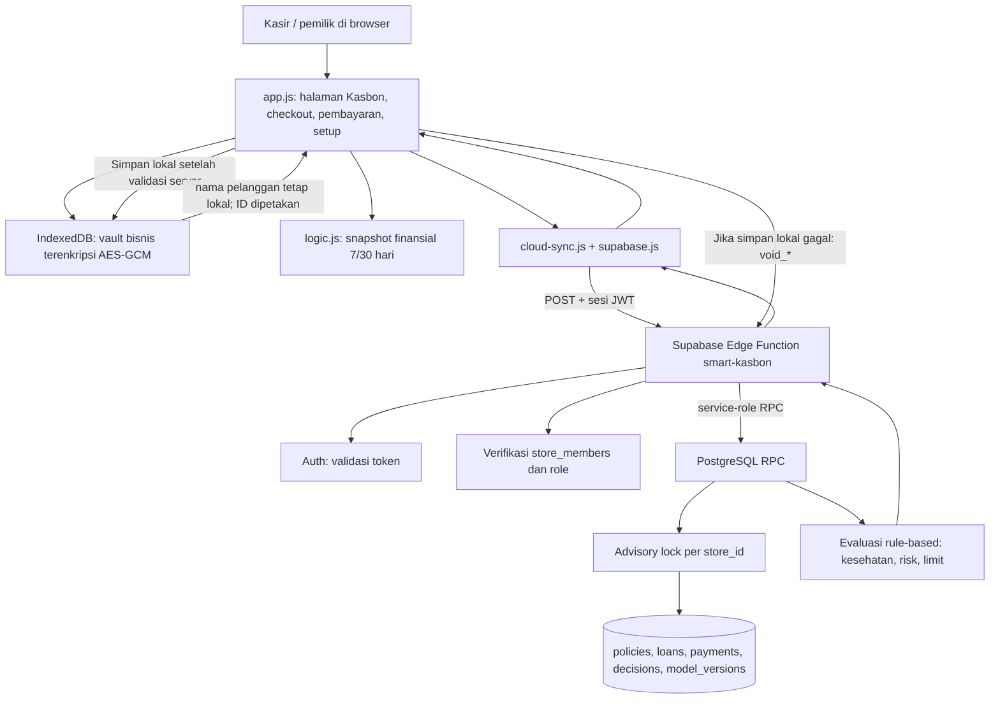

# Laporan Teknis dan Audit Implementasi Smart Kasbon

**Aplikasi:** WarungPintar
**Tanggal laporan:** 13 November 2026
**Commit dasar yang diperiksa:** `9a1e9ea` (`Add purchase-based product creation and currency formatting`)
**Ruang lingkup:** perubahan Smart Kasbon yang ada di working tree saat pemeriksaan.
**Batas pemeriksaan:** pembacaan kode/config dan hasil tes yang tersedia; migrasi belum dijalankan pada PostgreSQL/Supabase dan fitur belum diuji pada toko produksi.

> **Pembaruan 13 November 2026:** mismatch ID yang ditemukan dalam audit awal telah diperbaiki di working tree dan tes regresi ID pseudonim lulus. Pemeriksaan lanjutan juga menemukan serta memperbaiki bug perhitungan limit total piutang. Perbaikan belum dideploy dan belum diverifikasi pada Deno/PostgreSQL/Supabase; fitur tetap **belum siap untuk toko nyata**. Bagian awal merekam temuan historis audit pertama; addendum di akhir laporan adalah status terbaru dan mengesampingkan status lama jika berbeda.

## 1. Ringkasan Implementasi

Smart Kasbon dibuat untuk menerapkan batas kasbon berdasarkan kebijakan toko, kondisi keuangan ringkas, serta riwayat pembayaran pelanggan. Keputusan penerbitan dan pencatatan pembayaran dirancang agar divalidasi di server, bukan hanya di browser. Data bisnis utama tetap berada di vault terenkripsi lokal/cloud; sebagian metadata kasbon sengaja disimpan di Supabase agar server dapat menegakkan limit dan mengunci transaksi lintas perangkat.

**Yang ada di source tree:**

- UI di halaman Kasbon untuk memuat dashboard, memperlihatkan kondisi toko, piutang dan tunggakan, ringkasan risiko, keputusan terbaru, serta mengatur kebijakan sebagai pemilik.
- `smartKasbonFinancialSnapshot` menghitung ringkasan transaksi 7/30 hari yang dikirim ke backend.
- Client mengirim aksi ke Supabase Edge Function `smart-kasbon`.
- Edge Function memverifikasi JWT, keanggotaan toko, role pemilik untuk aksi tertentu, bentuk data, dan memanggil fungsi database.
- Migration membuat tabel kebijakan, kasbon, pembayaran, keputusan, versi model, RLS/grant, fungsi evaluasi dan fungsi transaksi.
- Ada bootstrap riwayat kasbon lama, pseudonimisasi ID pelanggan untuk operasi tertentu, penguncian transaksi per toko di SQL, retry satu kali untuk error jaringan terpilih, dan kompensasi jika operasi backend berhasil tetapi penyimpanan lokal gagal.
- Dokumentasi menyatakan bahwa aturan saat ini rule-based dan ML belum diterapkan.

**Yang belum selesai atau belum dibuktikan:**

- Temuan awal mismatch ID kasbon/pembayaran sudah diperbaiki di working tree, tetapi alur lengkap belum dibuktikan pada database runtime.
- Limit total piutang pada migration awal mengurangi saldo piutang berjalan dua kali; formula source sudah diperbaiki, tetapi belum diuji pada PostgreSQL.
- Tidak ada tes otomatis untuk Edge Function, migration SQL, transaksi ledger, idempotensi database, concurrency, retry, kompensasi, dan otorisasi multi-tenant.
- Migration SQL belum divalidasi dengan PostgreSQL lokal maupun diterapkan ke Supabase. Edge Function belum dideploy dan konfigurasi runtime/secret di Supabase belum diverifikasi.
- Belum ada hasil uji alur kasbon dari browser dengan akun dan backend nyata.
- Machine Learning belum diterapkan, dilatih, dievaluasi, ataupun digunakan untuk keputusan.
- Perubahan Smart Kasbon belum di-commit atau di-push pada saat pemeriksaan ini. File laporan ini adalah deliverable baru.

## 2. Arsitektur Sistem

1. Aplikasi browser membaca bisnis dari vault di IndexedDB. Perubahan vault dikerjakan pada salinan data terisolasi, kemudian disimpan kembali dalam bentuk terenkripsi.
2. `app.js` membentuk ringkasan finansial dan menyiapkan bootstrap riwayat ketika pemilik membuka Kasbon. Nama pelanggan tidak dikirim pada payload dashboard; UI mencoba mencocokkan ID pelanggan backend dengan data pelanggan lokal.
3. `cloud-sync.js` meneruskan aksi Smart Kasbon ke `supabase.js`, yang mengirim POST ke `/functions/v1/smart-kasbon` menggunakan sesi Supabase.
4. Gateway memverifikasi JWT sesuai `supabase/config.toml`. Edge Function memverifikasi token lagi melalui Auth, mengambil keanggotaan pada `store_members`, lalu menerapkan batas role pemilik untuk aksi yang ditentukan.
5. Edge Function menggunakan service-role key dari environment server untuk membaca data dashboard dan memanggil RPC. Fungsi SQL melakukan evaluasi/transaksi terhadap tabel ledger. Setiap transaksi mengunci ID toko dengan `pg_advisory_xact_lock`.
6. Backend mengembalikan keputusan/hasil. Kasbon atau pembayaran juga disimpan secara lokal; jika langkah lokal gagal, frontend mencoba membatalkan catatan server.



**Catatan arsitektur yang penting:** diagram menggambarkan komponen yang dibuat, bukan bukti bahwa database/Edge Function sudah terpasang atau beroperasi. Audit awal menemukan perbedaan ID pada jalur issue/payment; mismatch tersebut telah diperbaiki pada working tree dan belum diverifikasi pada database runtime. Lihat addendum.

## 3. Daftar File yang Diubah

Daftar berdasarkan `git status --short` sebelum file laporan dibuat.

| Path | Fungsi file | Perubahan dan alasan |
|---|---|---|
| `js/app.js` | Alur UI dan aksi aplikasi | Menambahkan pseudonimisasi dan bootstrap, sinkronisasi snapshot, pemuatan dashboard, keputusan kasbon/pembayaran, setup kebijakan, retry/kompensasi, serta penanda pembersihan/reset offline. Tujuan: menghubungkan UI ke ledger server. Termasuk temuan ID tidak konsisten yang dijelaskan dalam laporan. |
| `js/logic.js` | Logika bisnis murni | Menambahkan `smartKasbonFinancialSnapshot` untuk omzet, HPP, laba, arus kas, dan cold start. Tujuan: membentuk input finansial backend tanpa memasukkan piutang kasbon sebagai kas yang diterima. |
| `js/cloud-sync.js` | Konteks akun dan sinkronisasi | Menambahkan `smartKasbon(action, payload)`, yang mensyaratkan sesi dan koneksi lalu meneruskan `store_id` aktif. |
| `js/supabase.js` | Klien HTTP/Auth Supabase | Menambahkan pemanggilan POST Edge Function `smart-kasbon` melalui wrapper request yang sudah ada. |
| `supabase/config.toml` | Konfigurasi Edge Function | Menetapkan `verify_jwt = true` untuk `smart-kasbon`. |
| `supabase/functions/smart-kasbon/index.ts` | API Edge Function | Menambahkan validasi input, pemeriksaan JWT/keanggotaan/role, query dashboard, pemanggilan RPC, dan respons error. Menggunakan service-role key dari environment server. |
| `supabase/migrations/202610240001_smart_kasbon.sql` | Skema dan transaksi backend | Menambahkan lima tabel, RLS/grant, evaluasi rule-based, fungsi transaksi, bootstrap, kompensasi, reset dan penguncian per toko. Belum dijalankan atau divalidasi di PostgreSQL. |
| `tests/smart-kasbon.test.js` | Tes logika Smart Kasbon | Empat tes menguji pseudonimisasi ID, validasi timestamp, pemisahan omzet/laba/arus kas, dan cold start. Tidak menguji SQL atau Edge Function. |
| `README.md` | Dokumentasi proyek | Menambahkan langkah migrasi/deploy, aturan limit/risk, keterbatasan ML, dan peringatan bahwa metadata Smart Kasbon tidak dienkripsi end-to-end. |
| `sw.js` | Service worker/cache | Menaikkan versi cache ke `warungpintar-v46` supaya aset baru tidak terus memakai cache lama. |

File terkait yang diperiksa namun **tidak** termasuk perubahan Smart Kasbon dalam status tersebut: `js/db.js`, `js/crypto.js`, `css/style.css`, dan migration dasar `supabase/migrations/202610210001_warungpintar.sql`.

## 4. Formula dan Logika Smart Kasbon

Formula berikut dibaca dari `smart_kasbon_evaluate` di migration, bukan asumsi desain.

### 4.1 Snapshot finansial yang menjadi input

`smartKasbonFinancialSnapshot` memakai periode berjalan 30 hari, periode pembanding 30 hari sebelumnya, dan periode 7 hari:

- **Omzet** = jumlah `hargaJual × qty` dari penjualan yang dihitung sebagai pendapatan.
- `saleCountsAsRevenue` menerima transaksi tanpa `statusPembayaran`, atau status `berhasil` / `kasbon`; status `menunggu_konfirmasi` dan `dibatalkan` tidak dihitung.
- **HPP** = jumlah `hargaBeliSaatItu × qty`.
- **Laba kotor** = omzet − HPP.
- **Laba bersih** = omzet − HPP − pengeluaran usaha. Penarikan pribadi tidak mengurangi laba bersih.
- **Kas masuk** = penjualan non-kasbon yang dihitung sebagai pendapatan + penerimaan pembayaran kasbon.
- **Kas keluar** = total pembelian barang + pengeluaran + penarikan pribadi.
- **Arus kas** = kas masuk − kas keluar.
- Penjualan metode kasbon tetap dihitung sebagai omzet/laba, tetapi tidak dihitung sebagai kas masuk saat diterbitkan. Pembayaran kasbon dihitung sebagai kas masuk pada waktu pembayaran.

Implementasi ini tidak menghitung saldo kas/modal kerja aktual otomatis. `cash_available`, `working_capital`, `liabilities`, dan `reserve_cash` diisi/dikonfirmasi pemilik. `financeSnapshot` menerima angka dari browser setelah validasi bentuk/nilai; backend tidak menghitung ulang snapshot dari vault terenkripsi.

### 4.2 Kondisi kesehatan toko

Notasi:

- `R`, `Rprev`: omzet 30 hari terakhir dan 30 hari sebelumnya.
- `P`, `Pprev`: laba bersih dua periode tersebut.
- `margin = P / R` jika `R > 0`, selain itu nol.
- `salesTrend = (R − Rprev) / Rprev` jika `Rprev > 0`; jika tidak, `1` bila `R > 0`, selain itu `0`.
- `profitTrend = (P − Pprev) / abs(Pprev)` jika `abs(Pprev) > 0`; jika tidak, `1` bila `P > 0`, selain itu `0`.
- `overdueRatio = piutang jatuh tempo / seluruh piutang aktif`, nol bila piutang nol.
- `cashFlow` = snapshot arus kas 30 hari.

Kategori diuji secara berurutan; kondisi pertama yang cocok dipakai:

| Kategori | Kondisi aktual | Faktor `H` |
|---|---|---:|
| `cold_start` | `has_sales_30` false | 0,10 |
| `kritis` | kas atau modal kerja null; atau kas ≤ cadangan; atau laba < 0 **dan** arus kas < 0; atau `overdueRatio ≥ 0,35` | 0 |
| `menurun` | `salesTrend ≤ −0,20` atau `profitTrend ≤ −0,20` | 0,20 |
| `stagnan` | `margin < 0,05` atau laba ≤ 0 | 0,35 |
| `sangat_sehat` | `margin ≥ 0,15`, kedua tren ≥ 0,20, arus kas ≥ 0, `overdueRatio < 0,05` | 1 |
| `sehat` | `margin ≥ 0,10`, arus kas ≥ 0, `overdueRatio < 0,15` | 0,80 |
| `stabil` | selain kondisi di atas | 0,60 |

Kondisi `cold_start` diperiksa sebelum kondisi kritis. Implementasi menandai toko cold start hanya berdasarkan ada/tidaknya setidaknya satu transaksi penjualan pada 30 hari; tidak ada syarat jumlah sampel minimum selain itu.

### 4.3 Kapasitas dan limit

Misalkan:

- `C` = kas tersedia dari kebijakan.
- `Reserve` = cadangan kas.
- `W` = modal kerja sebelum kewajiban dan piutang.
- `L` = kewajiban.
- `AR` = seluruh saldo piutang aktif, yaitu `Σ(amount − paid_amount)`.
- `Mtotal` = `max_total_receivable`.
- `Mcustomer` = `max_per_customer`.

Formula yang dijalankan SQL:

```text
capacity = min(max(C − Reserve, 0), max(W − L − AR, 0))
totalLimit = min(Mtotal, floor(capacity × H))
rawCustomerLimit = min(Mcustomer, totalLimit)
customerLimit = floor(rawCustomerLimit × customerRiskFactor)
```

`customerRiskFactor` = 0 untuk risiko tinggi, 0,5 untuk sedang, dan 1 untuk rendah. Nilai limit yang dipakai dalam pemeriksaan adalah nilai yang telah dikalikan faktor risiko.

### 4.4 Risk score pelanggan

Untuk pelanggan:

- `n` = jumlah kasbon berstatus `active` yang memiliki `settled_at`.
- `late` = jumlah dari kasbon tersebut yang tanggal pelunasannya melewati `due_date`.
- `lateRate = late / n`, bila `n > 0`.
- `customerOverdue` = saldo berjalan yang sudah melewati jatuh tempo.
- `customerBalance` = seluruh saldo berjalan pelanggan.
- `overdueShare = customerOverdue / customerBalance`, bila `customerBalance > 0`.
- `avgLateDays` = rata-rata `max(tanggal pelunasan − due_date, 0)` untuk kasbon yang sudah dilunasi.

Jika `n > 0`:

```text
riskScore = clamp(
  round(100 − 50 × lateRate − 30 × min(overdueShare, 1)
            − 20 × min(avgLateDays / 30, 1)),
  0, 100
)
```

Jika belum ada riwayat pelunasan, skor awal **60**, kategori **sedang**, faktor **0,5**. Setelah itu:

- **Tinggi** bila ada saldo pelanggan yang sudah jatuh tempo, atau skor < 50; faktor 0.
- **Sedang** bila skor < 75 atau jumlah pelunasan historis < 3; faktor 0,5.
- **Rendah** selain itu; faktor 1.

Risiko tinggi menolak kasbon baru. Pembayaran tetap memakai jalur pembayaran; kode tidak melakukan evaluasi risiko untuk menolak pembayaran.

### 4.5 Jumlah pelanggan aktif dan keputusan

Pelanggan aktif dihitung sebagai pelanggan unik dengan sekurangnya satu kasbon berstatus `active` dan jumlah sisa saldo > 0.

```text
activeLimit =
  0, jika H <= 0
  max(1, floor(max_active_customers × H)), selain itu
```

Untuk kasbon pelanggan baru, backend menolak bila `active_customers + 1 > activeLimit`. Pelanggan yang telah mempunyai saldo berjalan tidak dihitung sebagai pelanggan baru.

Kasbon baru ditolak bila salah satu kondisi ini benar:

1. Kebijakan belum dikonfigurasi.
2. Snapshot finansial tidak segar: `financial_snapshot_at` lebih lama dari 7 hari atau lebih dari 5 menit di masa depan.
3. Kesehatan `kritis` atau `totalLimit ≤ 0`.
4. Risk pelanggan tinggi.
5. `customerBalance + amount > customerLimit`.
6. `AR + amount > totalLimit`.
7. Kasbon untuk pelanggan baru melampaui `activeLimit`.
8. Nominal atau tanggal tidak valid; tanggal jatuh tempo baru yang lebih awal dari tanggal Jakarta hari ini ditolak.

Pengaruh laba, omzet, margin, arus kas, tren, kas, cadangan, modal kerja, kewajiban, piutang dan keterlambatan dibatasi pada formula di atas. Ini bukan model prediktif atau rekomendasi keuangan.

## 5. Implementasi Machine Learning

**Machine Learning belum diimplementasikan.**

- **Algoritma:** tidak ada algoritma ML yang digunakan.
- **File model:** tidak ada file model terlatih. Migration hanya menyiapkan tabel `smart_kasbon_model_versions` dengan kolom `model`, `metrics`, `training_count`, `evaluation_count` dan `state`.
- **Dataset:** tidak ada dataset pelatihan/evaluasi yang digunakan atau tersedia sebagai bukti dalam repository.
- **Fitur input, target, training, evaluasi, dan metrik aktual:** tidak ada untuk ML.
- **Cold start:** rule-based; snapshot tanpa transaksi dalam 30 hari memberi label `cold_start` dan faktor kesehatan 0,1. Skor risiko pelanggan awal 60 / kategori sedang saat belum ada riwayat pelunasan.
- **Fallback:** keputusan tetap memakai aturan SQL. Ini bukan fallback model ML, karena tidak ada model aktif.
- **Pemakaian pada keputusan:** tidak digunakan. `evaluate_model` pada Edge Function mengembalikan `state: unavailable` dan alasan data historis/holdout belum cukup. Dashboard memberi state `cold_start` bila belum ada baris model.

Kolom `decision_features` dan tabel model merupakan penyimpanan/kerangka data, bukan bukti bahwa model sudah dilatih atau dipakai.

## 6. Database dan Ledger

Migration terkait: `supabase/migrations/202610240001_smart_kasbon.sql`.

| Tabel | Kolom penting dan relasi |
|---|---|
| `smart_kasbon_policies` | `store_id` PK/FK ke `stores`; konfigurasi kas, modal kerja, kewajiban, cadangan, batas per pelanggan, pelanggan aktif, total piutang, snapshot JSON, timestamp freshness, flag bootstrap dan versi kebijakan. |
| `smart_kasbon_loans` | `id` PK UUID; `store_id` FK ke `stores`; `customer_id` UUID tanpa FK ke tabel pelanggan (karena pseudonim); `amount`, `paid_amount`, `due_date`, `created_by`, `status`, `settled_at`, `decision_features`; unique `(store_id,id)`. |
| `smart_kasbon_payments` | `id` PK; `store_id` FK ke `stores`; `loan_id`, nominal, waktu dan pembuat; composite FK `(store_id,loan_id)` ke `(store_id,id)` pada loans. |
| `smart_kasbon_decisions` | ID identity PK, `store_id` FK, loan/customer ID opsional, action, approved, JSON keputusan, actor dan waktu. Tidak ada FK loan/customer. Dipakai sebagai riwayat keputusan/audit. |
| `smart_kasbon_model_versions` | ID identity PK, `store_id` FK, versi unik per toko, state, versi fitur, JSON model/metrics dan hitungan training/evaluation. Belum digunakan untuk training atau keputusan. |

### Relasi dan pseudonimisasi

- Relasi store pada kebijakan/kasbon/pembayaran/keputusan/model memakai `store_id`.
- Pembayaran mempunyai composite FK yang mencegah pembayaran tertaut ke loan dari toko berbeda.
- `pseudonymousUuid(kind,id,storeId)` di `js/logic.js` membuat UUID deterministik dari SHA-256 atas string `warungpintar:smart-kasbon:<storeId>:<kind>:<id>`, lalu menyesuaikan bit versi/varian UUID.
- Bootstrap data lama mengubah ID kasbon, pembayaran, dan pelanggan menjadi UUID turunan. Nama pelanggan tetap dicocokkan lokal melalui peta nama pada browser.
- Pseudonimisasi ini bukan anonimisasi: transformasi deterministik tanpa secret salt; orang yang mengetahui nilai ID asal dapat menguji kandidat. Ketidakkonsistenan ID pada jalur mutasi ditemukan dalam audit awal dan sudah diperbaiki di working tree; validasi runtime belum dilakukan.
- Backend tetap menyimpan nominal kasbon/pembayaran, tanggal, status, snapshot keuangan dan JSON keputusan. Metadata tersebut tidak dilindungi AES-GCM vault.

### Ledger, saldo, idempotensi, dan atomicity

- `paid_amount` disimpan pada row loan. Saldo adalah `amount − paid_amount`; check constraint membatasi `0 ≤ paid_amount ≤ amount`.
- Pembuatan pembayaran memeriksa `paid_amount + amount ≤ loan.amount`, menambah `paid_amount`, dan menetapkan `settled_at` ketika lunas. Pembayaran parsial diperbolehkan.
- Idempotensi pembayaran memeriksa `payment_id` yang sudah ada dan membandingkan `loan_id`/nominal; penerbitan loan mencari ID yang sudah ada dan membandingkan customer/nominal/status.
- RPC memperoleh advisory lock per `store_id` dan mengunci policy row. Pembayaran juga memakai `FOR UPDATE` pada loan.
- Penerbitan, evaluasi, insert loan, update pembayaran/saldo, dan audit dilakukan dalam satu pemanggilan PostgreSQL function sehingga berada pada transaksi database yang sama. Mekanisme ini masuk akal secara kode tetapi belum diuji pada PostgreSQL atau concurrency nyata.
- Kompensasi `void_loan` mengubah status loan menjadi `void` jika dibuat actor saat ini dan belum memiliki pembayaran. `void_payment` menghapus row pembayaran, mengurangi `paid_amount`, dan memasukkan catatan keputusan kompensasi.
- Ini bukan ledger append-only penuh: kompensasi pembayaran menghapus row pembayaran; audit tindakan kompensasi tersimpan terpisah. `clear_history` juga menghapus semua row pembayaran dan menandai loan aktif sebagai void.
- IndexedDB lokal menyimpan satu vault terenkripsi; `db.atomic` mengubah salinan terisolasi lalu menyimpan vault terenkripsi dalam satu unit lokal. Atomicity lokal tidak membuat transaksi lokal dan PostgreSQL menjadi satu transaksi terdistribusi; aplikasi menggunakan kompensasi untuk mengurangi ketidakkonsistenan.

## 7. Keamanan dan Multi-Tenant

### Bukti kontrol yang ada di kode

- `supabase/config.toml`: `verify_jwt = true` pada fungsi `smart-kasbon`.
- Edge Function memvalidasi access token melalui `auth.auth.getUser(token)`, mencari pasangan `(store_id,user_id)` di `store_members`, dan menolak anggota yang tidak ada.
- `bootstrap`, `set_policy`, `sync_finance`, `evaluate_model`, dan `clear_history` dibatasi pada role `owner` di Edge Function.
- Actor (`p_actor`) dikirim ke RPC dari `userData.user.id`, bukan dari payload request.
- Edge Function menggunakan service-role key dari `Deno.env`; browser memanggil Edge Function lewat publishable key/sesi dan tidak menerima service-role key pada jalur yang diperiksa.
- UUID, nominal integer aman, rentang nominal, tanggal, snapshot dan batch bootstrap divalidasi di Edge Function.
- Semua tabel Smart Kasbon mengaktifkan RLS. Migration mencabut semua privilege dari `public`, `anon`, `authenticated`, memberikan grant ke `service_role`, dan tidak mendefinisikan policy langsung untuk tabel tersebut. Akses dimaksudkan hanya melalui Edge Function/service role.
- Query dashboard dan RPC dibatasi oleh `store_id`. SQL menggunakan store_id pada query loan/payment; payment juga memiliki composite FK.
- Fungsi SQL `SECURITY DEFINER` mengatur `search_path = ''`, mencabut execute dari `public`, `anon`, `authenticated`, dan memberi execute kepada `service_role`.
- CORS mengizinkan origin `APP_URL` serta localhost/127.0.0.1. README meminta `APP_URL` diset sebagai secret/environment Supabase.
- Vault bisnis utama dienkripsi AES-GCM; key wrapping menggunakan PBKDF2 pada `js/crypto.js`. Pengecualian metadata Smart Kasbon dijelaskan dalam README.

### Batas dan risiko yang belum diverifikasi

- RLS/grant baru efektif setelah migration diterapkan. Tidak ada hasil uji RLS langsung, cross-tenant, atau privilege database.
- Karena Edge Function memakai service role yang melewati RLS, validasi membership dan filter store di Edge/RPC merupakan batas keamanan kritis. Belum ada integration test yang mencoba store ID milik toko lain.
- Snapshot finansial dan angka kas/modal kerja berasal dari client/pemilik. Edge memvalidasi format dan batas integer, bukan membuktikan bahwa input cocok dengan vault. Pemilik yang tidak jujur atau browser yang dimanipulasi dapat mengirim angka berbeda.
- Timestamp pembayaran baru diambil dari waktu database dan tidak dapat dipilih client; validasi timestamp untuk data historis bootstrap menolak tanggal lebih dari 5 menit di masa depan. Timestamp histori tetap berasal dari vault lokal dan tidak membuktikan pembayaran benar-benar terjadi.
- ID pelanggan deterministik berbasis SHA-256 tanpa secret salt; pseudonimisasi mengurangi paparan nama langsung tetapi tidak memberi jaminan anonimitas.
- Keputusan JSON dan snapshot agregat dapat mengungkap saldo/arus keuangan kepada operator project Supabase. Ini dinyatakan di README.
- Tidak ada bukti pengujian CORS pada domain produksi, rotasi secret, logging/retensi, atau respons terhadap ukuran request ekstrem.

## 8. Laporan Keuangan

### Omzet, HPP, laba

Di `logic.js`, omzet terdiri dari penjualan yang lolos `saleCountsAsRevenue`; HPP memakai harga beli pada waktu penjualan; laba kotor = omzet − HPP; laba bersih = laba kotor − pengeluaran usaha. Penarikan pribadi tidak mengurangi laba bersih.

Untuk Smart Kasbon, penjualan kasbon termasuk omzet dan laba pada tanggal transaksi, tetapi tidak dimasukkan ke `cashSales`. Dengan demikian piutang kasbon tidak langsung dihitung sebagai kas masuk. Pembayaran kasbon dicatat sebagai collections/kas masuk pada tanggal pembayaran.

### Snapshot kas

```text
cash_in_30 = total penjualan terhitung selain metode kasbon + pembayaran kasbon
cash_out_30 = total purchases + operating expenses + withdrawals
cash_flow_30 = cash_in_30 − cash_out_30
```

Penarikan pribadi memang tidak mengurangi laba bersih, tetapi ikut mengurangi arus kas. Piutang aktif dihitung pada server sebagai jumlah saldo kasbon belum lunas. Piutang tidak dikurangkan dari laba bersih; ia berpengaruh pada kapasitas modal kerja (`working_capital − liabilities − receivable`) dan rasio tunggakan.

Pembayaran parsial menurunkan saldo melalui `paid_amount`; pelunasan penuh mengisi `settled_at`. Kasbon lewat jatuh tempo dihitung bila `due_date` lebih awal daripada tanggal hari ini di zona `Asia/Jakarta`. Nilai overdue dan total receivable disajikan di dashboard.

### Batas akurasi

- Snapshot memakai tanggal `sale.waktu` untuk periode penjualan, bukan waktu konfirmasi kas/bayar. Untuk transaksi yang baru dikonfirmasi kemudian, waktu pelaporan kas dapat berbeda dari waktu penerimaan aktual.
- `cash_out_30` menghitung seluruh `purchase.total` sebagai pengeluaran kas pada tanggal pembelian; kode snapshot tidak mengklasifikasikan pembelian secara tunai/kredit.
- Semua pembayaran kasbon menggunakan waktu lokal yang dikirim browser; tidak ada rekonsiliasi ke mutasi bank/kas.
- Tes snapshot membuktikan satu contoh hitung sederhana, bukan kelengkapan data akuntansi atau kecocokan dengan transaksi toko nyata.
- Angka kas tersedia/modal kerja tetap input manual dan tidak dapat diverifikasi dari data aplikasi.

## 9. Dashboard dan UI/UX

- **Frontend:** `js/app.js`, terutama `vKasbon`, `smartKasbonPanel`, `fetchSmartKasbon`, `payDebt`, `manualDebt`, dan `setupSmartKasbon`.
- **Data sumber:** ringkasan/policy/keputusan/risiko berasal dari Edge Function dan PostgreSQL; nama pelanggan dipetakan dari `S.customers` lokal; daftar kasbon dan pembayaran utama tetap berasal dari vault lokal.
- **Data yang ditampilkan:** label kesehatan toko, piutang aktif/terlambat, pelanggan aktif dibanding kebijakan, jumlah kasbon aktif, batas piutang efektif, status freshness snapshot, ringkasan kategori risiko, sebagian skor per pelanggan, keputusan terbaru, dan status ML/model.
- **Kebijakan:** tombol atur/ubah hanya dirender bagi owner; form meminta kas, modal kerja, kewajiban, cadangan, limit per pelanggan, maksimum pelanggan aktif, dan maksimum total piutang. UI mengingatkan bahwa kas/modal kerja tidak dilacak otomatis.
- **Loading/error/empty:** menampilkan teks memuat, pesan error dan tombol coba lagi, state dashboard belum dimuat, state kebijakan belum diset, dan state tanpa riwayat risiko/keputusan.
- **Nama:** bila mapping pelanggan lokal tidak tersedia, UI menampilkan “Pelanggan pseudonim”.
- **Responsivitas:** CSS umum mendefinisikan `.row.wrap`, dua kolom `.grid2`, lalu mengubah grid menjadi satu kolom pada lebar ≤520px; ada aturan tambahan ≤360px. Ini membuktikan aturan responsive CSS ada, bukan hasil uji visual dashboard di ukuran layar berbeda.
- **Pengujian UI:** ringkasan sesi sebelumnya hanya membuktikan halaman login dapat dibuka di browser lokal. Dashboard/kasbon tidak dibuktikan lewat browser dengan backend atau akun toko.

## 10. Retry dan Compensation

- `smartKasbonMutationWithRetry` menjalankan request pertama. Retry dijalankan **maksimal satu kali** bila pesan error cocok dengan pola koneksi tertentu (`tidak dapat terhubung ke server`, `network`, `failed to fetch`). Error validasi/penolakan bisnis tidak otomatis diulang.
- Retry menggunakan payload/ID yang sama. SQL mendesain idempotensi berdasarkan ID loan/payment; hasil komit yang responsnya hilang diharapkan dikenali ulang.
- Jika retry tetap gagal, kode mencoba aksi undo (`void_loan` atau `void_payment`). Jika undo gagal juga, error eksplisit meminta pengguna memeriksa dashboard sebelum mengulang.
- Untuk penerbitan kasbon, server dipanggil lebih dulu lalu `db.atomic` menyimpan transaksi lokal. Jika simpan lokal gagal, aplikasi langsung mencoba `void_loan`.
- Untuk pembayaran, backend dipanggil dulu, kemudian validasi/simpan pembayaran dan saldo secara lokal dalam `db.atomic`. Bila penyimpanan lokal gagal, aplikasi mencoba `void_payment`.
- `void_loan` mensyaratkan actor yang sama dan tidak ada pembayaran; `void_payment` mensyaratkan actor pencipta pembayaran yang sama. Semua aksi memakai lock database per toko.
- Saat offline, aksi kasbon/pembayaran diblokir. Penanda clear/reset disimpan lokal dan dicoba saat pemilik membuka Kasbon kembali.

**Risiko tersisa:** ini bukan transaksi terdistribusi atomik. Bila server dan client kehilangan respons bersamaan, status dapat tidak diketahui; bila kompensasi gagal, backend dapat menyimpan transaksi yang tidak ada di vault lokal. Pesan error meminta pengecekan manual, tetapi tidak ada reconciliation otomatis yang membandingkan ledger dengan vault. Mismatch ID yang disebut di audit awal sudah diperbaiki pada working tree, tetapi belum diuji end-to-end.

## 11. Hasil Pengujian

### Perintah dan hasil aktual yang tersedia

- `npm test` (`node --test`): **37 lulus, 0 gagal** pada validasi 13 November 2026 yang dicatat di addendum pertama; saat itu 35 baseline test ditambah dua tes regresi.
- `npm run build`: **berhasil**, menghasilkan bundle `js/barcode-scanner.js` sekitar 473,9 kB. Script build hanya menjalankan build scanner; bukan build/integrasi backend.
- `node --check` untuk semua berkas `js/**/*.js`: **berhasil**, tanpa keluaran error.
- Esbuild membundle `supabase/functions/smart-kasbon/index.ts` bersama import lokal, dengan import eksternal Supabase dikecualikan: **berhasil**. Ini bukan Deno type-check, deploy, atau runtime test.
- `git diff --check`: **exit code 0**, tidak menemukan whitespace error. Git menampilkan peringatan bahwa LF akan menjadi CRLF pada `js/app.js`, `js/logic.js`, dan `sw.js`.
- Migration SQL: **tidak diuji** terhadap PostgreSQL/Supabase. Tidak ada bukti `supabase db test`, `supabase start`, atau deploy.

Rincian 35 test baseline ditambah dua test regresi yang tampil pada output aktual saat validasi tersebut. Kolom “expected” merangkum maksud/assertion kasus; “actual” adalah hasil runner, semuanya PASS. Kasus ini bukan bukti bahwa setiap fitur backend Smart Kasbon telah diuji. Jumlah tersebut adalah riwayat pada saat itu, bukan total suite terbaru; lihat addendum lanjutan.

| # | Nama test aktual | Expected result yang diuji | Actual |
|---:|---|---|---|
| 1 | data vault hanya dapat dibuka dengan password akun atau recovery key | Data terenkripsi dapat dibuka menggunakan kredensial yang didukung | PASS |
| 2 | cadangan terenkripsi tidak memuat data terbuka dan menolak password salah | Backup tetap terenkripsi dan password salah ditolak | PASS |
| 3 | format harga memberi pemisah ribuan dan mengabaikan karakter selain angka | Input harga diformat ribuan dan karakter nonangka tidak dipakai | PASS |
| 4 | parse harga menerima nilai berformat dan membiarkan input kosong | Nilai berformat diparse dan input kosong tetap kosong/null sesuai fungsi | PASS |
| 5 | IndexedDB menyimpan vault terenkripsi dan transaksi stok tetap atomik | Data vault tersimpan terenkripsi dan mutasi stok satu unit | PASS |
| 6 | laba kotor memakai harga beli saat transaksi (historis) | HPP/laba memakai harga beli yang tersimpan pada baris penjualan | PASS |
| 7 | prive tidak mengurangi laba bersih, pengeluaran mengurangi | Penarikan pribadi dikecualikan dari laba; expense mengurangi laba | PASS |
| 8 | kasbon: sisa utang dan jatuh tempo | Sisa kasbon dihitung dan status jatuh tempo dikenali | PASS |
| 9 | pembayaran kasbon menolak jumlah tidak valid dan lebih dari saldo | Nominal tidak valid/lebih besar dari saldo ditolak | PASS |
| 10 | peringatan stok: habis, di bawah minimum, dan prediksi habis | Kondisi stok menipis menghasilkan peringatan yang sesuai | PASS |
| 11 | produk lambat laku | Produk lama dengan stok yang tidak terjual teridentifikasi | PASS |
| 12 | laporan barang terjual memuat semua produk dan menggabungkan jumlah dalam periode | Produk dan kuantitas transaksi digabungkan sesuai periode | PASS |
| 13 | zakat perdagangan: contoh 85 gram emas, haul, dan kadar 2,5% | Contoh nisab/haul menghasilkan nilai sesuai aturan test | PASS |
| 14 | zakat perdagangan membedakan nilai di bawah, tepat, dan di atas nisab | Batas nisab dibandingkan dengan benar | PASS |
| 15 | zakat perdagangan mensyaratkan haul dan tidak menetapkan kewajiban saat belum terpenuhi | Haul yang belum selesai tidak menghasilkan kewajiban | PASS |
| 16 | zakat perdagangan membatasi dasar negatif menjadi nol dan piutang macet tidak ditambahkan | Nilai bersih negatif dibatasi nol dan piutang macet dikecualikan | PASS |
| 17 | nilai persediaan menggunakan nilai pasar yang diberikan, bukan biaya produk | Nilai persediaan mengikuti harga pasar yang diinput | PASS |
| 18 | komponen keuntungan hanya dihitung saat belum tercakup komponen lain | Komponen yang sudah masuk tidak dihitung ganda | PASS |
| 19 | harga emas kosong atau gagal diverifikasi tidak menghasilkan kewajiban | Data emas tak tersedia tidak memicu kewajiban | PASS |
| 20 | perubahan harga emas dan data harta dihitung ulang secara konsisten | Perubahan input menghasilkan kalkulasi konsisten | PASS |
| 21 | zakat perdagangan menolak input negatif, pecahan, dan nilai melebihi batas aman | Input tidak valid/di luar safe integer ditolak | PASS |
| 22 | haul diperkirakan dari kalender Hijriah dan tanggal yang tidak valid memerlukan konfirmasi manual | Kalender Hijriah digunakan dan tanggal invalid ditangani | PASS |
| 23 | nomor WhatsApp dinormalisasi ke format 62 | Nomor lokal dinormalisasi ke prefix Indonesia | PASS |
| 24 | skor kesehatan usaha 0-100 dan butuh data | Skor dibatasi rentang dan menandai data yang belum cukup | PASS |
| 25 | struk memuat total dan kembalian | Teks struk mencantumkan jumlah dan kembalian | PASS |
| 26 | struk mencantumkan status bayar yang tidak mengklaim QRIS lunas | Status QRIS pending tidak ditampilkan lunas | PASS |
| 27 | QRIS menunggu konfirmasi dan transaksi yang dibatalkan tidak dihitung dalam ringkasan | Pending/cancel tidak dihitung seperti transaksi sukses | PASS |
| 28 | transaksi QRIS yang dikonfirmasi berpindah ke urutan transaksi terbaru | Waktu/status konfirmasi memengaruhi urutan transaksi | PASS |
| 29 | CSV meloloskan tanda kutip dan menetralkan sel formula | CSV quoting dan mitigasi formula diuji | PASS |
| 30 | belanja barang membuat produk baru dengan stok awal dan restock memperbarui stok atomik | Produk baru/restock mengubah stok dalam satu mutasi | PASS |
| 31 | belanja dengan total tidak valid tidak mengubah data | Validasi total gagal tanpa mutasi | PASS |
| 32 | snapshot keuangan memisahkan omzet, laba, dan arus kas 30 hari | Contoh mengharapkan omzet 25.000; HPP 15.000; laba kotor 10.000; laba bersih 9.000; kas masuk 21.500; kas keluar 3.500; arus kas 18.000; transaksi QRIS pending dikecualikan | PASS |
| 33 | snapshot menandai toko tanpa transaksi sebagai cold start | Tidak ada sales menghasilkan `has_sales_30=false`, omzet/laba bersih nol | PASS |
| 34 | membuat berkas xlsx valid berisi lembar kerja dan nilai sel | Workbook terbentuk dan sel dapat dibaca | PASS |
| 35 | menolak data lembar kerja yang tidak berbentuk daftar baris | Input workbook dengan shape salah ditolak | PASS |
| 36 | ID backend kasbon deterministik dan terpisah antarjenis serta toko | ID yang dihasilkan berupa UUID valid dan berbeda untuk namespace/toko berbeda | PASS |
| 37 | timestamp Smart Kasbon dinormalisasi dan menolak nilai invalid atau masa depan | Timestamp valid dinormalisasi; tanggal invalid dan lebih dari 5 menit di masa depan ditolak | PASS |

**Cakupan Smart Kasbon langsung dari 37 tes:** empat tes di `smart-kasbon.test.js` menguji pseudonimisasi ID, validasi timestamp, snapshot finansial, dan cold start. Test no. 8–9 menguji helper hutang/pembayaran lokal umum, bukan Edge Function, SQL, RLS, atau transaksi backend. Tes UUID menguji helper, bukan keseluruhan alur issue → payment pada database.

## 12. Pengujian Skenario Bisnis

| Skenario | Status bukti | Catatan |
|---|---|---|
| Toko baru tanpa histori | **Unit test parsial** | Snapshot cold start diuji. Faktor cold-start di SQL dan keputusan issue tidak diuji di database. |
| Keuntungan meningkat | **Belum diuji** | Tidak ada integration test tren/health factor SQL. |
| Keuntungan stagnan | **Belum diuji** | Threshold margin/laba pada SQL belum dites. |
| Keuntungan menurun | **Belum diuji** | Perubahan tren omzet/laba belum dites. |
| Kas toko kritis | **Belum diuji** | Kondisi kas, cadangan, dan kapasitas belum dites terhadap SQL. |
| Pelanggan tepat waktu | **Belum diuji backend** | Tidak ada tes risk score SQL untuk riwayat tepat waktu. |
| Pelanggan terlambat | **Belum diuji backend** | Tidak ada tes risk score SQL untuk keterlambatan. |
| Pelanggan menunggak | **Belum diuji backend** | Tidak ada tes penolakan karena overdue balance. |
| Pembayaran parsial | **Helper lokal diuji; backend belum** | Tes helper pembayaran menolak nominal invalid/di atas saldo; pembaruan ledger partial tidak diuji. |
| Pelunasan | **Helper lokal parsial; backend belum** | Tidak ada tes `settled_at` SQL atau alur server-to-local. |
| Limit pelanggan aktif tercapai | **Belum diuji** | Tidak ada test batas jumlah pelanggan. |
| Limit total piutang tercapai | **Belum diuji** | Tidak ada test formula/penolakan limit SQL. |
| Transaksi bersamaan | **Belum diuji** | Advisory lock ada di source, tapi concurrency tidak dijalankan. |
| Kegagalan jaringan | **Belum diuji** | Tidak ada simulasi fetch/Edge error pada test suite. |
| Retry dan kompensasi | **Belum diuji** | Tidak ada test request retry, idempotensi server, undo, atau kegagalan undo. |

## 13. Temuan Risiko dan Kekurangan

Tingkat severity menilai dampak potensial dan kekuatan bukti. Temuan “terkonfirmasi dari kode” tidak berarti sudah direproduksi di Supabase, karena belum ada DB runtime.

| ID / severity | Temuan dan bukti | Dampak |
|---|---|---|
| **F-01 — CRITICAL, RESOLVED IN WORKING TREE; runtime belum diverifikasi** | Audit awal menemukan `issue` memakai ID mentah sedangkan `payment` memakai UUID pseudonim. Working tree kini membuat `issue`, `payment`, `void_loan`, dan bootstrap memakai UUID pseudonim yang sama per loan; helper UUID diperbaiki agar membentuk seluruh 32 digit hex dan versi/variant UUID valid. Tes ID regresi lulus. | Mismatch kode diperbaiki, tetapi alur issue → partial payment → settlement belum dijalankan pada database. Perbaikan belum dideploy. |
| **F-02 — HIGH, belum diuji** | Migration SQL belum dijalankan pada PostgreSQL/Supabase; Edge Function belum dideploy. Hasil tes hanya sintaks Edge, bukan DB. | Kesalahan SQL/RPC, grant, schema, runtime environment, CORS dan asumsi PostgREST mungkin baru muncul saat deploy. Jangan gunakan produksi sebelum uji staging. |
| **F-03 — HIGH, risiko integritas input** | Snapshot angka dan nilai kas/modal kerja berasal dari client. Edge Function memvalidasi bentuk/angka (`index.ts` sekitar L57–90), namun tidak dapat membandingkan snapshot dengan vault yang terenkripsi; pemilik memasukkan kas/modal kerja manual (`app.js` sekitar L1350–1386). | Client yang dimodifikasi atau input pemilik yang tidak akurat dapat menaikkan/menurunkan limit. Backend tidak memiliki data terbuka untuk audit ulang angka sumber. |
| **F-04 — MEDIUM, PARTIALLY RESOLVED** | Timestamp pembayaran baru diambil dari `now()` database; Edge tidak meneruskan `paid_at` dari client untuk aksi payment. Timestamp umum yang masih diterima (mis. bootstrap historis) ditolak jika lebih dari 5 menit di masa depan. | Tanggal pembayaran baru tidak dapat dimundurkan oleh client. Timestamp histori saat bootstrap masih bersumber dari vault dan tidak diverifikasi independen; keputusan histori dapat dipengaruhi data pemilik. |
| **F-05 — MEDIUM, pseudonimisasi** | Hash SHA-256 deterministik memakai `storeId`, jenis dan ID, tanpa secret salt (`logic.js`, `pseudonymousUuid`). Jalur loan/payment/void/bootstrap yang sudah diperiksa menggunakan UUID pseudonim yang sama per entitas; `actor_id` tetap ID Auth. | Pseudonimisasi tidak anonim; ID asal yang diketahui dapat diuji. Server tetap menyimpan nominal, tanggal dan metrik keuangan. |
| **F-06 — MEDIUM, akurasi kas** | Snapshot menganggap seluruh `purchase.total` sebagai cash out pada tanggal pembelian dan memakai `sale.waktu` sebagai rentang penjualan (`logic.js` sekitar L45–87). | Untuk pembelian kredit atau konfirmasi pembayaran yang terjadi pada tanggal berbeda, snapshot arus kas/periode dapat berbeda dari kas aktual. Status pembayaran pembelian tidak diperiksa oleh fungsi snapshot. |
| **F-07 — MEDIUM, ledger non-append-only** | Kompensasi `void_payment` menghapus row pembayaran dan mengubah `paid_amount`; `clear_history` juga menghapus semua payments (`migration` sekitar L373–398, L591–608). | Audit menyimpan aksi kompensasi, tetapi tidak mempertahankan row pembayaran sebagai entri immutable. Rekonstruksi penuh ledger setelah penghapusan terbatas. |
| **F-08 — MEDIUM, concurrency belum terbukti** | Advisory lock per toko dan row lock ada pada SQL (`migration` sekitar L365 dan L558–570), tetapi tidak ada tes DB concurrency. | Mekanisme terlihat menserialisasi mutasi yang melewati RPC; efektivitas operasional dan retry lintas request belum dibuktikan. |
| **F-09 — LOW, ML belum ada** | Model table adalah placeholder; `evaluate_model` mengembalikan `unavailable`; keputusan memakai rumus SQL. | Tidak ada prediksi ML atau hasil evaluasi yang dapat diklaim. Ini keterbatasan eksplisit, bukan kegagalan model. |
| **F-10 — MEDIUM, operasi/rekonsiliasi** | Bila respons server atau kompensasi tidak pasti, aplikasi meminta pemeriksaan manual; tidak ada job rekonsiliasi ledger-vault yang terlihat. | Bisa terjadi catatan backend tanpa catatan lokal setelah kegagalan berantai. Error dijelaskan ke pengguna, tetapi penyelesaian masih manual. |
| **F-11 — MEDIUM, test coverage (historis)** | Catatan audit awal memiliki cakupan test logika keuangan yang terbatas; pada addendum 13 November tercatat empat tes logika Smart Kasbon. Tidak ada tes migration runtime, Edge authorization, retry/kompensasi. | Sebagian besar klaim keamanan/transaksi adalah inspeksi kode, bukan perilaku runtime yang telah diuji. |

**Koreksi historis F-11:** empat tes logika Smart Kasbon tersedia pada addendum pertama dan total suite saat itu 37 tes lulus. Addendum lanjutan mencatat tiga tes pemulihan tambahan (40 total) serta suite SQL pgTAP yang disiapkan. Hasil setelah pengujian staging tercatat pada addendum terbaru di bawah.

**Race condition:** source menggunakan lock database per toko, sehingga mekanisme utama dirancang mencegah dua mutasi backend melewati limit secara bersamaan. Tidak ada race test yang membuktikan perilaku tersebut. Frontend juga memiliki flag in-memory; flag itu tidak mengunci tab/perangkat lain dan bukan pengganti lock database.

## 14. Status Kesiapan

| Area | Penilaian | Dasar |
|---|---|---|
| Implementasi source | **Sebagian terimplementasi; belum siap produksi** | Mismatch ID dan double-subtraction limit diperbaiki di source; validasi database dan Edge runtime belum dilakukan. |
| Testing | **Rendah untuk Smart Kasbon backend** | 37 tes lulus, termasuk empat tes Smart Kasbon murni; tidak ada integrasi SQL/Edge. |
| Keamanan | **Kontrol desain tersedia; belum terverifikasi** | JWT, membership, owner checks, RLS/grant dan service role tampak di source, tetapi database belum diaplikasikan dan belum diuji cross-tenant. |
| Integrasi | **Belum selesai** | Migration dan Edge Function belum diterapkan/deploy; secret/domain runtime belum diverifikasi. |
| Penggunaan toko nyata | **Tidak siap** | Perbaikan belum dideploy, belum ada staging/integration test, dan input finansial bersifat self-reported. |
| Machine Learning | **Belum siap / belum diimplementasikan** | Tidak ada model, training/evaluation data, metrik, atau penggunaan model dalam keputusan. |

**Kesimpulan historis:** jangan menyatakan fitur production-ready. Source memiliki rancangan backend rule-based; pada audit pertama teridentifikasi bug jalur pembayaran, yang status terkininya dicatat pada addendum.

## 15. Rekomendasi Lanjutan

### P0 — Sebelum uji bisnis

1. Verifikasi perbaikan ID dan formula limit di PostgreSQL/Supabase staging; tambahkan integration test issue → partial payment → settlement.
2. Jalankan migration dan Edge Function di proyek staging terpisah. Validasi semua fungsi SQL, grants, foreign keys, dan fungsi rollback sebelum production.
3. Uji kasus issue → payment → settlement serta kegagalan lokal/kompensasi dengan database aktual. Jangan melakukan migrasi produksi sebelum hasilnya lulus.

### P1 — Keamanan, integritas, dan transaksi

1. Tambahkan test multi-tenant: user toko A mencoba semua aksi memakai store ID toko B; uji owner vs assistant dan akses langsung ke tabel.
2. Tambahkan tes batas untuk setiap kelas health, rumus risk, overdue, jumlah pelanggan aktif, total receivable, freshness snapshot, dan nominal minimum/maksimum.
3. Uji konkurensi dua issue/pembayaran pada toko yang sama dan pada toko berbeda.
4. Tetapkan kebijakan validasi timestamp pembayaran, terutama masa depan dan perubahan tanggal, serta dokumentasikan siapa yang boleh mencatat/mengubah tanggal historis.
5. Tambahkan prosedur rekonsiliasi setelah kegagalan kompensasi, termasuk pencocokan ID server dengan vault lokal.
6. Uji RLS dan grant setelah migration terpasang; service role harus tetap hanya berada di secret Edge Function.

### P2 — Akurasi dan privasi

1. Tentukan apakah arus kas harus memakai waktu pembayaran/konfirmasi dan status pembayaran pembelian; tambahkan field sumber aktual bila dibutuhkan.
2. Tinjau snapshot yang berasal dari client/pemilik dan tampilkan waktu serta sumber input yang jelas; jika diperlukan validasi independen, definisikan data minimum yang dapat dibuka ke server.
3. Tinjau pseudonimisasi (termasuk ID transaksi baru), minimisasi metadata dan retensi keputusan; dokumentasikan bahwa hash saat ini deterministik, bukan anonimisasi.
4. Tambahkan tes visual/aksesibilitas UI pada ukuran ponsel, kondisi loading/error dan akun assistant.

### P3 — Machine Learning

1. Jangan mengaktifkan ML hanya karena ada tabel model atau skor risiko rule-based.
2. Kumpulkan dataset historis yang sah dan terdefinisi, tentukan label/target serta pencegahan kebocoran waktu, dan evaluasi holdout.
3. Tetapkan metrik, ambang penerimaan, pemantauan drift, penjelasan keputusan, fallback rule-based, dan prosedur rollback sebelum model dapat ikut memutus limit.

## 16. Referensi Bukti

Nomor baris di bawah merujuk ke working tree yang diperiksa. File dan rentang fungsi ditulis supaya auditor dapat menavigasi sumber dengan cepat.

| Bukti | Lokasi |
|---|---|
| Pseudonimisasi dan bootstrap legacy | Audit awal: `js/app.js` L84–168. Current helper: `js/logic.js` L45–56; bootstrap payload: `js/app.js` L84–111. |
| Snapshot, fetch dashboard, konteks akun | `js/app.js` L171–223: `fetchSmartKasbon`; `cloud-sync.js` L276–280: `smartKasbon` |
| Temuan ID issue/payment | Audit awal: `js/app.js` L226–242 dan L1277–1301. Current paths: `js/app.js` L213–228 (issue), L1266–1315 (payment/compensation); SQL L503–541 (issue), L542–575 (payment). |
| Retry dan kompensasi | `js/app.js` L250–295: `smartKasbonMutationWithRetry`, `saveLocalWithLoanCompensation`; pembayaran L1303–1325 |
| Financial snapshot dan formula laba/kas | `js/logic.js` L34–87: `summarize`, `smartKasbonFinancialSnapshot`, `saleCountsAsRevenue` |
| Limit, health dan risk score | `supabase/migrations/202610240001_smart_kasbon.sql` L96–333: `smart_kasbon_evaluate`; khusus risk L185–199; health L220–240; capacity/limits L243–254; approval L280–303 |
| Tabel, PK/FK, RLS/grants | Migration L1–94; fungsi transaction lock L335–369 |
| Bootstrap, issue/payment, idempotensi dan kompensasi | Migration L400–471 (bootstrap), L495–541 (issue), L542–575 (payment), L576–608 (void) |
| Edge validation/auth/role/dashboard | `supabase/functions/smart-kasbon/index.ts` L29–124 (validasi), L126–159 (JWT/membership/role), L162–217 (dashboard), L219–269 (aksi/RPC) |
| JWT gateway | `supabase/config.toml` L7–8 |
| Client request Edge | `js/supabase.js` L168–173 |
| Dashboard dan policy UI | `js/app.js` L1195–1259: `vKasbon`, `smartKasbonPanel`; L1277–1389: pembayaran dan setup |
| Reset/clear dan retry offline | `js/app.js` L1870–1932; bootstrap pending L128–168 |
| Penyimpanan lokal atomik/terenkripsi | `js/db.js` L53–88 (vault), L178–219 (`atomic`), L336–342 (wipe/clear); `js/crypto.js` L21–47, L91–105 |
| RLS membership dasar | `supabase/migrations/202610210001_warungpintar.sql` L10, L85–108, L123–125 |
| Responsive CSS | `css/style.css` L50–53, L323–359 |
| Tes baru | Audit awal: dua snapshot test. Current: `tests/smart-kasbon.test.js` L5–59; 4 tes untuk ID, timestamp, snapshot, dan cold start. |
| Dokumentasi deployment/formula/ML/privacy | `README.md` L99–133, L199–207, L240–248 |
| Versi cache | `sw.js` L3 |
| Hasil runner aktual | Baseline: 35 PASS/0 FAIL. Current: `npm test` 37 PASS/0 FAIL; `npm run build` berhasil; `node --check` semua `js/**/*.js` berhasil; esbuild bundle Edge + local import berhasil; `git diff --check` exit 0. |

### Ringkasan untuk auditor berikutnya

Prioritas pemeriksaan independen adalah menguji ID, formula limit, otorisasi, RLS, dan concurrency pada database staging. Jangan menganggap Edge Function/migration aktif di produksi berdasarkan keberadaan file. **Machine Learning tidak benar-benar diterapkan; implementasi keputusan saat ini adalah Rule-Based System.**

## Addendum — Audit Lanjutan dan Perubahan Working Tree (13 November 2026)

Addendum ini memperbarui temuan dan hasil pada bagian sebelumnya tanpa menghapus rekaman audit awal. Semua perubahan di bawah hanya berada pada working tree lokal. Tidak ada commit, push, deploy, ataupun perubahan database produksi.

### Perubahan yang diperiksa

| File | Perubahan/status terbaru |
|---|---|
| `js/logic.js` | `pseudonymousUuid` membentuk UUID dari seluruh 32 digit hex digest dan menetapkan bit versi/variant UUID. Ditambahkan `validatedSmartKasbonTimestamp`, yang menormalkan timestamp valid dan menolak nilai lebih dari 5 menit di masa depan. |
| `js/app.js` | Penerbitan, pembayaran, pembatalan, bootstrap dan kompensasi memakai ID loan/payment pseudonim yang konsisten per toko. Pembayaran baru menggunakan waktu yang dikembalikan server untuk catatan lokal; waktu pembayaran tidak lagi dipilih/dikirim oleh client. |
| `supabase/functions/smart-kasbon/index.ts` | Aksi payment tidak meneruskan `paid_at` dari client. Validasi timestamp yang masih digunakan memakai helper bersama dan menolak input invalid/terlalu jauh di masa depan. |
| `supabase/migrations/202610240001_smart_kasbon.sql` | Payment memakai `now()` database dan mengembalikan `paid_at` server pada respons normal/idempoten. Perhitungan kapasitas total diperbaiki agar piutang berjalan tidak dikurangi dua kali. |
| `tests/smart-kasbon.test.js` | Ditambahkan regresi UUID pseudonim dan timestamp; seluruh suite kini berisi 37 test. |
| `README.md` | Formula batas total, sumber waktu pembayaran, batas kepercayaan snapshot, serta arti pseudonimisasi diperjelas. |
| `LAPORAN_AUDIT_SMART_KASBON.md` | Addendum ini merekam perubahan, hasil validasi baru, dan blocker yang masih terbuka. |

### Formula limit terbaru di SQL

Formula berikut adalah bentuk aktual pada migration setelah perubahan working tree:

```text
capacity = min(
  max(cash_available - reserve_cash, 0),
  max(working_capital - liabilities, 0)
)
total_limit = min(policy.max_total_receivable, floor(capacity * health_factor))
remaining_receivable = max(total_limit - current_receivable, 0)
```

Kasbon ditolak jika `current_receivable + amount > total_limit`. Limit pelanggan adalah `floor(min(policy.max_per_customer, total_limit) * risk_factor)` dan penerbitan ditolak jika `customer_balance + amount` melebihinya. Sebelumnya `current_receivable` juga dikurangi saat membentuk `capacity`, lalu dibandingkan lagi sebagai saldo berjalan terhadap `total_limit`; akibatnya piutang yang ada memengaruhi kapasitas dua kali. Formula sekarang memperlakukan `total_limit` sebagai batas absolut, sedangkan saldo berjalan hanya dikurangkan sekali pada pemeriksaan saldo dan sisa limit. Perubahan ini dinilai dari nama kebijakan, pemeriksaan saldo, dan definisi “batas total piutang”; **belum diuji pada PostgreSQL**, sehingga tetap perlu validasi bisnis/runtime.

### Identitas dan waktu transaksi

- Jalur issue/payment sebelumnya tidak menggunakan ID loan yang sama. Setelah diselaraskan, keduanya memakai `pseudonymousUuid('loan', localLoanId, storeId)`; pembatalan loan juga memakai ID tersebut. ID payment yang sama dipakai untuk pencatatan dan kompensasi.
- Tes regresi ID awalnya menemukan helper UUID lama menghasilkan bentuk malformed, contoh `1df76171-b191-50a8-8-`, yang tidak sesuai validator UUID Edge Function. Helper diperbaiki; tes helper baru dan suite akhir lulus. Ini belum membuktikan alur RPC end-to-end.
- Pembayaran baru memperoleh timestamp database; waktu lokal disalin dari respons server. Timestamp histori bootstrap masih berasal dari data vault pemilik dan tidak dapat diverifikasi secara independen.
- SHA-256 tetap deterministik dan tanpa secret salt; ini pseudonimisasi, bukan anonimisasi. `actor_id` masih merupakan ID pengguna Auth.

### Hasil validasi pada addendum pertama (snapshot 13 November 2026)

| Pemeriksaan | Hasil aktual | Batas interpretasi |
|---|---|---|
| `npm test` (`node --test`) | **37 PASS, 0 FAIL** | 35 test baseline ditambah regresi UUID dan timestamp; tidak menjalankan SQL/Edge pada Supabase. |
| `npm run build` | **PASS**; scanner bundle 473.9 kB | Script hanya membangun `js/barcode-scanner.js`, bukan seluruh aplikasi/backend. |
| `node --check` seluruh `js/**/*.js` | **PASS** | Pemeriksaan sintaks JavaScript saja. |
| Esbuild bundle Edge Function + import lokal | **PASS**; Supabase SDK URL dikecualikan | Bukan Deno type-check, deployment, ataupun function runtime test. |
| `git diff --check` | **PASS**, exit code 0 | Ada peringatan Git tentang konversi LF ke CRLF pada beberapa file. |
| Migration, RLS/grant, RPC, concurrent transaction | **BELUM DIUJI** | Tidak ada PostgreSQL/Supabase staging yang digunakan; jangan gunakan project production untuk uji ini. |
| Browser end-to-end, dua akun/dua toko | **BELUM DIUJI** | Tidak ada hasil E2E atau cross-tenant runtime. |

Riwayat tes: baseline 35/35 lulus; test UUID baru sempat gagal dan menunjukkan helper malformed; setelah perbaikan, tes terarah lulus dan suite akhir 37/37 lulus. Tidak ada klaim bahwa pembayaran, kompensasi, idempotensi database, ataupun concurrent issuance telah berhasil diuji.

### Temuan keamanan pada snapshot addendum pertama (sebelum mitigasi lanjutan)

1. **HIGH — registrasi publik dapat membuat email belum diverifikasi seolah sudah terkonfirmasi.** `supabase/functions/register-owner/index.ts` memanggil `admin.auth.admin.createUser` dengan `email_confirm: true`. Endpoint menerima permintaan tanpa sesi dan tidak terlihat memiliki CAPTCHA atau rate limit aplikasi; pemeriksaan Origin juga tidak menolak request tanpa header Origin. Orang lain dapat membuat akun terkonfirmasi memakai alamat email yang belum terdaftar, membuat pemilik alamat tersebut kehilangan kemampuan mendaftar dengan emailnya dan memungkinkan penyamaran identitas. Ini memerlukan alur verifikasi email (atau kontrol anti-abuse yang setara) dan pengujian Auth; perubahan tidak dilakukan karena membutuhkan perubahan UX/config email/Auth dan deployment yang tidak diotorisasi.
2. **MEDIUM — endpoint pemulihan dapat mengungkap keberadaan akun dan tidak menunjukkan pembatasan percobaan di kode.** `reset-password` memberikan respons berbeda untuk akun tidak ditemukan, toko tidak ada, data pemulihan tidak ada, dan kode pemulihan tidak cocok; fungsi menelusuri daftar pengguna per 1000. Kunci pemulihan merupakan prasyarat kuat, tetapi rate limit/CAPTCHA dan mitigasi enumeration tidak tampak di fungsi. Pengaturan rate limit Supabase di luar repository belum diverifikasi.
3. **HIGH — snapshot finansial merupakan input client tepercaya.** Bentuk/rentang angka divalidasi, namun backend tidak menghitung ulang angka dari vault terenkripsi. Pemilik/client termodifikasi dapat mengubah snapshot atau angka kas/modal kerja; score/limit bukan audit keuangan independen.
4. **HIGH — integrasi backend belum terbukti.** SQL, RLS, grants, verifikasi JWT, penguncian, idempotensi dan isolasi tenant belum dijalankan pada staging. Ini blocker terlepas dari hasil tes JavaScript.

### Status kesiapan pada addendum pertama (digantikan oleh addendum lanjutan)

- **Implementasi source:** perbaikan mismatch ID dan pengurangan ganda limit ada di working tree; belum dideploy atau dibuktikan runtime.
- **Testing:** 37 tes lokal lulus, tetapi tidak menguji backend; kesiapan integrasi rendah.
- **Keamanan:** belum siap disahkan karena risiko registrasi publik, input finansial client, dan RLS/multi-tenant belum diuji.
- **Penggunaan toko nyata:** **BELUM SIAP**. Jangan masukkan transaksi/keputusan kasbon produksi sampai verifikasi email/anti-abuse, staging, migrasi, integrasi, otorisasi, dan alur kompensasi selesai.
- **Machine Learning:** **BELUM DIIMPLEMENTASIKAN**. Tidak ditemukan model, dataset training, target, metode training/evaluasi, hasil evaluasi, maupun pemanggilan model dalam keputusan. Keputusan tetap rule-based; tabel/istilah model tidak mengubah status ini.

### Prioritas rekomendasi pada addendum pertama

- **P0:** sediakan proyek staging terpisah; jalankan migration dan uji end-to-end issue → pembayaran parsial → pelunasan, formula limit, idempotensi, kompensasi, concurrency, RLS, dan isolasi dua toko.
- **P1:** ubah pendaftaran agar memverifikasi kepemilikan email dan menambahkan proteksi abuse; mitigasi enumeration/rate-limit reset; tinjau ulang sumber snapshot/kas sehingga keputusan limit tidak bergantung sepenuhnya pada nilai client.
- **P2:** tambah tes backend untuk seluruh threshold kesehatan/risk/limit, kebijakan retensi ledger, serta rekonsiliasi jika kompensasi gagal; validasi histori bootstrap.
- **P3:** baru pertimbangkan ML setelah dataset/label sah, evaluasi temporal, metrik, pemantauan, fallback, dan rollback tersedia. Jangan sebut implementasi sekarang sebagai ML.

**Kesimpulan addendum pertama:** tidak ada bukti yang cukup untuk menyatakan Smart Kasbon siap produksi atau siap digunakan di toko nyata. Machine Learning tidak diterapkan; sistem saat ini Rule-Based. Status setelah mitigasi lanjutan ada pada addendum terakhir.

### Referensi bukti addendum pertama

| Temuan/kontrol | Lokasi dan simbol |
|---|---|
| UUID pseudonim dan timestamp | `js/logic.js` L45–62: `pseudonymousUuid`, `validatedSmartKasbonTimestamp`; regresi di `tests/smart-kasbon.test.js` L5–24. |
| ID loan issue/payment/kompensasi konsisten | `js/app.js` L213–228: `authorizeSmartKasbonLoan`; L1266–1315: `payDebt`; bootstrap di L84–111. |
| Timestamp pembayaran baru | `supabase/functions/smart-kasbon/index.ts` L52–57, L240–259; `supabase/migrations/202610240001_smart_kasbon.sql` L542–575, khususnya L563–572. |
| Koreksi kapasitas piutang | `supabase/migrations/202610240001_smart_kasbon.sql` L243–249 (capacity/total limit), L293–298 (saldo + amount dibandingkan terhadap batas absolut), L320–323 (remaining limit). Belum dijalankan di PostgreSQL. |
| Registrasi publik dan email confirmation | `supabase/config.toml` L1–2 (`verify_jwt = false`); `supabase/functions/register-owner/index.ts` L5–34 (Origin/permintaan), L60–75 (validasi dan `email_confirm: true`). |
| Pemulihan dan enumeration | `supabase/config.toml` L4–5 (`verify_jwt = false`); `supabase/functions/reset-password/index.ts` L60–91 (pencarian akun dan respons yang berbeda). |
| Edge authorization Smart Kasbon | `supabase/functions/smart-kasbon/index.ts` L151–160 (validasi user/membership); L240–269 (aksi/RPC). Belum diverifikasi melalui request runtime. |
| Ringkasan finansial client | `js/logic.js` L65–107: `smartKasbonFinancialSnapshot`; data dikirim di `js/app.js` L154 dan L1371. |
| Hasil runner pada addendum pertama | Output aktual `npm test` 37/37; `npm run build` selesai; pemeriksaan sintaks JavaScript, esbuild bundle Edge, dan `git diff --check` selesai. |

## Addendum Lanjutan — Mitigasi Akun, Pengujian, dan Blocker (13 November 2026)

Addendum ini memperbarui status mitigasi pendaftaran/pemulihan dan bukti lokal setelah addendum sebelumnya. Seluruh migrasi, tes database, dan pengujian autentikasi Supabase di bawah masih belum dijalankan pada staging. Tidak ada perubahan pada database produksi, deployment, commit, atau push. Bagian terdahulu dipertahankan sebagai catatan kondisi saat audit sebelumnya.

### 1. Registrasi owner tanpa verifikasi email

Registrasi publik yang dapat mengesahkan email tanpa membuktikan kepemilikan mailbox telah diganti pada source dengan undangan administrator satu kali. `register-owner` memvalidasi undangan lalu membuat akun melalui Supabase Auth `signUp`; fungsi tidak lagi memanggil `admin.createUser(email_confirm: true)`. Migration menyimpan SHA-256 token, bukan token mentah, mengikat token ke alamat email yang dinormalisasi, memberi masa berlaku default 7 hari, mengunci reservasi selama 5 menit, dan menandai undangan terpakai setelah sesi Auth berhasil. RPC yang mengelola undangan dibatasi untuk `service_role`; kode dibuat dengan 32 byte acak.

Pilihan ini mempertahankan persyaratan aplikasi tanpa verifikasi email dan tidak memerlukan provider SMS. Tradeoff UX-nya ialah calon pemilik tidak dapat mendaftar mandiri dan harus meminta kode kepada administrator. Ini adalah persetujuan melalui bearer secret, **bukan bukti kepemilikan alamat email**: siapa pun yang memperoleh kode dapat mencoba membuat akun untuk alamat yang diundang. Pengiriman kode harus melalui kanal privat, dan penerbitannya perlu dibatasi serta diaudit. Verifikasi nomor telepon dapat membuktikan kontrol nomor tetapi memerlukan provider, biaya, perubahan alur, dan pengelolaan nomor; tidak dipilih pada perubahan ini.

Alur Auth mensyaratkan pengaturan Supabase **Confirm email OFF** agar `signUp` menghasilkan sesi. Jika sesi tidak terbentuk, fungsi mengembalikan error konfigurasi dan berusaha menghapus akun sementara serta melepas reservasi. Perilaku ini, termasuk hasil cleanup dan tidak adanya email konfirmasi, belum diuji pada Auth staging. Pengaturan tersebut merupakan blocker konfigurasi dan bukan sesuatu yang dapat dibuktikan hanya dari repository.

### 2. Pemulihan akun dan pembatasan percobaan

Untuk permintaan dengan format email/kata sandi yang valid, `reset-password` memberikan status HTTP 202 dan payload `{ "request_received": true }` yang sama baik email tidak ditemukan, recovery key salah, recovery key benar, atau bucket rate limit telah habis. Untuk email yang tidak ditemukan, fungsi tetap melakukan verifikasi terhadap dummy recovery envelope. Input recovery key dengan format salah diganti dengan nilai dummy agar alur verifikasi tetap memakai PBKDF2. Hasil ini mengurangi account enumeration melalui respons aplikasi; tidak membuktikan kesetaraan waktu eksekusi atau meniadakan side channel pada jaringan/log.

Kunci pemulihan saat ini berisi 20 byte acak (160 bit), ditampilkan sebagai lima kelompok delapan digit hex. Envelope dibungkus dengan AES-GCM; validasi server memakai PBKDF2-HMAC-SHA-256 120.000 iterasi, salt 16 byte, IV 12 byte, dan AES-256-GCM. Kunci mentah tidak disimpan di server; server hanya menerima envelope untuk memverifikasi recovery key. Biaya verifikasi yang sama untuk alamat tak dikenal membantu menyamarkan keberadaan akun, tetapi juga memberi biaya komputasi kepada endpoint publik.

Pembatasan dicatat persisten pada tabel `password_reset_attempts` dengan fingerprint HMAC-SHA-256 email (secret `RESET_RATE_LIMIT_SECRET`, minimal 32 karakter): paling banyak 10 percobaan per fingerprint dalam jendela satu jam; percobaan ke-11 dan seterusnya ditolak dengan respons generik. Upsert database membuat penghitungan per alamat atomik terhadap request yang bersamaan. Record lebih tua dari 24 jam dibersihkan bertahap, maksimum 50 record pada pemanggilan yang melakukan pembersihan. Secret tidak boleh dirotasi tanpa memahami bahwa fingerprint lama tidak akan cocok dengan bucket baru.

**Risiko tersisa:** limiter hanya berdasarkan email, bukan IP/perangkat; penyerang dapat menghabiskan jatah suatu alamat dan menghalangi pemilik sementara (denial of service). Belum ada pengujian runtime konkurensi limiter. Perlindungan persisten tersedia di source, tetapi efektivitasnya belum terbukti di PostgreSQL.

### 3. Sumber keuangan dan batas jaminan

Backend menerima snapshot yang dihitung oleh browser dari vault lokal terenkripsi dan angka kas/modal kerja/kewajiban yang diisi pengguna. Server memvalidasi struktur, rentang, timestamp, dan transaksi ledger, tetapi tidak memiliki plaintext sumber untuk menghitung ulang penjualan, HPP, biaya, kas, atau histori pelanggan secara independen. Pemilik/client termodifikasi tetap dapat mengirim angka yang menyesatkan. Perbaikan source mengurangi manipulasi waktu pembayaran dan membatasi transaksi ledger, bukan memverifikasi kesehatan usaha.

Karena itu, skor, risk score, dan limit adalah **aturan internal berbasis input yang belum diverifikasi**, bukan audit usaha, penilaian kredit yang tervalidasi, atau jaminan kemampuan bayar. Keterbatasan ini belum diselesaikan; verifikasi independen memerlukan perubahan arsitektur/data (misalnya ledger server-side untuk operasi sumber dan mekanisme rekonsiliasi) yang mempertimbangkan dampak pada model vault terenkripsi. Tidak ada klaim bahwa perubahan tersebut telah dilakukan.

### 4. Pengujian database dan keamanan yang disiapkan

`supabase/tests/security_integrity.test.sql` memuat `plan(55)` dan 55 assertion pgTAP. Suite ini **disiapkan, tidak dijalankan**. Suite harus dijalankan hanya pada database lokal/staging yang terisolasi, sesudah migration dasar dan migration yang diuji diterapkan. Test memerlukan role/schema Supabase seperti `anon`, `authenticated`, `service_role`, `auth.users`, serta extension pgTAP; test bukan migration runner dan tidak membuktikan migrasi dapat diterapkan dari database kosong.

| Area | Yang dicakup oleh file tes | Bukti aktual |
|---|---|---|
| Tabel, RLS, dan grants | Keberadaan tabel undangan/rate-limit, RLS aktif, akses tabel ditolak ke anon/authenticated, hak fungsi terbatas | Assertion tertulis, belum dieksekusi |
| Pendaftaran dan recovery | Undangan terikat email, reservasi/release/redeem sekali pakai; limiter menerima 10, menolak percobaan berikutnya, lalu mengizinkan setelah jendela lewat; RPC lookup target | Assertion tertulis, belum dieksekusi |
| Owner, assistant, anon, dua toko | Fixture dua owner dan satu assistant; pemeriksaan visibilitas store, membership, role, dan privilege anon | Beberapa pemeriksaan RLS/SQL tertulis; **bukan** pengujian request HTTP Edge Function atau seluruh operasi tabel |
| Smart Kasbon RPC | Bootstrap, set policy, issue, issue idempotent, pembayaran parsial, payment idempotent, batas piutang, pelunasan | Assertion tertulis, belum dieksekusi |
| Kompensasi dan isolasi | Void loan/payment untuk kompensasi serta penolakan pembayaran lintas toko | Assertion tertulis, belum dieksekusi |
| Concurrency | Tidak ada tes dua sesi/request bersamaan | **Belum disiapkan atau diuji**; file pgTAP satu sesi tidak membuktikan lock/advisory-lock mengatasi race |
| Edge authorization | Tidak ada pengujian runtime JWT owner/assistant/anon kepada setiap Edge Function | **Belum diuji**; memerlukan endpoint staging dan token fixture yang aman |

Dengan demikian suite memberi rancangan cakupan database yang berguna, tetapi belum memenuhi pembuktian migrasi, concurrency, atau keseluruhan batas otorisasi HTTP. Pengujian akun owner, assistant, tanpa login, dan dua toko belum boleh diberi status PASS.

### 5. Hasil validasi aktual pada working tree

| Pemeriksaan | Hasil | Batas interpretasi |
|---|---|---|
| `npm test` (`node --test`) | **40 PASS, 0 FAIL** | 37 tes dari hasil addendum pertama ditambah tiga tes `recovery-security.test.js`; tes lokal JavaScript saja |
| Tes recovery key | `recovery key validation matches the 160-bit generated format` — PASS | Validasi format dan nilai acak yang dihasilkan |
| Tes recovery envelope | `server recovery verification accepts only the matching recovery key` — PASS | Verifikasi kriptografi lokal terhadap envelope; bukan fungsi Supabase runtime |
| Tes fingerprint limiter | `password reset rate-limit fingerprint is keyed and email-normalized` — PASS | HMAC dan normalisasi lokal; bukan atomicity RPC PostgreSQL |
| `npm run build` | **PASS**, scanner bundle 473.9 kB | Hanya build pemindai barcode |
| `node --check` semua `js/**/*.js` | **PASS** | Sintaks JavaScript saja |
| Esbuild bundle `register-owner`, `reset-password`, `smart-kasbon` dengan SDK URL eksternal | **PASS** | Parsing/bundling saja; bukan Deno type-check, deployment, atau runtime test |
| `git diff --check` | **PASS**, exit code 0 | Git mengeluarkan peringatan konversi LF→CRLF pada beberapa file |
| `security_integrity.test.sql` | **BELUM DIJALANKAN** | Tidak ada hasil migration/RLS/grants/RPC |
| Auth, Edge HTTP, concurrency, dua toko pada staging | **BELUM DIUJI** | Tidak ada staging terverifikasi yang digunakan |

Pemeriksaan lingkungan menemukan executable Docker tetapi daemon tidak dapat dihubungi (`dockerDesktopLinuxEngine` pipe tidak tersedia). `supabase`, `psql`, dan `deno` tidak ditemukan pada PATH. Tidak ada koneksi database staging yang telah diverifikasi dalam sesi ini. Oleh sebab itu migration tidak dijalankan; khususnya tidak ada koneksi atau perubahan terhadap database produksi.

Browser smoke lokal juga tidak menghasilkan bukti registrasi: halaman yang dibuka memuat `js/app.js?v=45`, sedangkan source saat itu telah meminta invite code; snapshot browser menampilkan formulir lama tanpa field undangan dan service worker melaporkan gagal memperbarui cache. `index.html` dan `manifest.webmanifest` pada working tree kini menggunakan cache query v46 yang sejalan dengan `sw.js` v46, tetapi percobaan ulang browser tetap menyajikan `js/app.js?v=45`. Ini menunjukkan browser/server tersebut belum mengambil working tree yang diperbarui atau masih memakai cache lama. Karena itu perubahan cache belum terverifikasi di browser; pengujian formulir dan pendaftaran tetap **BELUM LULUS/BELUM TERBUKTI**, bukan PASS.

### 6. Status risiko terkini

| Risiko | Status |
|---|---|
| Registrasi publik tanpa persetujuan | **Dimitigasi pada source** dengan undangan administrator satu kali; Auth staging dan kebocoran/penyalahgunaan kode belum diuji. |
| Account enumeration reset | **Dimitigasi pada respons source** untuk input valid; respons/waktu runtime belum diuji. |
| Tebakan recovery key berulang | **Dimitigasi pada source** dengan limiter DB persisten 10/jam/email; belum dieksekusi pada DB. DoS per-email tetap mungkin. |
| Manipulasi sumber angka finansial | **BELUM DIHILANGKAN**; snapshot dan input kas tetap client/pemilik. Limit bukan jaminan kesehatan usaha. |
| Migration, RLS/grants/RPC, dan isolasi tenant | **BELUM DIBUKTIKAN**; tes SQL tersedia tetapi belum dijalankan. |
| Issue/payment/idempotensi/kompensasi | **BELUM DIBUKTIKAN pada DB**; hanya assertion pgTAP yang belum dijalankan dan tes helper lokal. |
| Race condition/concurrency | **BELUM DIUJI**; membutuhkan tes dua sesi/request pada staging. |
| Machine Learning | **BELUM DIIMPLEMENTASIKAN**; Smart Kasbon tetap Rule-Based System. |

### 7. Penilaian kesiapan setelah mitigasi

- **Implementasi source:** alur undangan dan respons pemulihan seragam tersedia pada working tree; perlu validasi konfigurasi Auth dan runtime.
- **Testing lokal:** 40 tes JavaScript lulus, build dan bundling syntax lulus; cakupan backend tetap tidak terbukti.
- **Keamanan:** membaik pada pendaftaran dan percobaan reset, tetapi belum layak disahkan tanpa uji staging, Edge authorization, concurrency, dan mitigasi risiko sumber keuangan.
- **Integrasi:** **BELUM TERVERIFIKASI**. Migration belum diterapkan di database lokal/staging; deployment Edge Function tidak dilakukan.
- **Penggunaan toko nyata:** **BELUM SIAP**. Jangan beri status “SIAP DIGUNAKAN PENGGUNA NYATA” sampai seluruh migration, Auth config, isolasi, transaksi, concurrency, dan prosedur kegagalan berhasil diuji di staging.
- **Machine Learning:** **BELUM SIAP karena belum ada implementasi ML**; keputusan tetap Rule-Based.

### 8. Prioritas lanjutan

- **P0:** sediakan PostgreSQL/Supabase lokal atau staging yang terisolasi dan kredensial pengujian; verifikasi target bukan produksi sebelum menjalankan migration/test. Jalankan migration berurutan dan 55 tes pgTAP; perbaiki semua kegagalan sebelum lanjut.
- **P0:** uji pendaftaran dengan Confirm email OFF, kode valid/salah/kedaluwarsa/terpakai, kegagalan `signUp`/cleanup, serta pastikan tidak ada email konfirmasi. Uji reset untuk akun tidak ada, key salah/benar, limiter habis, error RPC, dan respons yang sama.
- **P0:** buktikan issue, partial payment, settlement, idempotensi, kompensasi, limit total, dan isolasi owner/assistant/anon/dua toko pada database/Edge staging.
- **P1:** siapkan tes dua sesi/request bersamaan untuk penerbitan dan pembayaran pada toko sama dan berbeda; jangan menyimpulkan advisory lock efektif hanya dari inspeksi SQL.
- **P1:** tentukan mitigasi abuse pemulihan (rate limit per IP/edge atau challenge) tanpa membocorkan keberadaan akun; uji dampak limiter email terhadap denial-of-service.
- **P1:** tetapkan desain sumber keuangan yang dapat diverifikasi secara independen atau pertahankan batas produk dengan penjelasan jelas bahwa limit bukan jaminan kemampuan bayar.
- **P2:** uji pemulihan setelah kompensasi gagal, rotasi secret rate-limit, penghapusan record kedaluwarsa, dan observabilitas tanpa menyimpan email/kunci mentah.
- **P3:** evaluasi ML hanya setelah ada data, label, izin pemrosesan, baseline, evaluasi temporal, dan kontrol model yang dapat diaudit; ML bukan syarat yang saat ini terpenuhi.

### 9. Referensi bukti addendum ini

| Bukti | Lokasi |
|---|---|
| UI kode undangan | `js/app.js`, `renderAuth`; pengiriman payload di `js/supabase.js` |
| Reserve → Auth signUp → complete/cleanup undangan | `supabase/functions/register-owner/index.ts` |
| Tabel token dan RPC undangan, tabel rate limit, lookup reset, grants | `supabase/migrations/202611130001_registration_and_recovery_security.sql` |
| Batas akses fungsi reset | `supabase/functions/reset-password/index.ts` |
| Format key, HMAC, dummy envelope, verifikasi PBKDF2/AES-GCM | `supabase/functions/_shared/reset-security.js`; generator key di `js/crypto.js` |
| Tiga tes lokal recovery | `tests/recovery-security.test.js` |
| 55 assertion backend yang disiapkan | `supabase/tests/security_integrity.test.sql` (`plan(55)`) |
| Instruksi Confirm email, invite, secret dan migrasi | `README.md` |
| Cache aplikasi setelah perubahan UI | `index.html`, `manifest.webmanifest`, `sw.js` (v46) |

**Kesimpulan terkini:** beberapa risiko registrasi dan enumeration telah dimitigasi pada source, tetapi seluruh temuan P0/P1 belum dapat dinyatakan hilang atau terbukti. Staging dan tooling database tidak tersedia pada pemeriksaan ini; status penggunaan nyata tetap **BELUM SIAP**. Machine Learning tidak diterapkan—Smart Kasbon tetap menggunakan **Rule-Based System**.

## Catatan Verifikasi Tambahan — Percobaan Supabase Lokal (13 November 2026)

Setelah pemeriksaan sebelumnya, Docker daemon dapat dihubungi (Docker Server 29.5.3) dan Supabase CLI 3.1.0 dapat dijalankan secara sementara melalui `npx` tanpa menambahkan dependency proyek. `npx supabase start` dicoba untuk membuat lingkungan lokal terisolasi, bukan menyentuh proyek produksi.

Stack lokal **tidak berhasil dimulai**. Pengambilan image container mengalami `toomanyrequests: Rate exceeded`; beberapa unduhan kemudian gagal dengan `read-only file system` pada penyimpanan Docker/containerd. Proses dihentikan setelah retry berulang. Tidak ada container Supabase lokal yang siap dan tidak ada migration atau tes SQL yang dijalankan.

Pada pemeriksaan environment setelah pengguna menyatakan staging tersedia, proses tool tetap tidak menerima `SUPABASE_STAGING_PROJECT_REF`, `SUPABASE_STAGING_URL`, `SUPABASE_STAGING_DB_URL`, maupun `SUPABASE_STAGING_ANON_KEY`. Nilai secret tidak dibaca atau ditampilkan. Target staging tidak dapat diverifikasi, sehingga tidak ada koneksi ke Supabase remote dan tidak ada perubahan database.

**Status:** migration, RLS/grants, transaksi, isolasi tenant, Auth, dan concurrency tetap **BELUM DIUJI**. Agar dapat melanjutkan, lingkungan harus menyediakan staging terisolasi dengan variabel yang dapat diakses proses pengujian, serta memperbaiki storage Docker atau menyiapkan PostgreSQL/Supabase lokal yang berfungsi. Project production `skvskjrhhekwvkwuxjec` tidak digunakan.

## Addendum Terbaru — Verifikasi Database Staging (13 November 2026)

Addendum ini memperbarui status Addendum Lanjutan dan Catatan Verifikasi Supabase Lokal di atas. Bagian terdahulu dipertahankan sebagai rekaman kondisi saat itu; jika berbeda, hasil di sini yang berlaku. Tidak ada database produksi yang diubah, tidak ada Edge Function yang dideploy, dan tidak ada commit atau push.

### 1. Target dan migration

Supabase CLI menampilkan project `warungpintar-staging` dengan ref `unkmykhwddwhbtuioqrg` sebagai `ACTIVE_HEALTHY`. Project produksi `CodeMu` (`skvskjrhhekwvkwuxjec`) tetap menjadi project linked lokal dan **tidak** menjadi target operasi write. Seluruh perintah perubahan database menyebut ref staging secara eksplisit. CLI tetap menandai metadata target sebagai `environment: unverified`; identitas staging diverifikasi dari nama/ref pada daftar project, bukan dari label environment CLI.

Dry-run staging menunjukkan lima migration pending. Kelimanya kemudian berhasil diterapkan dan diverifikasi dengan `supabase migration list`:

- `202610210001_warungpintar.sql`
- `202610220001_store_data_updated_at_wib.sql`
- `202610230001_store_qris_storage.sql`
- `202610240001_smart_kasbon.sql`
- `202611130001_registration_and_recovery_security.sql`

Ini membuktikan kelima migration dapat diterapkan pada database staging yang saat itu belum memiliki riwayat migration tersebut. Tidak ada migration dijalankan pada project produksi. Supabase lokal tetap tidak tersedia karena kegagalan Docker yang dicatat sebelumnya.

### 2. Hasil pgTAP staging

`supabase/tests/security_integrity.test.sql` sekarang telah dijalankan pada staging. pgTAP tersedia di server tetapi belum terpasang, sehingga extension diaktifkan sementara hanya untuk pelaksanaan tes, lalu dihapus kembali. Tes pertama mengungkap dua masalah pada test fixture, bukan pada migration: grant ke alias schema `pg_temp` gagal, dan expected `paid_amount` salah (`10000`, padahal pembayaran yang diuji berjumlah `400000`). File test diperbaiki menjadi grant dinamis ke schema temporary aktif dan expected `400000`.

**Hasil akhir: 55/55 assertion PASS, 0 FAIL.** Rincian assertion aktual meliputi:

- Tabel undangan dan reset limiter tersedia; RLS aktif; anon/authenticated tidak memperoleh akses tabel terlarang; grants fungsi reset sesuai.
- Undangan 256-bit terikat email, reservasi/release/redeem sekali pakai; limiter mengizinkan 10 percobaan, memblokir berikutnya, dan pulih setelah window.
- Lookup recovery owner/assistant; fixture owner A, owner B, dan assistant; visibilitas RLS hanya pada toko anggota; assistant tidak menjadi owner; anon tidak dapat membaca tabel stores; RPC transaksi tidak dapat dipanggil role authenticated.
- Bootstrap, penerbitan kasbon, idempotensi issue/payment, pembayaran parsial, pelunasan, batas piutang, rekonsiliasi saldo, dan penolakan pembayaran lintas toko.
- Kompensasi `void_loan`/`void_payment` dan pemulihan saldo.

Suite ini menguji SQL/RLS dan privilege pada role database yang disiapkan oleh test. Suite **tidak** menguji setiap tabel/operasi, HTTP/JWT Edge Function, Auth UI, konfigurasi Confirm email, atau perilaku browser. Ia juga bukan bukti bahwa nilai finansial yang dimasukkan pemilik benar di dunia nyata.

### 3. Concurrency staging

Dua request `smart_kasbon_transaction('issue', ...)` dikirim secara bersamaan ke database staging untuk satu toko uji. Setiap pelanggan memiliki riwayat tiga pelunasan tepat waktu agar kedua request secara individual memenuhi limit pelanggan; batas total piutang toko ditetapkan `1200`, dan tiap request meminta `800`.

- Request A: **approved = true**.
- Request B: **approved = false**, dengan alasan “Batas total piutang toko akan terlampaui.”
- Query verifikasi sesudah kedua request: **1 kasbon aktif, piutang outstanding `800`**.

Ini membuktikan satu skenario concurrency penerbitan kasbon pada RPC dan batas total piutang yang diuji. Ini **bukan** tes concurrency pembayaran, ID request duplikat bersamaan, kegagalan jaringan/retry, atau beban berulang. Semua akun, toko, pinjaman, keputusan, dan pembayaran khusus tes dibersihkan; query verifikasi mengembalikan nol akun/toko/pinjaman uji. Extension pgTAP juga sudah dihapus setelah tes.

### 4. Validasi lokal terbaru

| Pemeriksaan | Hasil aktual | Batas |
|---|---|---|
| `npm test` (`node --test`) | **43 PASS, 0 FAIL** | Tes JavaScript/unit; bukan pengujian Edge runtime |
| `npm run build` | **PASS**, scanner bundle 473.9 kB | Build aplikasi yang dikonfigurasi proyek |
| `git diff --check` | **Exit 0** | Git hanya memperingatkan konversi line ending LF/CRLF |
| Deno CLI | **Tidak tersedia** | Edge Function belum di-type-check dengan Deno |
| Migration staging | **5/5 diterapkan dan tercatat** | Hanya staging |
| pgTAP staging | **55/55 PASS** | Ruang lingkup sesuai assertion yang tercantum di atas |
| Concurrency issue | **1 disetujui, 1 ditolak; saldo 800** | Satu skenario dua request |

### 5. Hal yang masih belum dibuktikan atau diselesaikan

1. `supabase functions list --remote=unkmykhwddwhbtuioqrg` mengembalikan daftar kosong dan daftar custom secret staging juga kosong. `register-owner`, `reset-password`, `smart-kasbon`, `assistant-access`, dan `invite-assistant` **belum dideploy** ke staging. Karena itu alur pendaftaran, recovery, JWT, owner/assistant/anon melalui HTTP, respons enumeration, secret runtime, CORS, dan interaksi UI belum diuji. Pengguna memberikan kandidat origin `https://warungpintar-ijd1.onrender.com`, tetapi pemeriksaan GET ke `/` dan `/js/config.js` sama-sama mendapat HTTP 404. Origin tersebut tidak dipakai dan deployment dihentikan. Source `js/config.js` saat ini hanya memuat `config.local.js` pada localhost; host non-local memakai konfigurasi production. Maka belum ada bukti bahwa origin itu menggunakan project staging.
2. Pengguna mengonfirmasi bahwa Supabase Auth staging disetel **Confirm email OFF**. Nilai ini belum dibaca secara independen atau diverifikasi melalui alur runtime; pendaftaran tanpa verifikasi email tetap bergantung pada konfigurasi tersebut.
3. Angka kas, modal kerja, snapshot omzet/laba, dan histori awal berasal dari client/pemilik. Tabel vault tetap menyimpan ciphertext; backend belum memiliki ledger server-side dari transaksi penjualan/pembelian/pengeluaran untuk menghitung ulang angka finansial. **Pemilihan ledger server sebagai sumber otoritatif belum diimplementasikan.** Smart Kasbon tidak boleh dipasarkan sebagai jaminan kesehatan usaha atau kemampuan bayar.
4. RLS/isolasi yang PASS terbatas pada assertion SQL. Tes HTTP owner/assistant/anon lintas dua toko belum dilakukan; seluruh tabel dan jalur operasional belum tercakup.
5. Race test hanya mencakup dua penerbitan dengan ID berbeda dan limit total. Payment concurrency, duplicate request serentak, serta outage/retry belum dibuktikan.
6. Kompensasi masih dapat menghapus row pembayaran/menandai loan void; ini bukan ledger immutable yang sepenuhnya append-only.
7. Mesin lokal gagal menjalankan Supabase akibat masalah Docker; Deno tidak tersedia. Edge build sebelumnya adalah bundle/syntax check saja.

### 6. Status kesiapan yang diperbarui

- **Migrations, grants/RLS yang diassert, RPC issue/payment/idempotency/kompensasi:** terverifikasi pada staging untuk 55 assertion.
- **Concurrency penerbitan kasbon:** satu skenario lulus.
- **Auth dan Edge runtime:** belum terverifikasi; function inventory staging kosong.
- **Integritas angka keuangan independen:** belum diselesaikan; sumber browser/pemilik tetap dapat dimanipulasi atau keliru.
- **Kesiapan penggunaan toko nyata/produksi:** **BELUM SIAP**. PASS database tidak menghapus blocker Auth/Edge, ledger, pengujian HTTP menyeluruh, atau risiko sumber data.
- **Machine Learning:** **belum diimplementasikan**; keputusan tetap Rule-Based System.

### 7. Pekerjaan lanjutan berdasarkan prioritas

- **P0:** setelah izin deployment staging diberikan, deploy fungsi ke staging, konfigurasikan secret yang dibutuhkan tanpa mengungkap nilainya, pastikan Confirm email OFF, lalu uji registrasi, recovery, serta HTTP owner/assistant/anon dan isolasi dua toko.
- **P0:** rancang dan implementasikan ledger server-side untuk transaksi aplikasi sebelum menyebut sumber angka kasbon tepercaya. Pertahankan keterbatasan bahwa server hanya dapat mengesahkan transaksi yang dicatat di aplikasi; kebenaran tunai dunia nyata membutuhkan rekonsiliasi/sumber eksternal.
- **P1:** tambahkan tes dua sesi untuk pembayaran, duplicate ID bersamaan, limiter reset, serta retry/kompensasi saat jaringan gagal.
- **P1:** dokumentasikan limit sebagai rule-based advisory, bukan kelayakan kredit atau jaminan pembayaran.
- **P2:** pertimbangkan ledger append-only dan rekonsiliasi terjadwal; uji penghapusan akun dan operasi pemulihan.

**Kesimpulan:** database staging dan skenario penerbitan concurrency yang diuji lulus setelah test fixture diperbaiki. Namun ini belum memenuhi target “layak produksi tanpa kekurangan”: Auth/Edge belum dideploy/diuji dan sumber keuangan belum dapat diverifikasi secara independen. Jangan beri status **SIAP DIGUNAKAN PENGGUNA NYATA**.

## Addendum — Persiapan Frontend Staging Render

Addendum ini mencatat perubahan setelah verifikasi database staging di atas. Bagian sebelumnya dipertahankan sebagai riwayat; status deployment frontend dan kesiapan aplikasi keseluruhan dinilai ulang di sini. Tidak ada service Render yang dibuat atau dideploy, tidak ada Edge Function/migration yang dijalankan, tidak ada perubahan database production, serta tidak ada commit atau push.

### Perubahan yang dibuat

| Path | Perubahan dan bukti |
|---|---|
| `js/config.js` | Menambahkan resolver konfigurasi runtime staging yang mewajibkan project ref staging, Supabase HTTPS yang tepat, Publishable Key, dan origin HTTPS yang cocok. Jika marker staging aktif tetapi file runtime hilang/invalid, aplikasi menampilkan error dan tidak fallback ke Supabase production. Export `APP_URL` dan `EXPECTED_PROJECT_REF` tetap konsisten dengan pemilihan konfigurasi aktif. |
| `scripts/build-render-staging.mjs` | `validateStagingBuildEnvironment` memvalidasi environment, URL/ref project staging, format publishable key, secret backend terlarang, serta pasangan `RENDER_SERVICE_NAME`/`RENDER_EXTERNAL_URL` jika ada. `copyFrontend` hanya menyalin asset frontend, membundle scanner tanpa menimpa source, dan menghilangkan URL/key production dari salinan `config.js`. `verifyOutput` menolak path backend/test dan referensi project production. Build menggunakan output terpisah `dist-staging`, runtime config, marker staging, versi cache service worker staging, dan hash untuk cache-busting. |
| `tests/config.test.js`, `tests/staging-build.test.js` | Menambahkan test runtime fail-closed, project/origin mismatch, staging environment, key/secret validation, Render identity/origin, dan local build tanpa mengarang URL Render. |
| `package.json`, `.gitignore` | Menambahkan `npm run build:staging` dan mengabaikan `dist-staging/` serta direktori temporary build. |
| `README.md` | Menambahkan instruksi manual untuk membuat Static Site terpisah di Render, konfigurasi environment variable, build command, dan publish directory. |

### Hasil verifikasi aktual

| Pemeriksaan | Hasil | Batas |
|---|---|---|
| `npm test` (`node --test`) | **49 PASS, 0 FAIL** | Unit/local tests; bukan tes HTTP Render, Auth, atau Edge runtime. |
| `npm run build:staging` | **PASS**; scanner bundle 473.9 kB dan output `dist-staging` dibuat | Memakai nilai Publishable Key placeholder lokal untuk uji build, bukan key staging aktual. Variabel `RENDER_*` tidak tersedia pada build ini. |
| Pemeriksaan isi artefak | **10 PASS**: scanner/runtime bundle tersedia; config lokal, Supabase backend, tests, dan `node_modules` tidak ada; referensi project production, URL, dan Publishable Key tidak ada; marker dan cache staging terpasang; ref runtime sesuai | Inspeksi file statis lokal, bukan respons HTTP atau inspeksi deployment Render. |
| Build staging tanpa environment wajib | **Ditolak** dengan `WP_ENVIRONMENT wajib bernilai staging.` | Menguji fail-closed sebelum proses menulis artefak. |
| `git diff --check` | **Exit 0** | Terdapat peringatan Git tentang konversi LF/CRLF pada file yang berubah di working tree. |
| Render Static Site / origin HTTPS / browser | **BELUM DIUJI** | Service ID/origin staging dan akses pengelolaan Render tidak tersedia pada tugas ini. Tidak ada deployment yang dapat diklaim berhasil. |

### Status terbaru dan batasan

- Frontend kini **siap dibuild secara lokal untuk staging** dan memiliki langkah deployment manual pada `README.md`; ini bukan bukti service Render telah dibuat, deployment aktif, atau aplikasi berhasil berjalan melalui HTTP.
- Tidak ada variabel environment staging Render aktual atau key staging aktual yang dipakai dalam build lokal. Build script mengizinkan build lokal tanpa `RENDER_*`; saat variabel Render tersedia keduanya harus hadir bersama-sama dan identitas service harus sesuai.
- Artefak lokal dibangun menggunakan Publishable Key placeholder untuk tes, diperiksa, lalu dihapus agar tidak tertinggal sebagai bundle yang dapat keliru dipakai. Render akan membuat output `dist-staging` dari konfigurasi environment service-nya.
- Production tidak disentuh. Output staging terpisah dari output/build source production. Aplikasi browser tetap membutuhkan RLS/backend untuk keamanan data; Supabase Publishable Key bukan secret.
- Hasil pemeriksaan frontend ini **tidak** mengatasi blocker sebelumnya: Edge Functions/Auth staging belum diverifikasi melalui HTTP; ledger finansial server-side belum diimplementasikan; transaksi tunai dan histori tetap dapat berasal dari input pemilik. Smart Kasbon tetap Rule-Based, bukan Machine Learning, dan bukan jaminan kemampuan bayar.
- Status keseluruhan: **BELUM SIAP DIGUNAKAN PENGGUNA NYATA / BELUM TERVERIFIKASI SIAP PRODUKSI**. Validasi hosting masih memerlukan pembuatan service staging terpisah, pemasangan environment variables pada Render, deployment manual, dan pengujian HTTPS/browser serta alur Auth/Edge.
